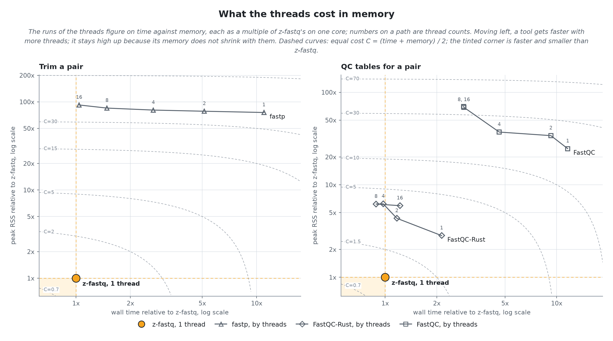

<!-- markdownlint-disable MD033 MD041 -->

<div align="center">
  
  <picture>
    <source media="(prefers-color-scheme: dark)" srcset="assets/tagline-dark.svg">
    <source media="(prefers-color-scheme: light)" srcset="assets/tagline-light.svg">
    
  </picture>
  <p><strong>Count, check, sample, interleave, and trim paired FASTQ with one static executable built in Zig.</strong></p>
  <p>
    <a href="https://github.com/eneskemalergin/z-fastq/releases/latest"></a>
    <a href="https://github.com/eneskemalergin/z-fastq/actions/workflows/ci.yml"></a>
    <a href="https://github.com/eneskemalergin/z-fastq/wiki/Installation"></a>
    <a href="https://ziglang.org/download/"></a>
    <a href="LICENSE"></a>
    <br>
    <a href="https://github.com/eneskemalergin/z-fastq/wiki/Performance"></a>
    <a href="bench/README.md"></a>
    <a href="https://github.com/eneskemalergin/z-fastq/wiki"></a>
    <a href="CHANGELOG.md"></a>
  </p>
</div>

---

I built z-fastq for the FASTQ work that comes before alignment: the steps that run on every sample, where a slow or memory-hungry tool is paid for again and again. One CLI, also usable as a Zig package, with no runtime dependencies. Every command runs on one core in bounded memory, a few MiB for most jobs, and stops on a broken record instead of passing it on:

- [`count`](https://github.com/eneskemalergin/z-fastq/wiki/Counting-and-Statistics): Count records in one or many files, or standard input.
- [`stats`](https://github.com/eneskemalergin/z-fastq/wiki/Counting-and-Statistics#stats): Report lengths, base composition, GC, and quality, as text or JSON.
- [`check`](https://github.com/eneskemalergin/z-fastq/wiki/Validation): Validate structure, sequence letters, and quality bytes, alone, as mate files, or interleaved, naming the record, byte offset, and rule of a failure.
- [`sample`](https://github.com/eneskemalergin/z-fastq/wiki/Sampling): Select a seeded fraction or an exact count of records or pairs, reproducibly.
- [`interleave` and `deinterleave`](https://github.com/eneskemalergin/z-fastq/wiki/Interleaving): Convert between mate files and one interleaved stream, checking every pair.
- [`process`](https://github.com/eneskemalergin/z-fastq/wiki/Processing): Trim and filter paired reads with fastp's rules into plain or gzip files, with [FastQC-compatible QC](https://github.com/eneskemalergin/z-fastq/wiki/Quality-Control) that MultiQC reads, in one pass.
- [Zig package](https://github.com/eneskemalergin/z-fastq/wiki/Zig-Library): the reader, writer, validation, and statistics give other Zig programs the same rules without the CLI.

z-fastq reads plain and gzip FASTQ and writes plain FASTQ, gzip from `process`, and text or JSON reports. It runs on Linux, on x86-64 and aarch64.

## Speed and memory

Each job against the fastest other tools for it, every tool on one CPU:

<!-- bench summary: generated by bench/FEATURE/run.sh summary -->

<p align="center">
  <a href="bench/README.md">
    <picture>
      <source media="(prefers-color-scheme: dark)" srcset="bench/summary/01-jobs-dark.png">
      <source media="(prefers-color-scheme: light)" srcset="bench/summary/01-jobs-light.png">
      
    </picture>
  </a>
</p>

| Job                      | z-fastq time | z-fastq memory | Other tool   | Its time | Its memory |
| ------------------------ | -----------: | -------------: | ------------ | -------: | ---------: |
| Count records            |       147 ms |       0.81 MiB | Needletail   |     1.4x |       2.6x |
| Aggregate statistics     |       280 ms |       0.81 MiB | Needletail   |     3.5x |       2.6x |
| Validate a file          |       216 ms |       0.79 MiB | fq           |     4.1x |       5.3x |
| Validate a pair          |       435 ms |       1.06 MiB | fq           |     6.7x |      25.4x |
| Sample by fraction       |       237 ms |       0.98 MiB | IRMA Core    |     5.0x |       4.8x |
| Sample by count          |       421 ms |       1.34 MiB | IRMA Core    |     2.8x |       3.5x |
| Sample pairs by fraction |       438 ms |       1.29 MiB | IRMA Core    |     3.7x |       3.4x |
| Interleave a pair        |       471 ms |       1.06 MiB | IRMA Core    |     3.1x |       3.8x |
| Deinterleave a pair      |       782 ms |       1.06 MiB | IRMA Core    |     4.8x |       3.8x |
| Trim a pair              |       3.41 s |      14.68 MiB | fastp*       |    11.0x |      75.9x |
| QC tables for a pair     |       1.91 s |      10.17 MiB | FastQC-Rust* |     2.1x |       2.8x |

On 1 GiB plain inputs, every tool on one CPU; the other tool is the fastest that does the whole job, its time and memory as multiples of z-fastq's; \* marks a job no other tool does whole, with the fastest that does part of it. On the malformed records and pairs of the edge cases, z-fastq stopped on 54 of 54; [the benchmark summary](bench/README.md) has the method, every tool, threads, and the cases where another tool is faster.

<!-- bench summary end -->

### What threads cost

fastp and FastQC-Rust can use many threads, and with enough of them they match z-fastq's wall time on one core. The threads buy them time, not memory: at every count they hold several times z-fastq's memory, and they spend several cores on a job z-fastq does with one.

<p align="center">
  <a href="https://github.com/eneskemalergin/z-fastq/wiki/Performance">
    <picture>
      <source media="(prefers-color-scheme: dark)" srcset="bench/summary/04-threads-memory-dark.png">
      <source media="(prefers-color-scheme: light)" srcset="bench/summary/04-threads-memory-light.png">
      
    </picture>
  </a>
</p>
<p align="center"><sub>The other tools at 1 to 16 threads on time against memory, relative to z-fastq on one core; the numbers on each path are thread counts. The <a href="https://github.com/eneskemalergin/z-fastq/wiki/Performance">Performance</a> page explains how it is measured and where another tool is faster.</sub></p>

## A few honest tradeoffs

I would like to support more than Linux. For now z-fastq is built and tested on Linux, on x86-64 and aarch64; native Windows and macOS builds are not there yet. If you use Windows, WSL is the way to try it. The benchmarks run on x86-64, where AVX2 code is picked at run time; on aarch64, z-fastq uses its portable vector code, and its speed there is not measured yet.

One core is a choice, not a limit I am waiting to lift. It keeps every run's cost known before it starts, so a pipeline can run one sample per core side by side. The price is one large file on an otherwise idle machine: a tool that spreads it over many cores can finish sooner, and z-fastq does not split a file across cores yet.

gzip output uses a fast preset by default, which writes files about 15% larger than fastp's at its default level. `--gzip-preset even` or `dense` makes them smaller, more slowly.

z-fastq writes data, not pages: its QC comes out as FastQC-style tables and a JSON summary for MultiQC to render, with no HTML report of its own.

## Start

Download the static Linux binary for x86-64 or aarch64 from the [latest release](https://github.com/eneskemalergin/z-fastq/releases/latest), or build it from source with [Zig 0.16.0](https://ziglang.org/download/); the [installation page](https://github.com/eneskemalergin/z-fastq/wiki/Installation) covers both.

```bash
zig build -Dstatic=true -Doptimize=ReleaseFast    # zig-out/bin/z-fastq; put it on your PATH
z-fastq check --paired reads_R1.fastq.gz reads_R2.fastq.gz
z-fastq stats reads_R1.fastq.gz
z-fastq sample --fraction 0.1 --seed 11 reads_R1.fastq.gz > sample.fastq
z-fastq process --gzip --adapter1 AGATCGGAAGAGCACACGTCTGAACTCCAGTCA --adapter2 AGATCGGAAGAGCGTCGTGTAGGGAAAGAGTGT \
  --min-length 15 --report sample.json --out1 trimmed_R1.fastq.gz --out2 trimmed_R2.fastq.gz reads_R1.fastq.gz reads_R2.fastq.gz
```

Work through the [getting-started walk-through](https://github.com/eneskemalergin/z-fastq/wiki/Getting-Started), then keep the [command cheat sheet](https://github.com/eneskemalergin/z-fastq/wiki/Command-Cheat-Sheet) nearby.

## Documentation

The wiki holds the details that would otherwise bury this page:

[Counting and statistics](https://github.com/eneskemalergin/z-fastq/wiki/Counting-and-Statistics) | [Validation](https://github.com/eneskemalergin/z-fastq/wiki/Validation) | [Paired reads](https://github.com/eneskemalergin/z-fastq/wiki/Paired-Reads) | [Sampling](https://github.com/eneskemalergin/z-fastq/wiki/Sampling) | [Interleaving](https://github.com/eneskemalergin/z-fastq/wiki/Interleaving) | [Processing](https://github.com/eneskemalergin/z-fastq/wiki/Processing) | [Quality control](https://github.com/eneskemalergin/z-fastq/wiki/Quality-Control) | [Zig package](https://github.com/eneskemalergin/z-fastq/wiki/Zig-Library)

[Report reference](https://github.com/eneskemalergin/z-fastq/wiki/Report-Reference) | [Input and output](https://github.com/eneskemalergin/z-fastq/wiki/Input-and-Output) | [Automation](https://github.com/eneskemalergin/z-fastq/wiki/Automation) | [Limits](https://github.com/eneskemalergin/z-fastq/wiki/Limits-and-Supported-Formats) | [Performance](https://github.com/eneskemalergin/z-fastq/wiki/Performance) | [Recipes](https://github.com/eneskemalergin/z-fastq/wiki/Recipes) | [Troubleshooting](https://github.com/eneskemalergin/z-fastq/wiki/Troubleshooting) | [FAQ](https://github.com/eneskemalergin/z-fastq/wiki/FAQ)

## License

z-fastq is released under the [MIT license](LICENSE).

---

<p align="center"><em>Four lines hold a life,<br>
Each base travels through the night,<br>
Reads emerge as light.</em></p>
