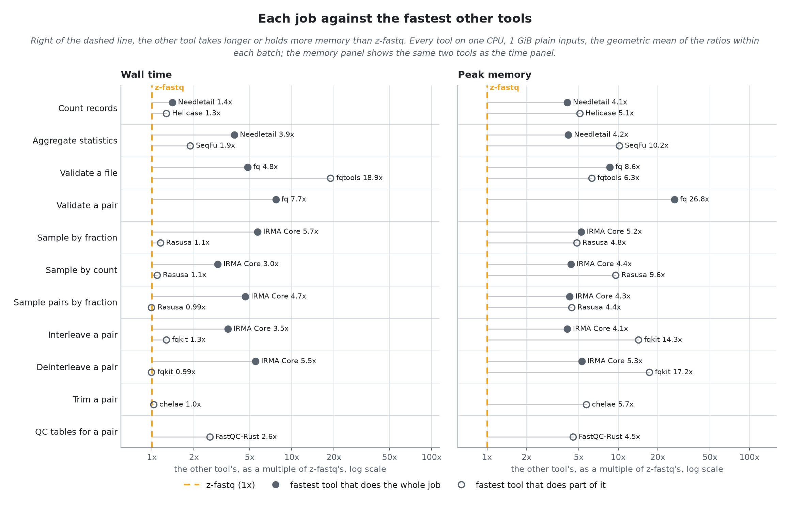
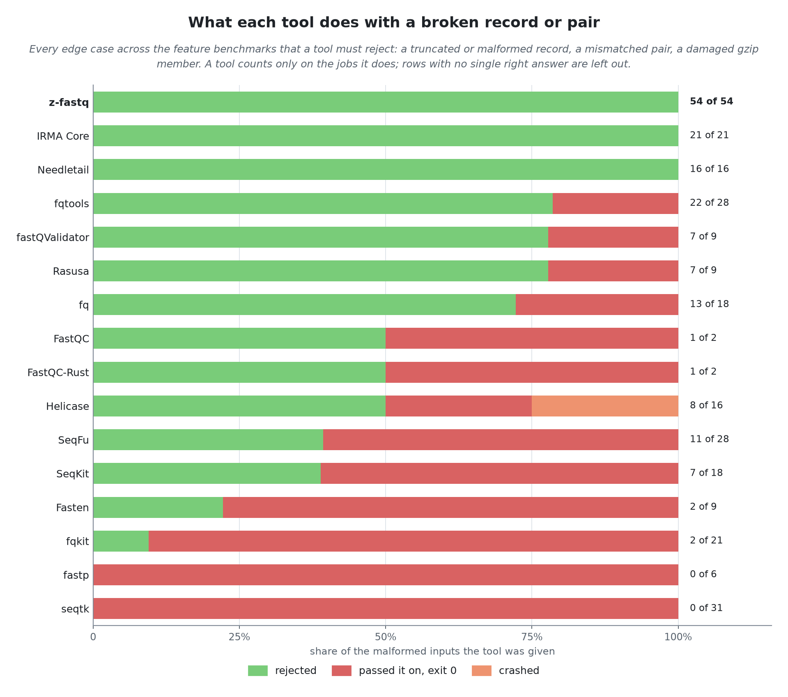
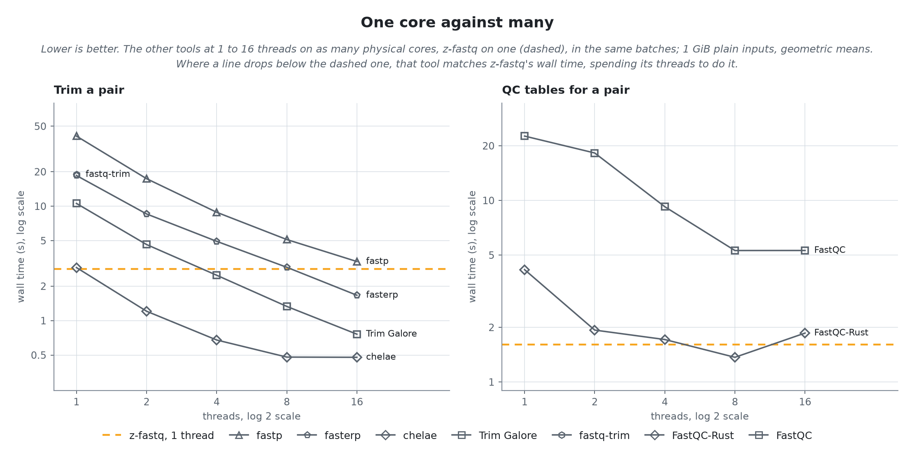
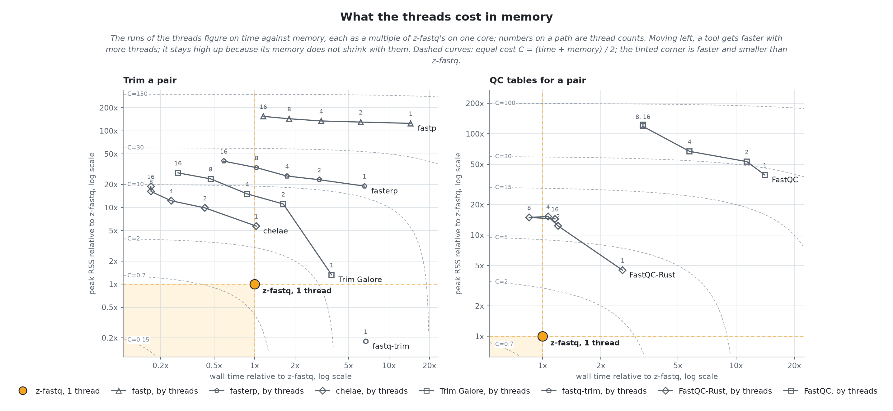

<!-- markdownlint-disable MD013 MD033 MD041 -->

# Benchmarks

How z-fastq compares with the tools people use for the same FASTQ jobs, at a glance. Each feature report below holds the detail: every input, format, and size, the edge cases, scaling, and the commands.

<p align="center">
  <picture>
    <source media="(prefers-color-scheme: dark)" srcset="summary/01-jobs-dark.png">
    <source media="(prefers-color-scheme: light)" srcset="summary/01-jobs-light.png">
    
  </picture>
</p>

| Job                      | z-fastq time | z-fastq memory | Complete tool | Its time | Its memory | Partial tool | Its time | Its memory |
| ------------------------ | -----------: | -------------: | ------------- | -------: | ---------: | ------------ | -------: | ---------: |
| Count records            |       144 ms |       0.52 MiB | Needletail    |    1.40x |      4.09x | Helicase     |    1.27x |      5.09x |
| Aggregate statistics     |       253 ms |       0.52 MiB | Needletail    |    3.88x |      4.17x | SeqFu        |    1.88x |     10.17x |
| Validate a file          |       181 ms |       0.52 MiB | fq            |    4.83x |      8.61x | fqtools      |   18.95x |      6.28x |
| Validate a pair          |       305 ms |       1.02 MiB | fq            |    7.69x |     26.78x | -            |        - |          - |
| Sample by fraction       |       211 ms |       0.91 MiB | IRMA Core     |    5.69x |      5.21x | Rasusa       |    1.15x |      4.83x |
| Sample by count          |       400 ms |       1.09 MiB | IRMA Core     |    2.96x |      4.36x | Rasusa       |    1.09x |      9.57x |
| Sample pairs by fraction |       328 ms |       1.03 MiB | IRMA Core     |    4.66x |      4.27x | Rasusa       |    0.99x |      4.42x |
| Interleave a pair        |       391 ms |       1.02 MiB | IRMA Core     |    3.49x |      4.09x | fqkit        |    1.27x |     14.26x |
| Deinterleave a pair      |       654 ms |       0.78 MiB | IRMA Core     |    5.50x |      5.27x | fqkit        |    0.99x |     17.23x |
| Trim a pair              |       2.82 s |       8.92 MiB | -             |        - |          - | chelae       |    1.03x |      5.70x |
| QC tables for a pair     |       1.60 s |       6.37 MiB | -             |        - |          - | FastQC-Rust  |    2.59x |      4.52x |

- A *complete* tool does the whole job z-fastq does, checks included; a *partial* one does part of it (fewer checks, or no reads written). Partial tools are shown, never ranked with complete ones.
- Times and memory: z-fastq's own, then each tool's as a multiple of z-fastq's; geometric means over the 1 GiB plain inputs, every tool on one CPU.

## How the numbers are taken

Every tool's output is checked against an independent truth before any timing; a tool is timed only on the inputs it got right. Each case runs every tool in one batch, on one pinned CPU each (threaded variants on as many physical cores as threads), with the input in the page cache. Wall time comes from the runner, peak memory and CPU time from the kernel for the tool alone. Peak RSS can lag the true peak by up to about 0.5 MiB, so smaller memory differences are inconclusive.

## Broken input

<p align="center">
  <picture>
    <source media="(prefers-color-scheme: dark)" srcset="summary/02-broken-dark.png">
    <source media="(prefers-color-scheme: light)" srcset="summary/02-broken-light.png">
    
  </picture>
</p>

| Tool           | Given | Rejected | Passed on, exit 0 | Crashed |
| -------------- | ----: | -------: | ----------------: | ------: |
| z-fastq        |    54 |       54 |                 0 |       0 |
| IRMA Core      |    21 |       21 |                 0 |       0 |
| Needletail     |    16 |       16 |                 0 |       0 |
| fqtools        |    28 |       22 |                 6 |       0 |
| fastQValidator |     9 |        7 |                 2 |       0 |
| Rasusa         |     9 |        7 |                 2 |       0 |
| fq             |    18 |       13 |                 5 |       0 |
| FastQC         |     2 |        1 |                 1 |       0 |
| FastQC-Rust    |     2 |        1 |                 1 |       0 |
| Helicase       |    16 |        8 |                 4 |       4 |
| SeqFu          |    28 |       11 |                17 |       0 |
| SeqKit         |    18 |        7 |                11 |       0 |
| Fasten         |     9 |        2 |                 7 |       0 |
| fqkit          |    21 |        2 |                19 |       0 |
| fastp          |     6 |        0 |                 6 |       0 |
| seqtk          |    31 |        0 |                31 |       0 |

A tool that passes a broken record on with exit 0 leaves a script no way to tell; z-fastq stops with the record, byte offset, and rule it broke.

## One core against many

<p align="center">
  <picture>
    <source media="(prefers-color-scheme: dark)" srcset="summary/03-threads-dark.png">
    <source media="(prefers-color-scheme: light)" srcset="summary/03-threads-light.png">
    
  </picture>
</p>

| Job                  | Tool        | 1 thread |       2 |      4 |      8 |     16 |
| -------------------- | ----------- | -------: | ------: | -----: | -----: | -----: |
| Trim a pair          | z-fastq     |   2.82 s |       - |      - |      - |      - |
| Trim a pair          | fastp       |  40.99 s | 17.40 s | 8.85 s | 5.11 s | 3.28 s |
| Trim a pair          | fasterp     |  18.54 s |  8.56 s | 4.93 s | 2.92 s | 1.67 s |
| Trim a pair          | chelae      |   2.91 s |  1.21 s | 0.68 s | 0.48 s | 0.48 s |
| Trim a pair          | Trim Galore |  10.57 s |  4.62 s | 2.49 s | 1.33 s | 0.76 s |
| Trim a pair          | fastq-trim  |  18.93 s |       - |      - |      - |      - |
| QC tables for a pair | z-fastq     |   1.60 s |       - |      - |      - |      - |
| QC tables for a pair | FastQC-Rust |   4.16 s |  1.93 s | 1.71 s | 1.37 s | 1.86 s |
| QC tables for a pair | FastQC      |  22.62 s | 18.25 s | 9.23 s | 5.30 s | 5.30 s |

Wall time on the 1 GiB plain inputs; z-fastq runs on one core. The process report gives CPU time at each count.

<p align="center">
  <picture>
    <source media="(prefers-color-scheme: dark)" srcset="summary/04-threads-memory-dark.png">
    <source media="(prefers-color-scheme: light)" srcset="summary/04-threads-memory-light.png">
    
  </picture>
</p>

| Job                  | Tool        |   1 thread |          2 |          4 |          8 |         16 |
| -------------------- | ----------- | ---------: | ---------: | ---------: | ---------: | ---------: |
| Trim a pair          | z-fastq     |    8.9 MiB |          - |          - |          - |          - |
| Trim a pair          | fastp       | 1113.7 MiB | 1157.4 MiB | 1196.8 MiB | 1278.9 MiB | 1372.7 MiB |
| Trim a pair          | fasterp     |  169.3 MiB |  205.0 MiB |  228.8 MiB |  294.4 MiB |  358.1 MiB |
| Trim a pair          | chelae      |   50.9 MiB |   88.0 MiB |  109.0 MiB |  144.0 MiB |  167.2 MiB |
| Trim a pair          | Trim Galore |   11.8 MiB |   98.8 MiB |  133.9 MiB |  210.3 MiB |  251.7 MiB |
| Trim a pair          | fastq-trim  |    1.6 MiB |          - |          - |          - |          - |
| QC tables for a pair | z-fastq     |    6.4 MiB |          - |          - |          - |          - |
| QC tables for a pair | FastQC-Rust |   28.8 MiB |   78.7 MiB |   97.7 MiB |   95.5 MiB |   92.5 MiB |
| QC tables for a pair | FastQC      |  250.9 MiB |  340.1 MiB |  429.2 MiB |  757.7 MiB |  785.0 MiB |

Peak memory of the same runs. Threads buy the other tools wall time, never memory: at the thread count where a tool first matches z-fastq's time, it still holds many times z-fastq's memory.

## Where z-fastq is not fastest

- **Sample pairs by fraction:** Rasusa (partial) takes 0.99x z-fastq's time, with 4.4x its memory.
- **Deinterleave a pair:** fqkit (partial) takes 0.99x z-fastq's time, with 17.2x its memory.
- **Trim a pair:** fasterp at 16 threads takes 0.59x z-fastq's time on one core, for 6.9x its CPU time.
- **Trim a pair:** chelae at 2 threads takes 0.43x z-fastq's time on one core, for 0.9x its CPU time.
- **Trim a pair:** Trim Galore at 4 threads takes 0.88x z-fastq's time on one core, for 3.6x its CPU time.
- **QC tables for a pair:** FastQC-Rust at 8 threads takes 0.85x z-fastq's time on one core, for 3.9x its CPU time.

## Feature reports

- [count](count/README.md): Counting records; z-fastq 0.3.0.
- [stats](stats/README.md): Aggregate statistics; z-fastq 0.3.0.
- [check](check/README.md): Validating FASTQ files; z-fastq 0.3.0.
- [sample](sample/README.md): Sampling records; z-fastq 0.3.0.
- [layout](layout/README.md): Converting paired layouts; z-fastq 0.3.0.
- [process](process/README.md): Processing paired reads; z-fastq 0.3.0.

## Limits

- One CPU per tool in every comparison except the threads figure; a tool built for many cores may do better with them.
- The real-run groups are uneven: three short fixed-length runs, one variable-length run, one synthetic shape per job.
- Copying a pair (the process report's first part) is the cost floor of `process`, not a job of its own, so it is not in the job figure.

## Reproduce

```bash
bench/process/run.sh release    # one feature: checks, timing, its README (each feature has its own run.sh)
bench/process/run.sh summary    # this page, from every feature's report tables
```
