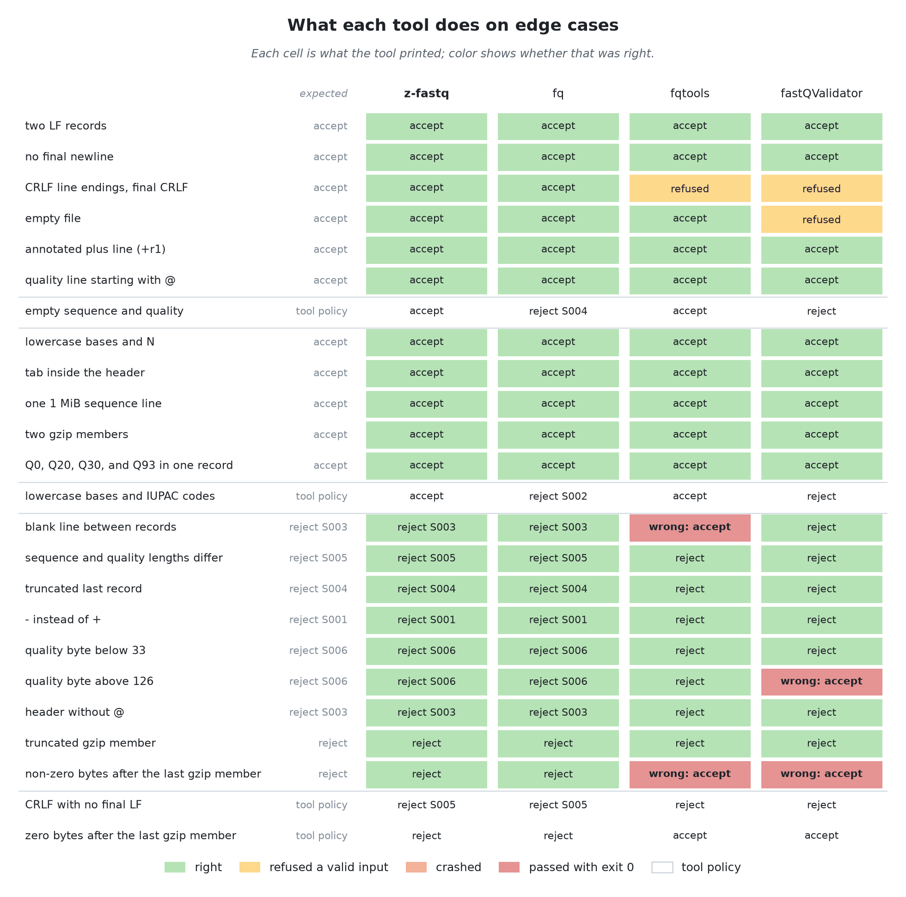
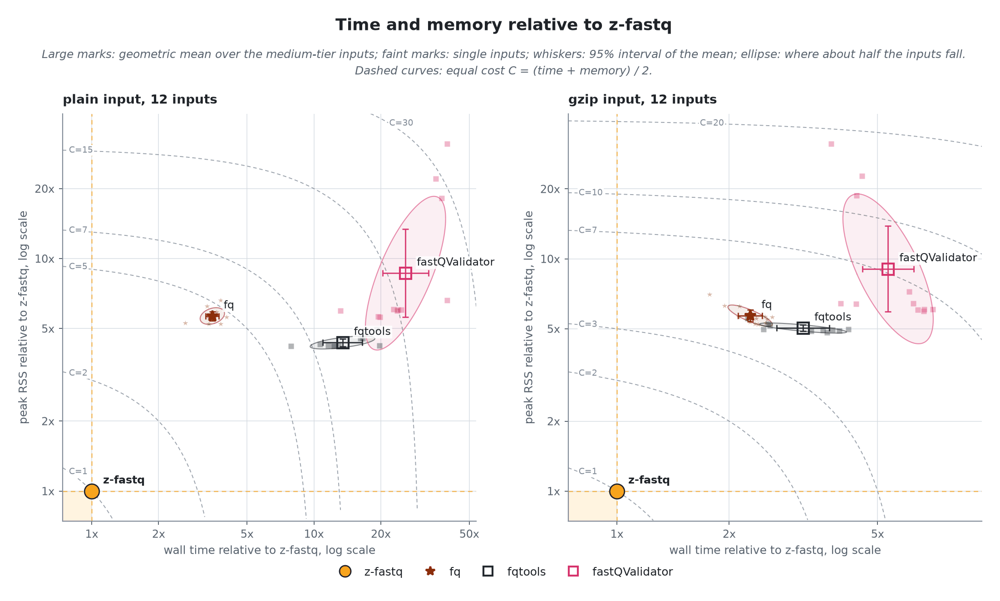
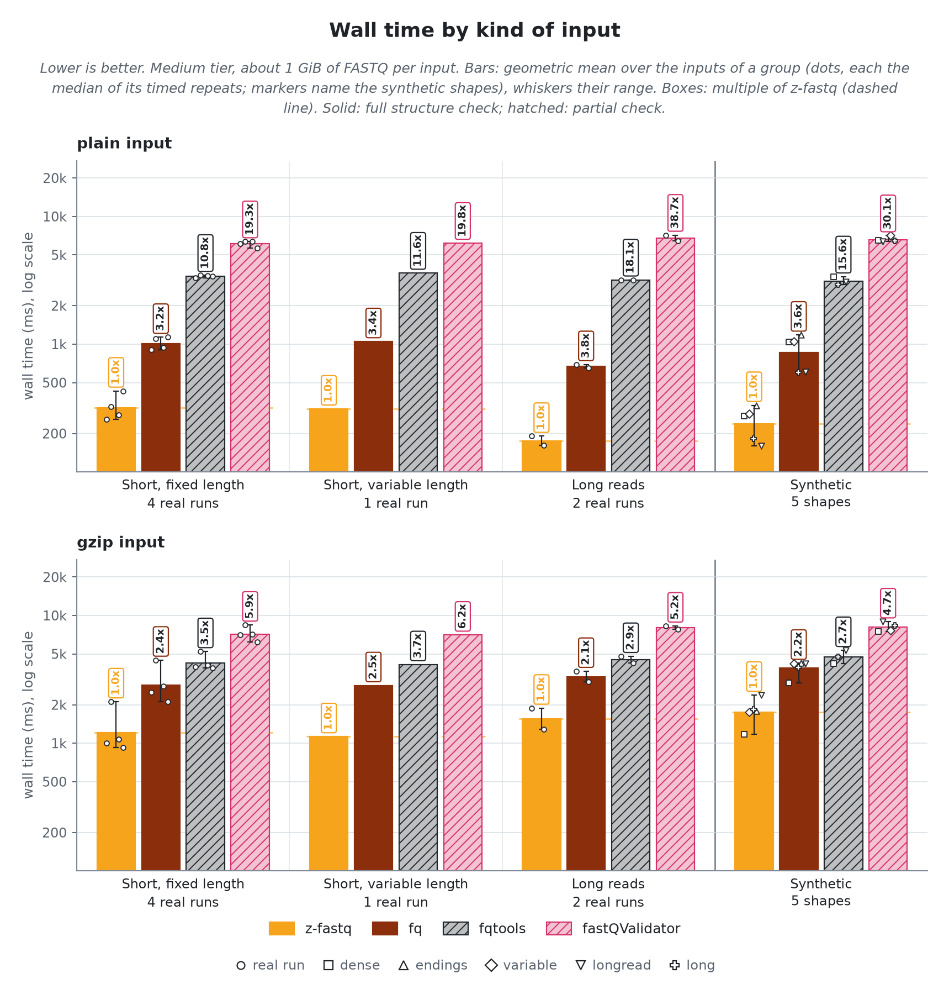
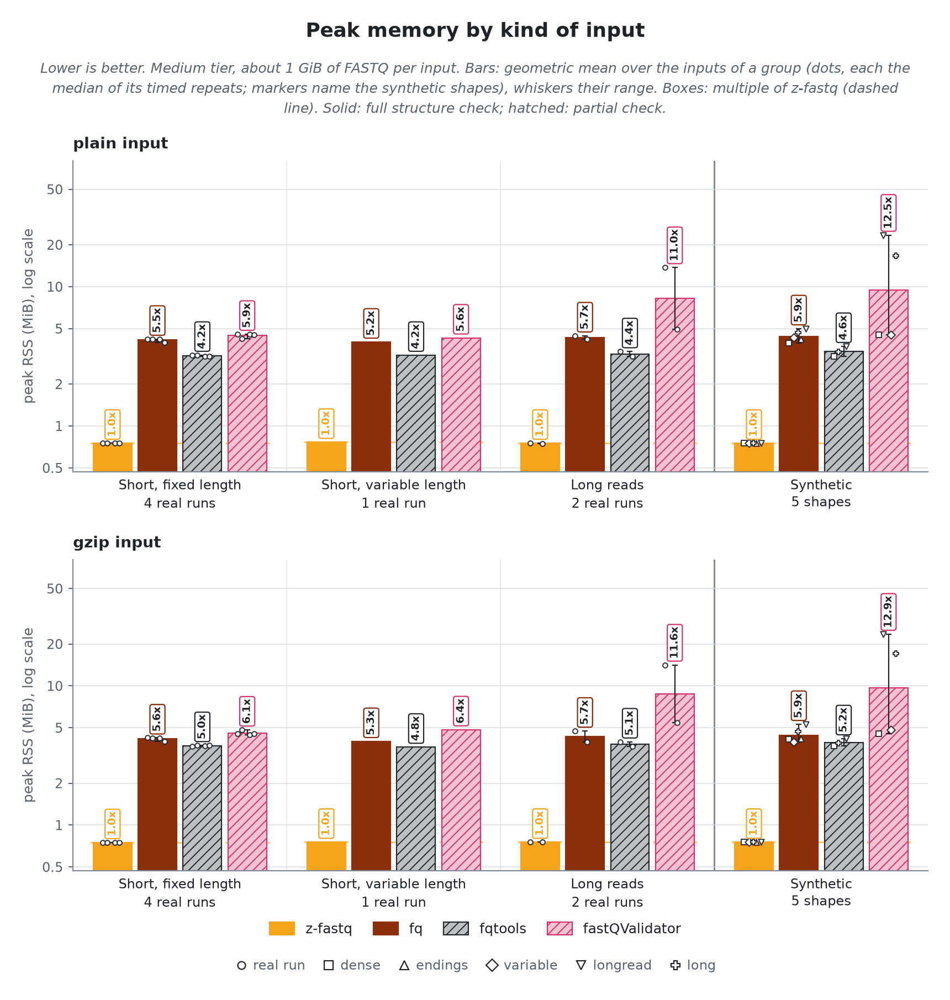
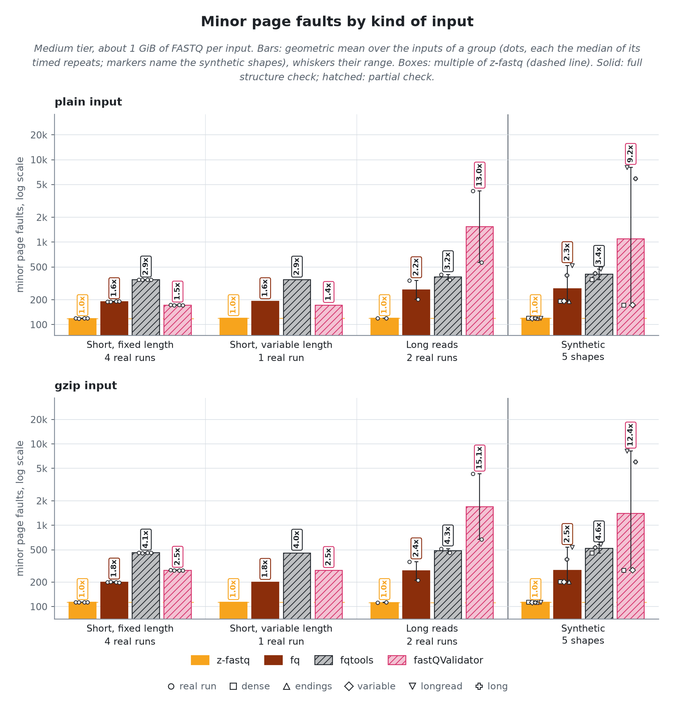
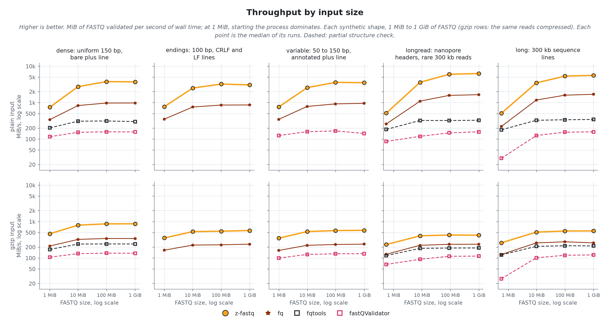
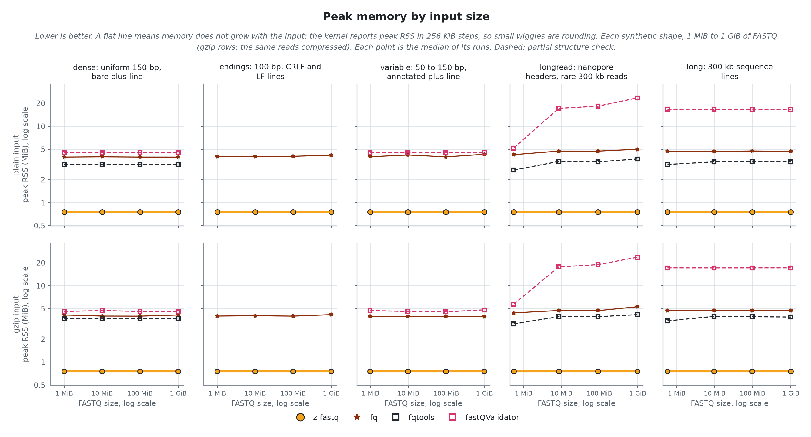

<!-- markdownlint-disable MD013 MD033 MD041 -->

# Validating FASTQ files
> <sub>`z-fastq check` against 3 other validators, on 7 real sequencing runs and 5 synthetic shapes, plain and gzip. A tool is timed only where it accepted the valid input; time and memory come from the same run, on one CPU.</sub>

- `z-fastq`: *0.1.0 at 90e46b4*
- `machine`: *Ryzen 9 3950X, Linux 7.2.11; one CPU per run*
- `runner`: *zebrac 0.6.2 with zexec*
- `data`:
  - **Real**: *7 public sequencing runs, 1 GiB each, pooled in the bars by the kind of reads they hold*
    - `Short, fixed length`: *NovaSeq, 150 bp; NovaSeq, Casava headers; BGISEQ, 100 bp; miRNA, 36 bp*
    - `Short, variable length`: *10x mates, 28 and 150 bp*
    - `Long reads`: *PromethION, 30 to 153 kb; Revio HiFi, 4 to 21 kb*
  - **Synthetic**: *5 shapes generated from real reads, each changing one thing; one group in the bars at 1 GiB, and the scaling lines from 1 MiB to 1 GiB*
    - `dense`: *uniform 150 bp, bare plus line*
    - `endings`: *100 bp, CRLF and LF lines*
    - `variable`: *50 to 150 bp, annotated plus line*
    - `longread`: *nanopore headers, rare 300 kb reads*
    - `long`: *300 kb sequence lines*
- `date`: *2026-10-25*

## Findings

- **Right answers:** z-fastq returned the right verdict on all 228 checked inputs and rejected every malformed edge case. 2 of the 3 other tools print a wrong verdict or crash on at least one.
- **Speed:** fq, the fastest other full-check tool, takes 3.49x z-fastq's time on plain input and 2.28x on gzip.
- **Memory:** every other tool peaks at 4.4x to 9x z-fastq's 0.75 MiB.
- **Where z-fastq is not fastest:** on no kind of input; it is the fastest tool on every kind of input (geometric mean over the group), plain and gzip.

## Compared tools
> <sub>*complete* tools check as much as z-fastq; *partial* tools check less, so they do less work. The bold count is how many of four malformed inputs the tool rejects: a sequence and quality length mismatch, a truncated last record, `-` instead of `+`, and a quality byte below 33.</sub>

- `z-fastq 0.1.0` **(subject)**; *checks every record's structure*; **4 of 4 rejected**
- `fq 0.12.0` **(complete)**; *checks every record's structure; IUPAC codes and empty reads are invalid under its rules*; **4 of 4 rejected**
- `fqtools 2.3` **(partial)**; *rejects CRLF; accepts a blank line*; **4 of 4 rejected**
- `fastQValidator 0.1.1a` **(partial)**; *minimum length and duplicate-name checks off; reads the whole file before exiting*; **4 of 4 rejected**

> [!IMPORTANT]
> Partial tools skip checks z-fastq makes, so they do less work per record; their times are not like-for-like with z-fastq or the complete tools.

## Right answers
> <sub>Every corpus file is valid, so the right verdict on each is to accept it. The edge cases are small inputs where tools differ: each cell shows what the tool printed, and its color whether that was right.</sub>

z-fastq returned the right verdict on all 228 inputs: every corpus file and synthetic shape on disk, 1 MiB to 1 GiB, plain and gzip. Every other tool was right on every input it was given except these, which are not timed where they gave a wrong verdict:

| Tool           | Wrong |  Of | Inputs            |
| -------------- | ----: | --: | ----------------- |
| fq             |     2 |  64 | paired            |
| fqtools        |    16 |  64 | endings, variable |
| fastQValidator |     8 |  54 | endings           |

> [!CAUTION]
> fqtools and fastQValidator print a wrong verdict and exit 0 on some malformed inputs, so a script cannot tell the file is broken.

<picture>
  <source media="(prefers-color-scheme: dark)" srcset="results/figures/edges-dark.png">
  <source media="(prefers-color-scheme: light)" srcset="results/figures/edges-light.png">
  
</picture>

> [!NOTE]
> A cell is the tool's verdict, with the rule it named where it names one: `accept`, `reject S003`, `reject` (no rule named), `wrong: accept` (passed a malformed input with exit 0), `refused` (rejected a valid input), or `crash`. "tool policy" rows have no single right answer.

<details><summary>Inputs where a tool gave a wrong verdict</summary>

| Tool           | Input                                          | Exit | Printed     |
| -------------- | ---------------------------------------------- | ---: | ----------- |
| fastQValidator | bench/data/synthetic/endings/medium.fastq      |    1 | reject      |
| fastQValidator | bench/data/synthetic/endings/medium.fastq.gz   |    1 | reject      |
| fastQValidator | bench/data/synthetic/endings/small.fastq       |    1 | reject      |
| fastQValidator | bench/data/synthetic/endings/small.fastq.gz    |    1 | reject      |
| fastQValidator | bench/data/synthetic/endings/tiny.fastq        |    1 | reject      |
| fastQValidator | bench/data/synthetic/endings/tiny.fastq.gz     |    1 | reject      |
| fastQValidator | bench/data/synthetic/endings/xsmall.fastq      |    1 | reject      |
| fastQValidator | bench/data/synthetic/endings/xsmall.fastq.gz   |    1 | reject      |
| fq             | bench/data/synthetic/paired/medium_R1.fastq    |    1 | reject P001 |
| fq             | bench/data/synthetic/paired/medium_R1.fastq.gz |    1 | reject P001 |
| fqtools        | bench/data/synthetic/endings/medium.fastq      |    1 | reject      |
| fqtools        | bench/data/synthetic/endings/medium.fastq.gz   |    1 | reject      |
| fqtools        | bench/data/synthetic/endings/small.fastq       |    1 | reject      |
| fqtools        | bench/data/synthetic/endings/small.fastq.gz    |    1 | reject      |
| fqtools        | bench/data/synthetic/endings/tiny.fastq        |    1 | reject      |
| fqtools        | bench/data/synthetic/endings/tiny.fastq.gz     |    1 | reject      |
| fqtools        | bench/data/synthetic/endings/xsmall.fastq      |    1 | reject      |
| fqtools        | bench/data/synthetic/endings/xsmall.fastq.gz   |    1 | reject      |
| fqtools        | bench/data/synthetic/variable/medium.fastq     |    1 | reject      |
| fqtools        | bench/data/synthetic/variable/medium.fastq.gz  |    1 | reject      |
| fqtools        | bench/data/synthetic/variable/small.fastq      |    1 | reject      |
| fqtools        | bench/data/synthetic/variable/small.fastq.gz   |    1 | reject      |
| fqtools        | bench/data/synthetic/variable/tiny.fastq       |    1 | reject      |
| fqtools        | bench/data/synthetic/variable/tiny.fastq.gz    |    1 | reject      |
| fqtools        | bench/data/synthetic/variable/xsmall.fastq     |    1 | reject      |
| fqtools        | bench/data/synthetic/variable/xsmall.fastq.gz  |    1 | reject      |

</details>

## Defect sweep
> <sub>Real reads with one injected defect each, 40 files per kind, at random records of three 1 MiB files (short fixed, short variable, and long reads).</sub>

The share of files each tool rejected:

| Tool           | plus line | sequence byte | header | truncated | lengths differ | quality below 33 | quality above 126 |
| -------------- | --------: | ------------: | -----: | --------: | -------------: | ---------------: | ----------------: |
| z-fastq        |      100% |          100% |   100% |      100% |           100% |             100% |              100% |
| fq             |      100% |          100% |   100% |      100% |           100% |             100% |              100% |
| fqtools        |      100% |          100% |   100% |      100% |           100% |             100% |              100% |
| fastQValidator |      100% |          100% |   100% |      100% |           100% |             100% |                0% |

The share where the line the tool reported is in the broken record (`-`: the tool reports no line):

| Tool           | plus line | sequence byte | header | truncated | lengths differ | quality below 33 | quality above 126 |
| -------------- | --------: | ------------: | -----: | --------: | -------------: | ---------------: | ----------------: |
| z-fastq        |      100% |          100% |   100% |      100% |           100% |             100% |              100% |
| fq             |      100% |          100% |   100% |      100% |           100% |             100% |              100% |
| fqtools        |      100% |          100% |   100% |      100% |             0% |             100% |              100% |
| fastQValidator |      100% |          100% |   100% |      100% |             2% |             100% |                 - |

## How each tool reports a problem

<details><summary>Messages for one broken record</summary>

One file of real reads with a quality byte below 33 in the record on lines 4389 to 4392, and what each tool printed.

- `z-fastq` exited 1:

```text
error: reads.fastq: S006: quality byte must be ASCII 33 through 126 (record 1097, line 4, offset 397055)
```

- `fq` exited 1:

```text
reads.fastq:4392:119: [S006] QualityStringValidator: invalid quality score character: '\x1f'
```

- `fqtools` exited 1:

```text
ERROR [line 4392]: invalid quality character (\x1f)
```

- `fastQValidator` exited 1:

```text
ERROR on Line 4392: Invalid character ('\x1f') in quality string.
Finished processing reads.fastq with 11584 lines containing 2896 sequences.
There were a total of 1 errors.
```

</details>

## Speed and memory
> <sub>The real runs and synthetic shapes at the medium tier, about 1 GiB of FASTQ each, pooled into kinds of input. Every tool runs on one CPU with the file in the page cache.</sub>

<picture>
  <source media="(prefers-color-scheme: dark)" srcset="results/figures/single-overview-dark.png">
  <source media="(prefers-color-scheme: light)" srcset="results/figures/single-overview-light.png">
  
</picture>

z-fastq itself takes 254.3 ms and 0.75 MiB per plain input, 1457.9 ms and 0.75 MiB per gzip input (geometric means over 12 inputs each); the table gives every tool as a multiple of that.

| Tool           | Plain time | Plain memory | Gzip time | Gzip memory |
| -------------- | ---------: | -----------: | --------: | ----------: |
| z-fastq        |      1.00x |        1.00x |     1.00x |       1.00x |
| fq             |      3.49x |        5.66x |     2.28x |       5.69x |
| fqtools        |     13.45x |        4.36x |     3.16x |       5.04x |
| fastQValidator |     25.83x |        8.66x |     5.34x |       9.06x |

<picture>
  <source media="(prefers-color-scheme: dark)" srcset="results/figures/single-speed-dark.png">
  <source media="(prefers-color-scheme: light)" srcset="results/figures/single-speed-light.png">
  
</picture>

<picture>
  <source media="(prefers-color-scheme: dark)" srcset="results/figures/single-memory-dark.png">
  <source media="(prefers-color-scheme: light)" srcset="results/figures/single-memory-light.png">
  
</picture>

<details><summary>Minor page faults by kind of input</summary>

<picture>
  <source media="(prefers-color-scheme: dark)" srcset="results/figures/single-faults-dark.png">
  <source media="(prefers-color-scheme: light)" srcset="results/figures/single-faults-light.png">
  
</picture>

</details>

## Scaling
> <sub>Each synthetic shape from 1 MiB to 1 GiB of FASTQ: throughput and peak memory against input size. A shape changes one thing a validator pays for, so its line shows what that one thing costs each tool.</sub>


<picture>
  <source media="(prefers-color-scheme: dark)" srcset="results/figures/single-scaling-speed-dark.png">
  <source media="(prefers-color-scheme: light)" srcset="results/figures/single-scaling-speed-light.png">
  
</picture>

<picture>
  <source media="(prefers-color-scheme: dark)" srcset="results/figures/single-scaling-memory-dark.png">
  <source media="(prefers-color-scheme: light)" srcset="results/figures/single-scaling-memory-light.png">
  
</picture>

At 1 GiB, z-fastq validates 3.0 to 6.2 GiB/s on plain input and 0.4 to 0.9 GiB/s on gzip input; no other tool is faster there.
z-fastq peaks at 0.75 MiB at every size and shape. Memory that grows with the input: fqtools by 1.4x on plain longread; fastQValidator by 4.5x on plain longread.

## Other layouts
> <sub>Mates in two files, with names checked across them, and mates interleaved in one file.</sub>

### Paired

Mates in two files, names checked across them.

z-fastq itself takes 516.6 ms and 1.00 MiB per plain input, 1588.2 ms and 1.00 MiB per gzip input (geometric means over 5 inputs each); the table gives every tool as a multiple of that.

| Tool    | Plain time | Plain memory | Gzip time | Gzip memory |
| ------- | ---------: | -----------: | --------: | ----------: |
| z-fastq |      1.00x |        1.00x |     1.00x |       1.00x |
| fq      |      4.65x |       26.86x |     3.60x |      26.85x |

### Interleaved

Mates alternating in one file.

z-fastq itself takes 570.1 ms and 0.75 MiB per plain input, 1644.7 ms and 0.75 MiB per gzip input (geometric means over 5 inputs each); the table gives every tool as a multiple of that.

| Tool    | Plain time | Plain memory | Gzip time | Gzip memory |
| ------- | ---------: | -----------: | --------: | ----------: |
| z-fastq |      1.00x |        1.00x |     1.00x |       1.00x |
| fqtools |      6.01x |        4.25x |     2.72x |       4.83x |

## Reproducibility

<details><summary>How it was measured</summary>

Every tool runs through `zexec -r` inside one zebrac batch per case, held to one CPU core by a systemd scope with a CPU quota and a 4G memory cap, after the input was read once so every run reads from the page cache. zebrac gives wall time; zexec records each run's peak memory, CPU time, and minor faults for the tool alone. The kernel reports peak memory in 256 KiB steps, so values closer than that are equal. Runs per tier, each after one warmup: tiny 31, xsmall 21, small 11, medium 3; sizes 1 MiB to 1 GiB. Generated by `bench/check/run.sh release` on 2026-10-25.

</details>

<details><summary>Identity</summary>

- `z-fastq`: *0.1.0 at 90e46b4*
- `zebrac`: *0.6.2*
- `zexec`: *12616 bytes, static, no libc*
- `kernel`: *7.2.11-200.fc44.x86_64*
- `cpu`: *AMD Ryzen 9 3950X 16-Core Processor*
- `load at batch start`: *2.62 to 11.67*

</details>

<details><summary>Commands</summary>

- `z-fastq`: *zig-out/bin/z-fastq check IN*
- `fq`: *tools/bin/fq lint IN*
- `fqtools`: *tools/bin/fqtools -dualr validate IN*
- `fastQValidator`: *tools/bin/fastQValidator --file IN --minReadLen 1 --disableSeqIDCheck*
- `z-fastq`, paired: *zig-out/bin/z-fastq check --paired IN*
- `z-fastq`, interleaved: *zig-out/bin/z-fastq check --interleaved IN*
- `fqtools`, interleaved: *tools/bin/fqtools -dualr -i validate IN*

</details>

<details><summary>Quick-check cases for peer and ab</summary>

Picked from these results: per group and format, the case where z-fastq leads its fastest full-check rival by the least. `run.sh peer` times z-fastq against a cached reference of the rival on each; `run.sh ab REV` times two z-fastq builds on each.

- `Long reads, plain`: *PromethION, 30 to 153 kb*; rival fq at 3.64x z-fastq's time
- `Short, fixed length, plain`: *miRNA, 36 bp*; rival fq at 2.63x z-fastq's time
- `Short, variable length, plain`: *10x mates, 28 and 150 bp*; rival fq at 3.37x z-fastq's time
- `Synthetic, plain`: *long: 300 kb sequence lines*; rival fq at 3.31x z-fastq's time
- `Long reads, gzip`: *PromethION, 30 to 153 kb*; rival fq at 1.94x z-fastq's time
- `Short, fixed length, gzip`: *BGISEQ, 100 bp*; rival fq at 2.12x z-fastq's time
- `Short, variable length, gzip`: *10x mates, 28 and 150 bp*; rival fq at 2.51x z-fastq's time
- `Synthetic, gzip`: *longread: nanopore headers, rare 300 kb reads*; rival fq at 1.77x z-fastq's time

</details>

<details><summary>Hardware counters (user space, plain medium-tier inputs, geometric means)</summary>

| Tool           | Instructions per byte | Instructions per cycle | Cache misses per MiB | Branch misses per MiB |
| -------------- | --------------------: | ---------------------: | -------------------: | --------------------: |
| z-fastq        |                  1.89 |                   3.65 |                 1093 |                    80 |
| fq             |                  9.51 |                   3.82 |                  426 |                  4653 |
| fqtools        |                 36.81 |                   3.41 |                  995 |                  1686 |
| fastQValidator |                 54.05 |                   2.51 |                 3317 |                  4370 |

</details>
