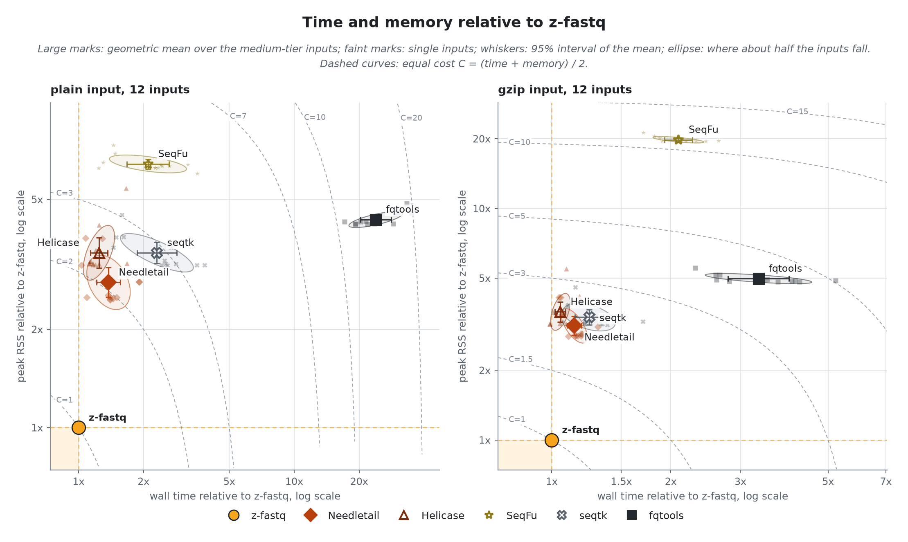
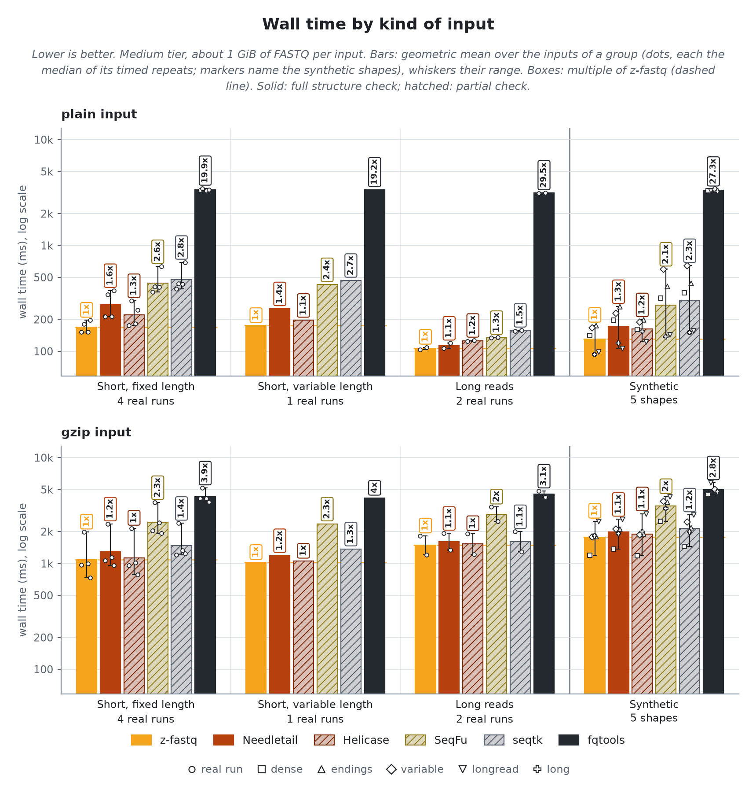
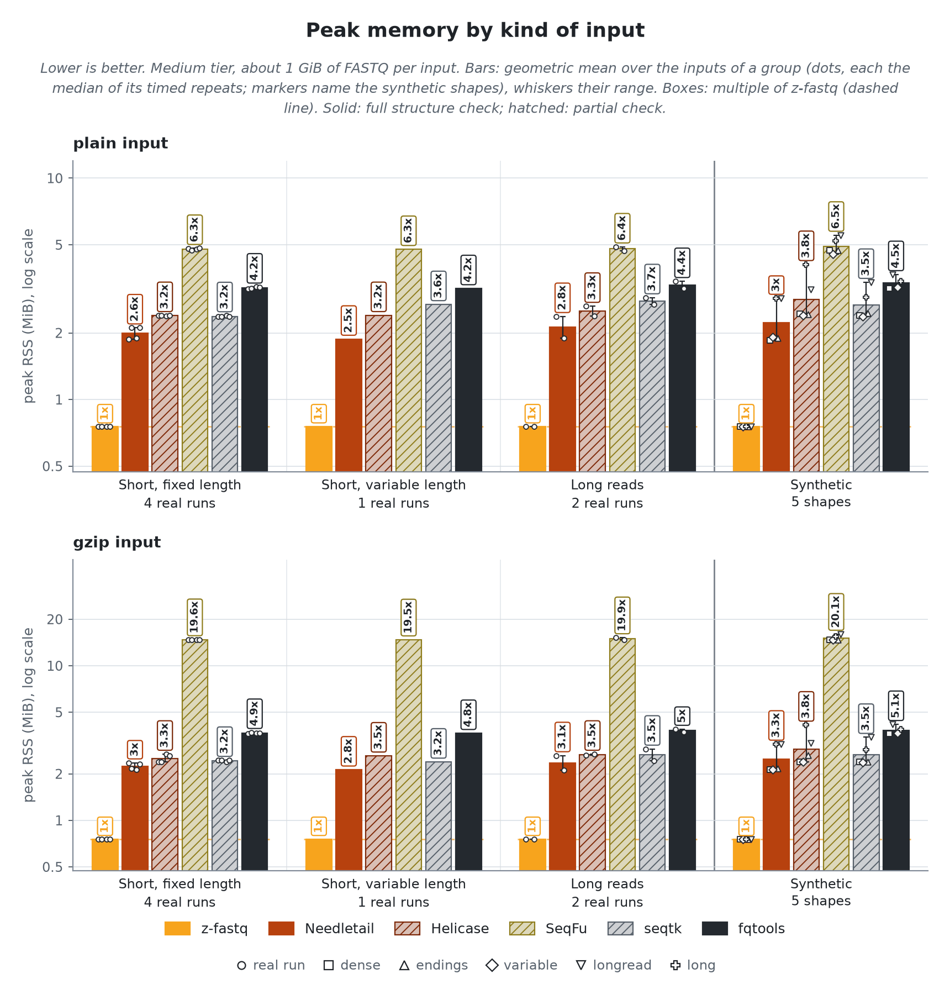
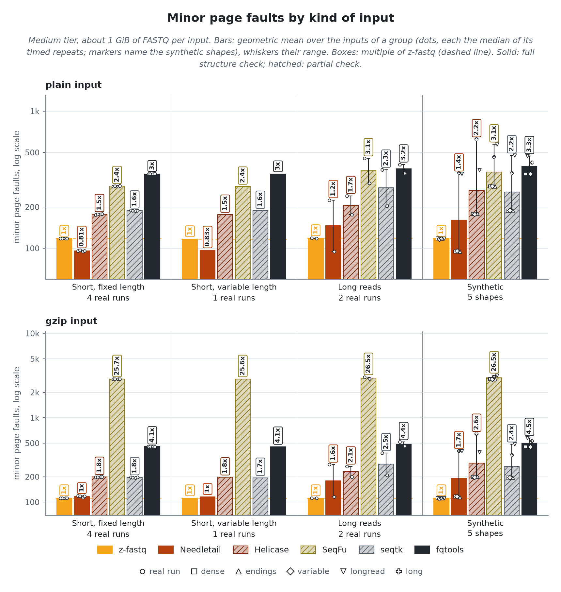
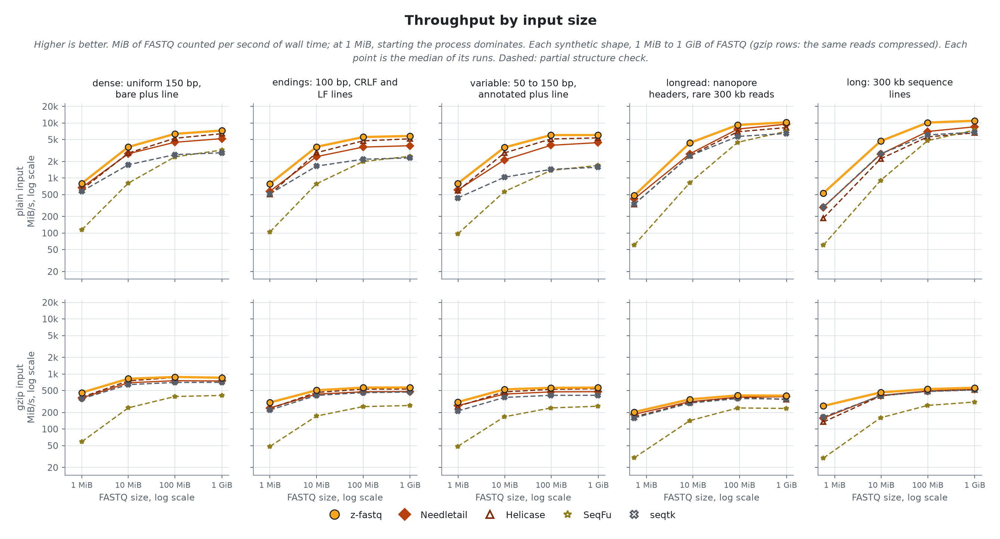
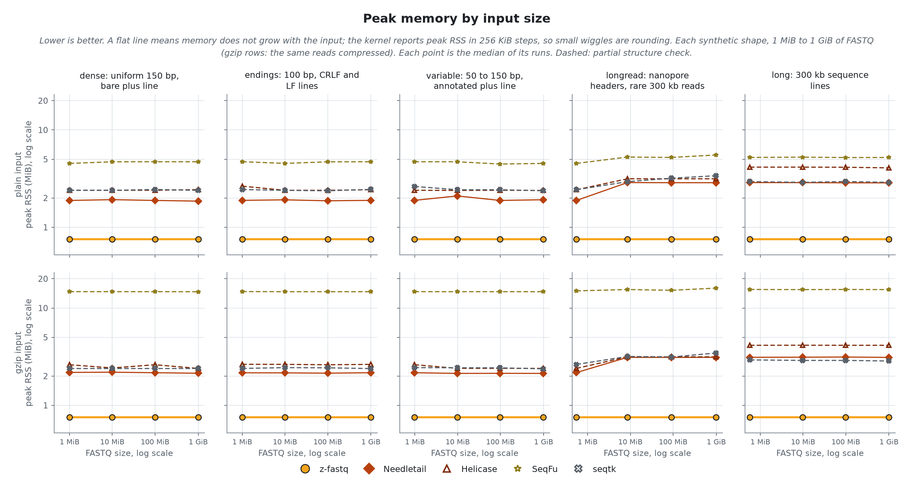

<!-- markdownlint-disable MD013 MD033 MD041 -->

# Counting records
> `z-fastq count` against 5 other counters, on 7 real sequencing runs and 5 synthetic shapes, plain and gzip. A tool is timed only where its count was right; time and memory come from the same run, on one CPU.

- `z-fastq`: *0.2.0, source at 246bbb1*
- `machine`: *Ryzen 9 3950X, Linux; one CPU per run*
- `runner`: *zebrac 0.6.2 with zexec*
- `data`:
  - **Real**: *7 public sequencing runs, 1 GiB each, pooled in the bars by the kind of reads they hold*
    - `Short, fixed length`: *NovaSeq, 150 bp; NovaSeq, Casava headers; BGISEQ, 100 bp; miRNA, 36 bp*
    - `Short, variable length`: *10x mates, 28 and 150 bp*
    - `Long reads`: *PromethION, 30 to 153 kb; Revio HiFi, 4 to 21 kb*
  - **Synthetic**: *5 shapes generated from real reads, each changing one thing; one group in the bars at 1 GiB, and the scaling lines from 1 MiB to 1 GiB*
    - `dense`: *uniform 150 bp, bare plus line*
    - `endings`: *100 bp, CRLF and LF lines*
    - `variable`: *50 to 150 bp, annotated plus line*
    - `longread`: *nanopore headers, rare 300 kb reads*
    - `long`: *300 kb sequence lines*
- `date`: *2026-10-30*

## Findings

- **Right answers:** z-fastq returned the right count on all 218 checked inputs and rejected every malformed edge case. 4 of the 5 other tools print a wrong count or crash on at least one.
- **Speed:** Needletail, the fastest other full-check tool, takes 1.37x z-fastq's time on plain input and 1.14x on gzip.
- **Memory:** every other tool peaks at 2.3x to 14x z-fastq's 0.93 MiB.
- **Where z-fastq is not fastest:** on no kind of input; it is the fastest tool on every kind of input (geometric mean over the group), plain and gzip.
- **Wrong on valid input, exit 0:** two gzip members: Helicase (printed 2).

## Compared tools
> *complete* tools check as much as z-fastq; *partial* tools check less, so they do less work. The bold count is how many of three malformed inputs the tool rejects: a sequence and quality length mismatch, a truncated last record, and `-` instead of `+`.

- `z-fastq 0.2.0` **(subject)**; *checks every record's structure*; **3 of 3 rejected**
- `Needletail 0.7.3` **(complete)**; *checks every record's structure; built for this CPU*; **3 of 3 rejected**
- `Helicase 0.2.0` **(partial)**; *misses a truncated last record and a bad plus line*; **1 of 3 rejected**
- `SeqFu 1.29.0` **(partial)**; *accepts a truncated last record; starts 8 threads by default, held to one CPU here like every tool*; **2 of 3 rejected**
- `seqtk 1.5` **(partial)**; *no structure check*; **0 of 3 rejected**
- `fqtools 2.3` **(complete)**; *checks every record's structure*; **3 of 3 rejected**

> [!IMPORTANT]
> Partial tools skip checks z-fastq makes, so they do less work per record; their times are not like-for-like with z-fastq or the complete tools.

## Right answers
> Each count is compared with the count recorded when the corpus was cut, without z-fastq. The edge cases are small inputs where tools differ: each cell shows what the tool printed, and its color whether that was right.

z-fastq returned the right count on all 218 inputs: every corpus file and synthetic shape on disk, 1 MiB to 1 GiB, plain and gzip. Every other tool was right on every input it was timed on except these, which are not timed where they missed the count:

| Tool    | Wrong |  Of | Inputs  |
| ------- | ----: | --: | ------- |
| fqtools |     2 |  24 | endings |

> [!CAUTION]
> On the edge cases below, Helicase, SeqFu, seqtk and fqtools print a wrong count and exit 0 on some malformed inputs, so a script cannot tell the count is wrong. Helicase crashes on some malformed gzip input.

<picture>
  <source media="(prefers-color-scheme: dark)" srcset="results/figures/edges-dark.png">
  <source media="(prefers-color-scheme: light)" srcset="results/figures/edges-light.png">
  
</picture>

> [!NOTE]
> A cell is the count printed, `reject` (exited with an error), `wrong: N` (printed another count, exit 0), `refused` (rejected a valid input), or `crash`. "tool policy" rows have no single right answer.

Inputs where a tool missed the count

| Tool    | Input                                        | Exit | Printed |
| ------- | -------------------------------------------- | ---: | ------- |
| fqtools | bench/data/synthetic/endings/medium.fastq    |    1 | nothing |
| fqtools | bench/data/synthetic/endings/medium.fastq.gz |    1 | nothing |

## Speed and memory
> The real runs and synthetic shapes at the medium tier, about 1 GiB of FASTQ each, pooled into kinds of input. Every tool runs on one CPU, with the file in the page cache.

<picture>
  <source media="(prefers-color-scheme: dark)" srcset="results/figures/file-overview-dark.png">
  <source media="(prefers-color-scheme: light)" srcset="results/figures/file-overview-light.png">
  
</picture>

z-fastq itself takes 147.0 ms and 0.81 MiB per plain input, 1484.5 ms and 1.06 MiB per gzip input (geometric means over 12 inputs each); the table gives every other tool as a multiple of that.
Geometric-mean process CPU time is 137.2 ms for plain input and 1337.6 ms for gzip. Elapsed time also includes launcher overhead and time waiting to run or for I/O.

| Tool       | Plain time | Plain memory | Gzip time | Gzip memory |
| ---------- | ---------: | -----------: | --------: | ----------: |
| z-fastq    |     147 ms |     0.81 MiB |    1.48 s |    1.06 MiB |
| Needletail |      1.37x |        2.57x |     1.14x |       2.25x |
| Helicase   |      1.22x |        3.19x |     1.04x |       2.51x |
| SeqFu      |      2.10x |        5.86x |     2.07x |      14.06x |
| seqtk      |      2.32x |        3.17x |     1.25x |       2.47x |
| fqtools    |     23.77x |        4.03x |     3.29x |       3.54x |

<picture>
  <source media="(prefers-color-scheme: dark)" srcset="results/figures/file-speed-dark.png">
  <source media="(prefers-color-scheme: light)" srcset="results/figures/file-speed-light.png">
  
</picture>

<picture>
  <source media="(prefers-color-scheme: dark)" srcset="results/figures/file-memory-dark.png">
  <source media="(prefers-color-scheme: light)" srcset="results/figures/file-memory-light.png">
  
</picture>

Minor page faults by kind of input

<picture>
  <source media="(prefers-color-scheme: dark)" srcset="results/figures/file-faults-dark.png">
  <source media="(prefers-color-scheme: light)" srcset="results/figures/file-faults-light.png">
  
</picture>

## Scaling
> Each synthetic shape from 1 MiB to 1 GiB of FASTQ: throughput and peak memory against input size. A shape changes one thing a counter pays for, so its line shows what that one thing costs each tool.

<picture>
  <source media="(prefers-color-scheme: dark)" srcset="results/figures/file-scaling-speed-dark.png">
  <source media="(prefers-color-scheme: light)" srcset="results/figures/file-scaling-speed-light.png">
  
</picture>

<picture>
  <source media="(prefers-color-scheme: dark)" srcset="results/figures/file-scaling-memory-dark.png">
  <source media="(prefers-color-scheme: light)" srcset="results/figures/file-scaling-memory-light.png">
  
</picture>

At 1 GiB, z-fastq counts 4.8 to 9.6 GiB/s on plain input and 0.4 to 0.8 GiB/s on gzip input. Faster on a single shape there, as throughput over z-fastq's: Helicase on gzip dense (1.03x).
z-fastq peaks at 1.06 MiB at every size of the dense, endings, long, longread and variable shapes. Memory that grows with the input: Needletail by 1.5x on plain longread; Helicase by 1.3x on plain longread; seqtk by 1.4x on plain longread.

> [!NOTE]
> fqtools is timed at the medium tier only: it is slow enough that sweeping sizes with it would take most of the run. Every tool is held to one CPU, so a tool that starts threads (SeqFu starts 8 by default) cannot use extra CPU cores here. Elapsed time can still exceed process CPU time because of scheduling and I/O waits. Lines rise with size because each tool's fixed start cost spreads over more data; SeqFu has the largest start cost, so its line rises the most.

## Other input forms
> The same counting, with the input on stdin or as many files in one call.

### Stdin

The same file on stdin.

Each tool's time and peak memory reading the file from a pipe, as a multiple of its own with the path (geometric mean over the shared shapes):

| Tool       | Plain time | Plain memory | Gzip time | Gzip memory |
| ---------- | ---------: | -----------: | --------: | ----------: |
| z-fastq    |      0.95x |        1.00x |     0.92x |       1.00x |
| Needletail |      0.95x |        0.99x |     0.93x |       0.98x |
| Helicase   |      0.94x |        0.90x |     0.93x |       0.86x |
| SeqFu      |      0.94x |        1.04x |     0.91x |       0.99x |
| seqtk      |      0.94x |        1.01x |     0.93x |       1.00x |

### Many files

Every xsmall corpus file in one call.

Counting all 11 xsmall corpus files (110 MiB) in one call, z-fastq takes 18.0 ms on plain input and 175.0 ms on gzip, at 0.81 MiB peak. SeqFu, the only other tool that counts many files in one call, takes 2.6x and 2.7x as long with 7x and 73x the memory.

## Reproducibility

How it was measured

Every tool runs through `zexec -r` inside one zebrac batch per case, held to one CPU core by a systemd scope with a CPU quota and a 4G memory cap, after the input was read once so every run reads from the page cache. zebrac gives wall time; zexec records each run's peak memory, CPU time, and minor faults for the tool alone. Peak RSS is the kernel's peak counter that `wait4` reports, which can lag the true peak by up to about 0.5 MiB, so memory differences smaller than that are inconclusive. Runs per tier, each after one warmup: tiny 31, xsmall 21, small 11, medium 3; sizes 1 MiB to 1 GiB. Timed by `bench/count/run.sh release`, last on 2026-10-28; this page written on 2026-10-30.

Identity

- `z-fastq`: *0.2.0, source at 246bbb1*
- `zebrac`: *0.6.2*
- `zexec`: *15000 bytes, static, no libc*
- `cpu`: *AMD Ryzen 9 3950X 16-Core Processor*
- `load at batch start`: *2.17 to 5.24*

Commands

- `z-fastq`: *zig-out/bin/z-fastq count IN*
- `Needletail`: *bench/cache/adapters/native/needletail-adapter count IN*
- `Helicase`: *bench/cache/adapters/native/helicase-adapter count IN*
- `SeqFu`: *tools/bin/seqfu count IN*
- `seqtk`: *tools/bin/seqtk size IN*
- `fqtools`: *tools/bin/fqtools count IN*

Quick-check cases for peer and ab

Picked from these results: per group and format, the case where z-fastq leads its fastest full-check rival by the least. `run.sh peer` times z-fastq against a cached reference of the rival on each; `run.sh ab REV` times two z-fastq builds on each.

- `Long reads, plain`: *PromethION, 30 to 153 kb*; rival Needletail at 0.97x z-fastq's time
- `Short, fixed length, plain`: *NovaSeq, 150 bp*; rival Needletail at 1.41x z-fastq's time
- `Short, variable length, plain`: *10x mates, 28 and 150 bp*; rival Needletail at 1.45x z-fastq's time
- `Synthetic, plain`: *longread: nanopore headers, rare 300 kb reads*; rival Needletail at 1.03x z-fastq's time
- `Long reads, gzip`: *PromethION, 30 to 153 kb*; rival Needletail at 1.06x z-fastq's time
- `Short, fixed length, gzip`: *NovaSeq, Casava headers*; rival Needletail at 1.14x z-fastq's time
- `Short, variable length, gzip`: *10x mates, 28 and 150 bp*; rival Needletail at 1.15x z-fastq's time
- `Synthetic, gzip`: *longread: nanopore headers, rare 300 kb reads*; rival Needletail at 1.06x z-fastq's time

Hardware counters (user space, plain medium-tier inputs, geometric means, tools at one thread)

| Tool       | Instructions per byte | Instructions per cycle | Cache misses per MiB | Branch misses per MiB |
| ---------- | --------------------: | ---------------------: | -------------------: | --------------------: |
| z-fastq    |                  0.51 |                   3.57 |                 1105 |                   118 |
| Needletail |                  0.68 |                   2.55 |                  430 |                   390 |
| Helicase   |                  0.80 |                   3.24 |                 1119 |                   233 |
| SeqFu      |                  1.35 |                   2.43 |                  548 |                  1264 |
| seqtk      |                  1.55 |                   2.45 |                 3092 |                  1480 |
| fqtools    |                 36.57 |                   3.46 |                 1088 |                  2860 |

