<!-- markdownlint-disable MD013 MD033 MD041 -->

# Converting paired layouts
> `z-fastq interleave` and `deinterleave` against 5 other converters, on 4 real sequencing runs and 1 synthetic shape, plain and gzip. A tool is timed only where its output was byte-exact; time and memory come from the same run, on one CPU.

- `z-fastq`: *0.1.0 at 246bbb1*
- `machine`: *Ryzen 9 3950X, Linux 7.2.12; one CPU per run*
- `runner`: *zebrac 0.6.2 with zexec*
- `data`:
  - **Real**: *4 public sequencing runs, 1 GiB each, pooled in the bars by the kind of reads they hold*
    - `Short, fixed length`: *NovaSeq, 150 bp; NovaSeq, Casava headers; BGISEQ, 100 bp*
    - `Short, variable length`: *10x mates, 28 and 150 bp*
  - **Synthetic**: *1 shape generated from real reads, each changing one thing; one group in the bars at 1 GiB, and the scaling lines from 1 MiB to 1 GiB*
    - `paired`: *100 bp mate pairs*
- `date`: *2026-10-29*

## Findings

- **Right answers:** z-fastq wrote byte-exact output on all 32 checked inputs and rejected every broken pair and record. 4 of the 5 other tools write output from a broken pair or record with exit 0.
- **Broken pairs:** fqkit, seqtk, SeqFu and fqtools write output from mates whose names differ or whose counts do not match, with exit 0.
- **Wrong on valid input, exit 0:** annotated plus line (interleave): fqkit, seqtk, IRMA Core, SeqFu, fqtools (plus line changed); valid pair (deinterleave): SeqFu (not a subset); annotated plus line (deinterleave): fqkit, IRMA Core (plus line changed), SeqFu (not a subset), fqtools (plus line changed).
- **Interleave speed:** the fastest other tool takes 1.12x z-fastq's time on plain input (fqkit) and 1.31x on gzip (seqtk); IRMA Core, the fastest other full-check tool, takes 3.06x z-fastq's time on plain input and 3.04x on gzip.
- **Deinterleave speed:** the fastest other tool takes 0.94x z-fastq's time on plain input (fqkit) and 1.60x on gzip (fqkit); IRMA Core, the fastest other full-check tool, takes 4.80x z-fastq's time on plain input and 4.03x on gzip.
- **Memory, interleave:** every other tool peaks at 2.6x to 19x z-fastq's 1.06 MiB.
- **Memory, deinterleave:** every other tool peaks at 3.8x to 14x z-fastq's 1.06 MiB.
- **Where z-fastq is not fastest, interleave:** fqkit on plain short, variable length (0.95x).
- **Where z-fastq is not fastest, deinterleave:** fqkit on plain synthetic (0.84x); fqkit on plain short, variable length (0.86x).

## Compared tools
> *complete* tools check pairs and records as much as z-fastq; *partial* tools check less, so they do less work per record. A command is `yes` when the tool was right on every input of it, `partly` on some, `-` when the tool has no such command. Malformed rejected: of the broken pairs and records in the edge cases, how many the tool rejects.

| Tool      | Class    | Interleave | Deinterleave | Malformed rejected |
| --------- | -------- | ---------- | ------------ | -----------------: |
| z-fastq   | subject  | yes        | yes          |           12 of 12 |
| fqkit     | partial  | yes        | yes          |            0 of 12 |
| seqtk     | partial  | yes        | -            |            0 of 12 |
| IRMA Core | complete | partly     | partly       |           12 of 12 |
| SeqFu     | partial  | yes        | partly       |            2 of 12 |
| fqtools   | partial  | yes        | yes          |           10 of 12 |

### What each tool checks
> Each kind of broken input from the edge cases, over both commands: `rejects`, or **passes** when the tool writes output from it with exit 0, so it does less work than z-fastq; `-` when the tool has no command for it.

| Tool      | Names differ | Mate missing | Length mismatch | Truncated record | Bad plus line | Quality range |
| --------- | ------------ | ------------ | --------------- | ---------------- | ------------- | ------------- |
| z-fastq   | rejects      | rejects      | rejects         | rejects          | rejects       | rejects       |
| fqkit     | **passes**   | **passes**   | **passes**      | **passes**       | **passes**    | **passes**    |
| seqtk     | **passes**   | **passes**   | **passes**      | **passes**       | **passes**    | **passes**    |
| IRMA Core | rejects      | rejects      | rejects         | rejects          | rejects       | rejects       |
| SeqFu     | **passes**   | **passes**   | **passes**      | **passes**       | **passes**    | **passes**    |
| fqtools   | **passes**   | rejects      | rejects         | rejects          | rejects       | rejects       |

- `fqkit 0.4.14`: *4 threads unless given -@ 1*
- `IRMA Core 0.11.0`: *its pair check rejects mates whose names carry both /1 and 1:N:0*

> [!IMPORTANT]
> Partial tools skip checks z-fastq makes, so they do less work per record; their times are not like-for-like with z-fastq or the complete tools.

## Right answers
> The corpus holds every pair as R1, R2, and the interleaved file, cut from the same records, so a right interleave output equals the interleaved file and right deinterleave outputs equal R1 and R2, byte for byte; when bytes differ, the subset checker names how. The edge cases are small inputs where tools differ: each cell shows what the tool printed, and its color whether that was right.

z-fastq returned byte-exact output on all 32 inputs it was given. Every other tool was right on every input it was given except these, which are not timed where they gave wrong output:

| Tool      | Wrong |  Of | Inputs         |
| --------- | ----: | --: | -------------- |
| IRMA Core |    16 |  32 | paired         |
| SeqFu     |     2 |  32 | BGISEQ, 100 bp |

> [!CAUTION]
> fqkit, seqtk, IRMA Core, SeqFu and fqtools print wrong output and exit 0 on some malformed inputs, so a script cannot tell the pairs are broken.

<picture>
  <source media="(prefers-color-scheme: dark)" srcset="results/figures/edges-dark.png">
  <source media="(prefers-color-scheme: light)" srcset="results/figures/edges-light.png">
  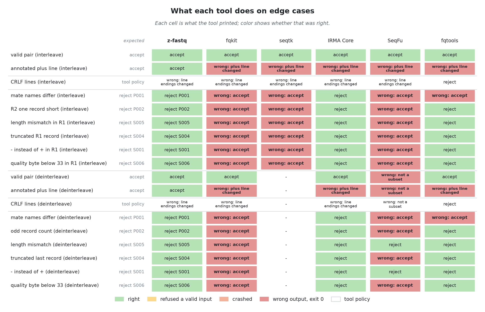
</picture>

> [!NOTE]
> A cell is the tool's verdict: `accept` (exit 0, output byte-exact), `reject P001` (with the rule it named), `reject`, `wrong: accept` (exit 0 on a broken pair or record), `wrong: plus line changed` and the like (exit 0 on a valid input, other bytes), `refused` (rejected a valid input), `crash`, or `-` (the tool has no such command). "tool policy" rows have no single right answer.

Inputs where a tool gave wrong output

| Tool      | Input                                                       | Exit | Printed             |
| --------- | ----------------------------------------------------------- | ---: | ------------------- |
| IRMA Core | bench/data/synthetic/paired/medium_R1.fastq                 |    1 | reject              |
| IRMA Core | bench/data/synthetic/paired/medium_R1.fastq.gz              |    1 | reject              |
| IRMA Core | bench/data/synthetic/paired/medium_interleaved.fastq        |    1 | reject              |
| IRMA Core | bench/data/synthetic/paired/medium_interleaved.fastq.gz     |    1 | reject              |
| IRMA Core | bench/data/synthetic/paired/small_R1.fastq                  |    1 | reject              |
| IRMA Core | bench/data/synthetic/paired/small_R1.fastq.gz               |    1 | reject              |
| IRMA Core | bench/data/synthetic/paired/small_interleaved.fastq         |    1 | reject              |
| IRMA Core | bench/data/synthetic/paired/small_interleaved.fastq.gz      |    1 | reject              |
| IRMA Core | bench/data/synthetic/paired/tiny_R1.fastq                   |    1 | reject              |
| IRMA Core | bench/data/synthetic/paired/tiny_R1.fastq.gz                |    1 | reject              |
| IRMA Core | bench/data/synthetic/paired/tiny_interleaved.fastq          |    1 | reject              |
| IRMA Core | bench/data/synthetic/paired/tiny_interleaved.fastq.gz       |    1 | reject              |
| IRMA Core | bench/data/synthetic/paired/xsmall_R1.fastq                 |    1 | reject              |
| IRMA Core | bench/data/synthetic/paired/xsmall_R1.fastq.gz              |    1 | reject              |
| IRMA Core | bench/data/synthetic/paired/xsmall_interleaved.fastq        |    1 | reject              |
| IRMA Core | bench/data/synthetic/paired/xsmall_interleaved.fastq.gz     |    1 | reject              |
| SeqFu     | bench/data/real/mgi-err10448913/medium_interleaved.fastq    |    0 | wrong: not a subset |
| SeqFu     | bench/data/real/mgi-err10448913/medium_interleaved.fastq.gz |    0 | wrong: not a subset |

## Interleave
> The real runs and synthetic shapes at the medium tier, about 1 GiB of FASTQ each, pooled into kinds of input. Every tool runs on one CPU, with the file in the page cache.

<picture>
  <source media="(prefers-color-scheme: dark)" srcset="results/figures/interleave-overview-dark.png">
  <source media="(prefers-color-scheme: light)" srcset="results/figures/interleave-overview-light.png">
  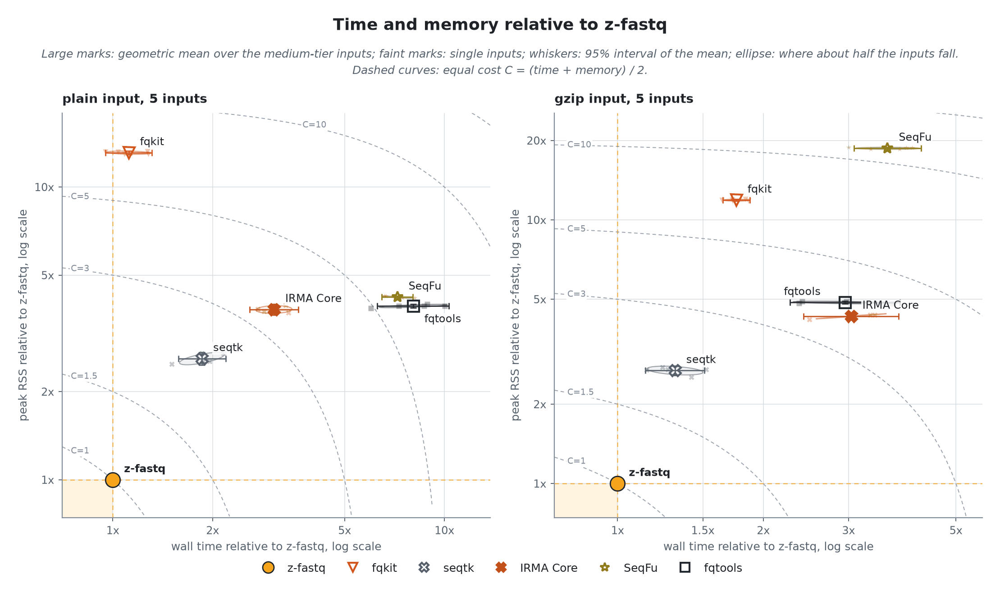
</picture>

z-fastq itself takes 471.5 ms and 1.06 MiB per plain input, 1749.9 ms and 1.06 MiB per gzip input (geometric means over 5 inputs each); the table gives every tool as a multiple of that.
Geometric-mean process CPU time is 442.9 ms for plain input and 1551.6 ms for gzip. Elapsed time also includes launcher overhead and time waiting to run or for I/O.

| Tool      | Plain time | Plain memory | Gzip time | Gzip memory | Passes malformed |
| --------- | ---------: | -----------: | --------: | ----------: | ---------------- |
| z-fastq   |      1.00x |        1.00x |     1.00x |       1.00x | none             |
| fqkit     |      1.12x |       13.10x |     1.76x |      11.88x | 6 of 6           |
| seqtk     |      1.86x |        2.59x |     1.31x |       2.68x | 6 of 6           |
| IRMA Core |      3.06x |        3.81x |     3.04x |       4.31x | none             |
| SeqFu     |      7.21x |        4.21x |     3.61x |      18.69x | 6 of 6           |
| fqtools   |      8.05x |        3.92x |     2.95x |       4.86x | 1 of 6           |

<picture>
  <source media="(prefers-color-scheme: dark)" srcset="results/figures/interleave-speed-dark.png">
  <source media="(prefers-color-scheme: light)" srcset="results/figures/interleave-speed-light.png">
  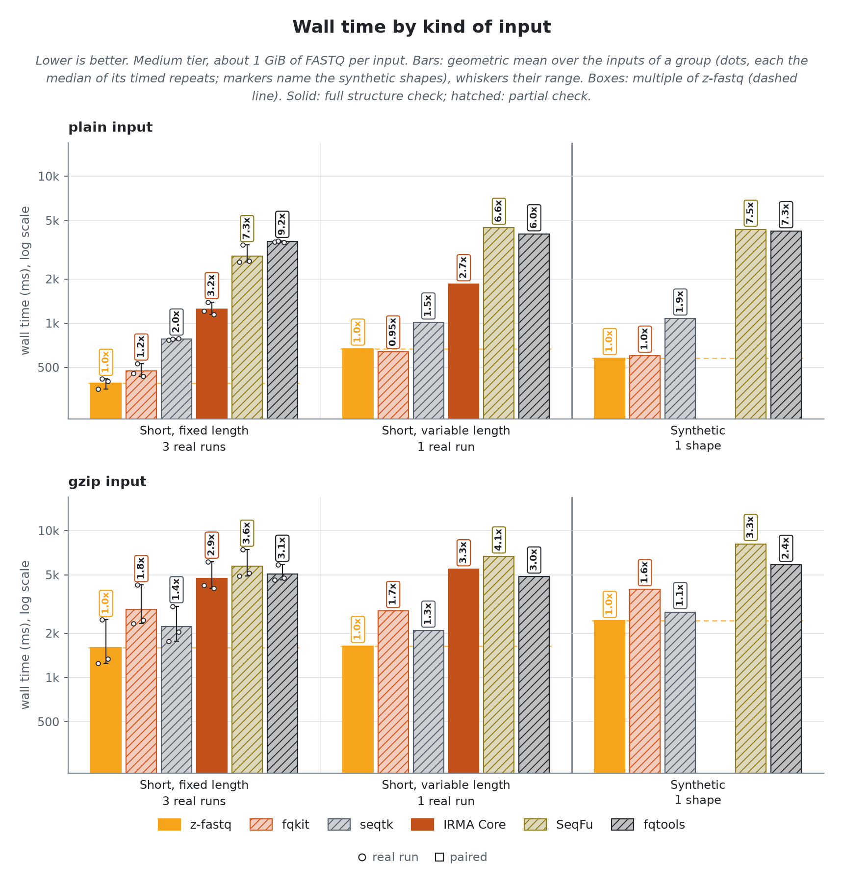
</picture>

<picture>
  <source media="(prefers-color-scheme: dark)" srcset="results/figures/interleave-memory-dark.png">
  <source media="(prefers-color-scheme: light)" srcset="results/figures/interleave-memory-light.png">
  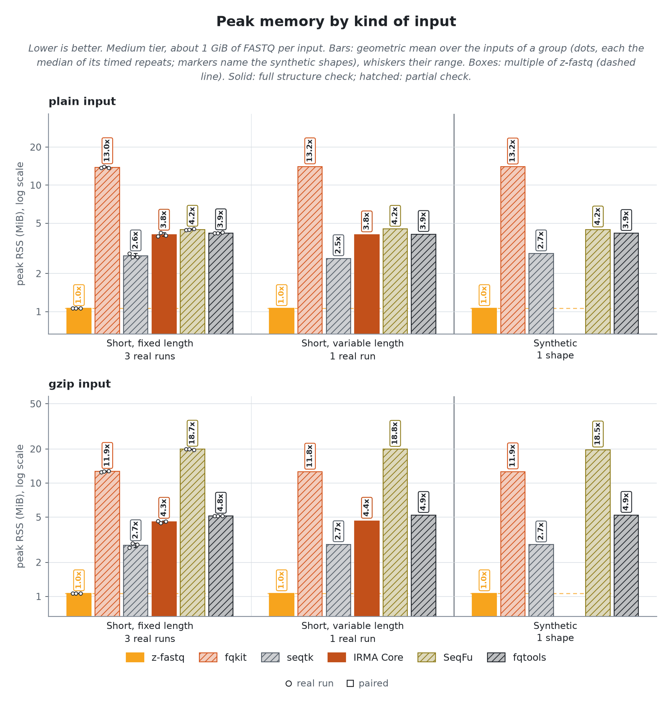
</picture>

Minor page faults by kind of input

<picture>
  <source media="(prefers-color-scheme: dark)" srcset="results/figures/interleave-faults-dark.png">
  <source media="(prefers-color-scheme: light)" srcset="results/figures/interleave-faults-light.png">
  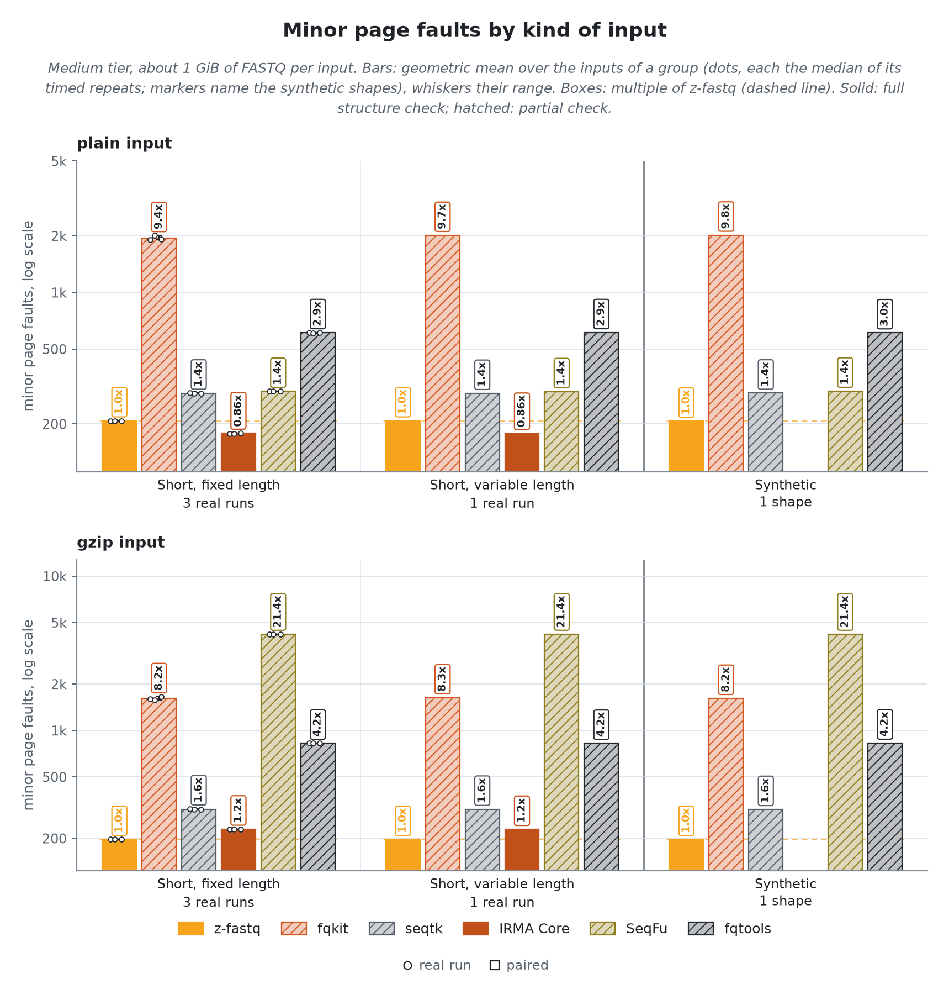
</picture>

### Scaling
> The `paired` shape (100 bp mate pairs) from 1 MiB to 1 GiB of FASTQ: throughput and peak memory against input size.

<picture>
  <source media="(prefers-color-scheme: dark)" srcset="results/figures/interleave-scaling-dark.png">
  <source media="(prefers-color-scheme: light)" srcset="results/figures/interleave-scaling-light.png">
  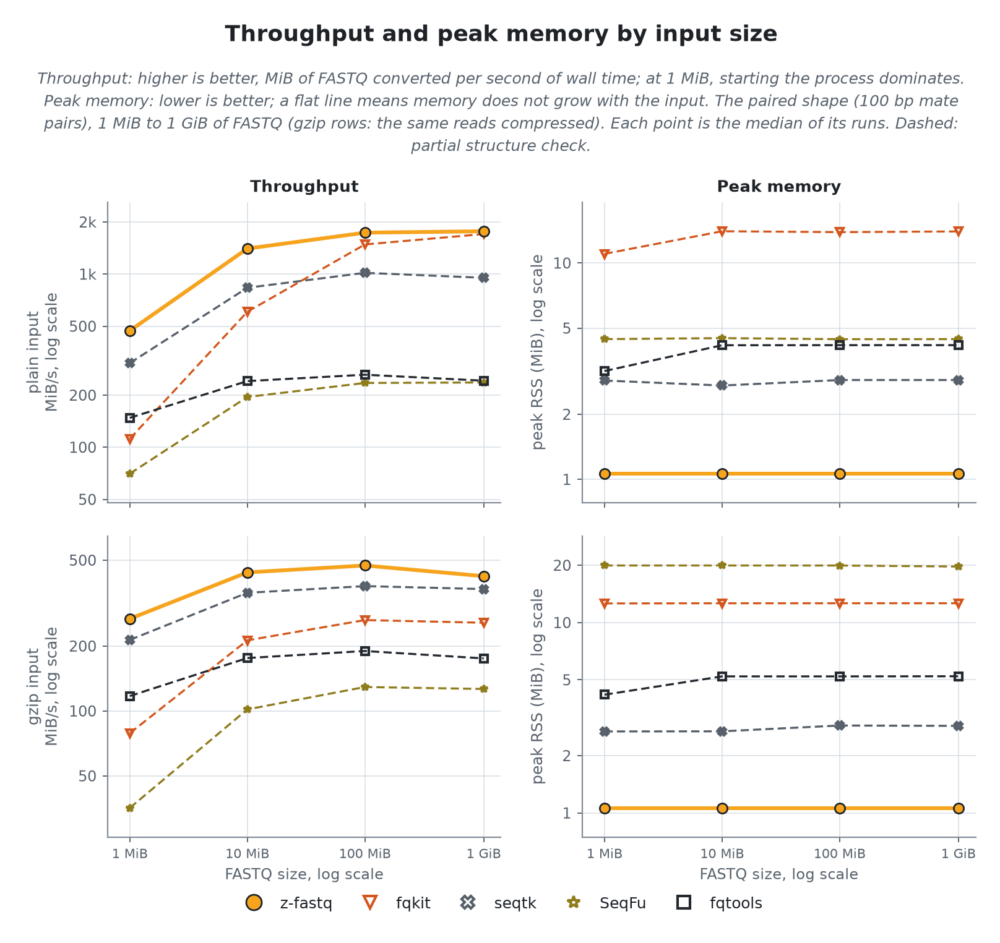
</picture>

At 1 GiB, z-fastq converts 1.7 to 1.7 GiB/s on plain input and 0.4 to 0.4 GiB/s on gzip input; no other tool is faster there.
z-fastq peaks at 1.06 MiB at every size and shape. Memory that grows with the input: fqkit by 1.3x on plain paired; fqtools by 1.3x on plain paired.

## Deinterleave
> The real runs and synthetic shapes at the medium tier, about 1 GiB of FASTQ each, pooled into kinds of input. Every tool runs on one CPU, with the file in the page cache.

<picture>
  <source media="(prefers-color-scheme: dark)" srcset="results/figures/deinterleave-overview-dark.png">
  <source media="(prefers-color-scheme: light)" srcset="results/figures/deinterleave-overview-light.png">
  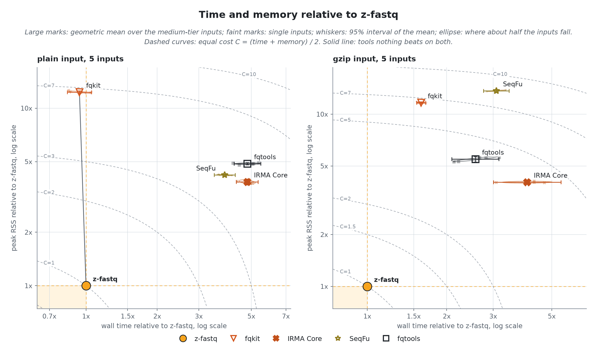
</picture>

z-fastq itself takes 782.0 ms and 1.06 MiB per plain input, 1931.8 ms and 1.06 MiB per gzip input (geometric means over 5 inputs each); the table gives every tool as a multiple of that.
Geometric-mean process CPU time is 679.8 ms for plain input and 1769.2 ms for gzip. Elapsed time also includes launcher overhead and time waiting to run or for I/O.

| Tool      | Plain time | Plain memory | Gzip time | Gzip memory | Passes malformed |
| --------- | ---------: | -----------: | --------: | ----------: | ---------------- |
| z-fastq   |      1.00x |        1.00x |     1.00x |       1.00x | none             |
| fqkit     |      0.94x |       12.31x |     1.60x |      11.65x | 6 of 6           |
| IRMA Core |      4.80x |        3.84x |     4.03x |       4.03x | none             |
| SeqFu     |      3.85x |        4.20x |     3.08x |      13.67x | 4 of 6           |
| fqtools   |      4.81x |        4.87x |     2.57x |       5.49x | 1 of 6           |

<picture>
  <source media="(prefers-color-scheme: dark)" srcset="results/figures/deinterleave-speed-dark.png">
  <source media="(prefers-color-scheme: light)" srcset="results/figures/deinterleave-speed-light.png">
  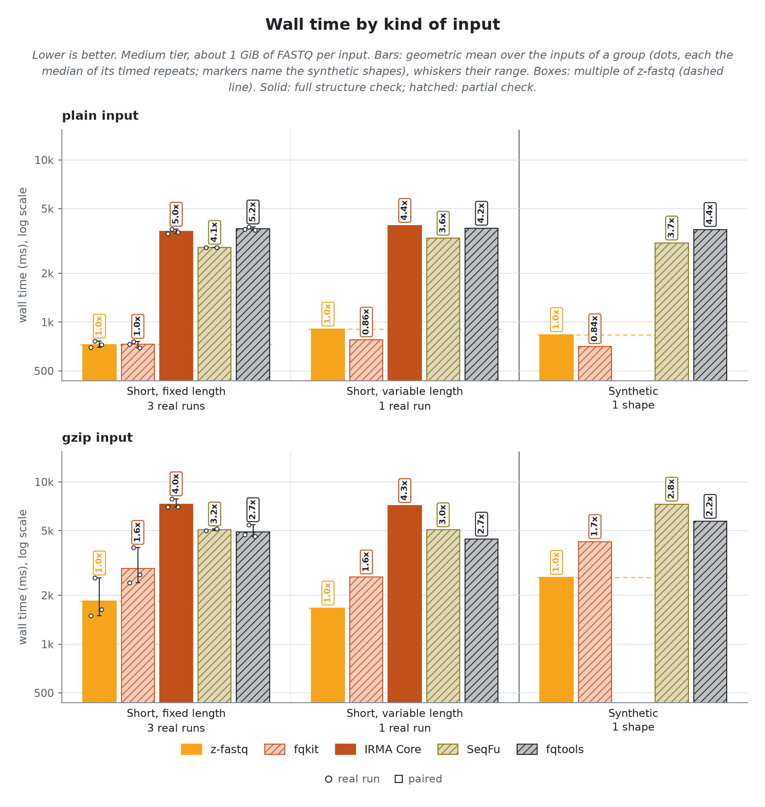
</picture>

<picture>
  <source media="(prefers-color-scheme: dark)" srcset="results/figures/deinterleave-memory-dark.png">
  <source media="(prefers-color-scheme: light)" srcset="results/figures/deinterleave-memory-light.png">
  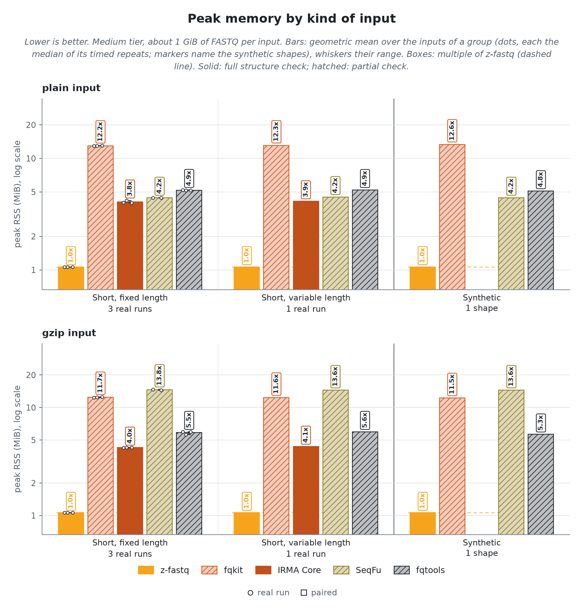
</picture>

Minor page faults by kind of input

<picture>
  <source media="(prefers-color-scheme: dark)" srcset="results/figures/deinterleave-faults-dark.png">
  <source media="(prefers-color-scheme: light)" srcset="results/figures/deinterleave-faults-light.png">
  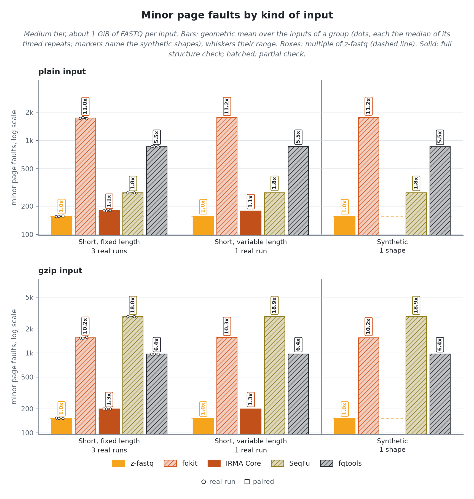
</picture>

Every tool writes its two mate files to disk under the same rules: new files per run, removed when the run ends, in an 8 GB memory cap so the written pages stay in the page cache.

### Scaling
> The `paired` shape (100 bp mate pairs) from 1 MiB to 1 GiB of FASTQ: throughput and peak memory against input size.

<picture>
  <source media="(prefers-color-scheme: dark)" srcset="results/figures/deinterleave-scaling-dark.png">
  <source media="(prefers-color-scheme: light)" srcset="results/figures/deinterleave-scaling-light.png">
  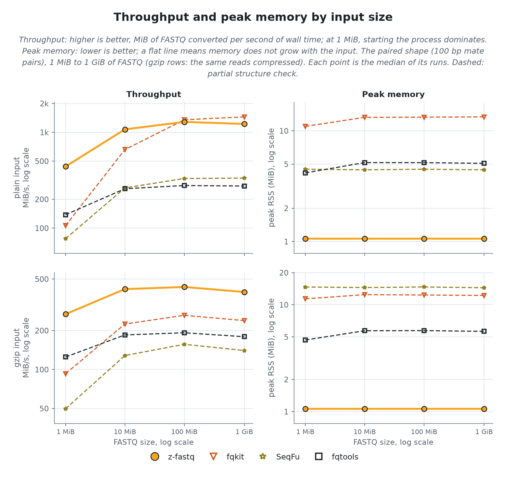
</picture>

At 1 GiB, z-fastq converts 1.2 to 1.2 GiB/s on plain input and 0.4 to 0.4 GiB/s on gzip input. Faster on a single shape there, as throughput over z-fastq's: fqkit on plain paired (1.19x).
z-fastq peaks at 1.06 MiB at every size and shape. No other tool grows by more than a quarter either.

## Reproducibility

How it was measured

Every tool runs through `zexec -r` inside one zebrac batch per case, held to one CPU core by a systemd scope with a CPU quota and a 4G memory cap, 8G for deinterleave, after the input was read once so every run reads from the page cache. zebrac gives wall time; zexec records each run's peak memory, CPU time, and minor faults for the tool alone. Peak RSS uses the kernel high-water counter, not an exact allocation count. Quick comparisons treat differences smaller than 256 KiB as inconclusive. Runs per tier, each after one warmup: tiny 31, xsmall 21, small 11, medium 3; sizes 1 MiB to 1 GiB. Generated by `bench/layout/run.sh release` on 2026-10-29.

Identity

- `z-fastq`: *0.1.0 at 246bbb1*
- `zebrac`: *0.6.2*
- `zexec`: *15000 bytes, static, no libc*
- `kernel`: *7.2.12-200.fc44.x86_64*
- `cpu`: *AMD Ryzen 9 3950X 16-Core Processor*
- `load at batch start`: *1.75 to 5.28*

Commands

- `z-fastq`: *zig-out/bin/z-fastq interleave IN*
- `fqkit`: *tools/bin/fqkit merge -1 IN -2 IN -@ 1*
- `seqtk`: *tools/bin/seqtk mergepe IN*
- `IRMA Core`: *tools/bin/irma-core xleave IN*
- `SeqFu`: *tools/bin/seqfu ilv -1 IN -2 IN*
- `fqtools`: *tools/bin/fqtools -I view IN*
- `z-fastq`, deinterleave: *zig-out/bin/z-fastq deinterleave --out1 {stem}_1.fq --out2 {stem}_2.fq IN*
- `fqkit`, deinterleave: *tools/bin/fqkit split -p {name} -o {dir} -@ 1 IN*
- `IRMA Core`, deinterleave: *tools/bin/irma-core xleave -1 {stem}_1.fq -2 {stem}_2.fq IN*
- `SeqFu`, deinterleave: *tools/bin/seqfu dei -o {stem} IN*
- `fqtools`, deinterleave: *tools/bin/fqtools -i -F F view -o {stem}% IN*

Quick-check cases for peer and ab

Picked from these results: per family, group, and format, the case where z-fastq is closest to, or furthest behind, its fastest rival of any class. `run.sh peer` times z-fastq against a cached reference of the rival on each; `run.sh ab REV` times two z-fastq builds on each.

- `interleave: Short, fixed length, plain`: *NovaSeq, Casava headers*; rival fqkit at 1.08x z-fastq's time
- `interleave: Short, variable length, plain`: *10x mates, 28 and 150 bp*; rival fqkit at 0.95x z-fastq's time
- `interleave: Synthetic, plain`: *paired: 100 bp mate pairs*; rival fqkit at 1.04x z-fastq's time
- `interleave: Short, fixed length, gzip`: *BGISEQ, 100 bp*; rival seqtk at 1.24x z-fastq's time
- `interleave: Short, variable length, gzip`: *10x mates, 28 and 150 bp*; rival seqtk at 1.27x z-fastq's time
- `interleave: Synthetic, gzip`: *paired: 100 bp mate pairs*; rival seqtk at 1.15x z-fastq's time
- `deinterleave: Short, fixed length, plain`: *NovaSeq, Casava headers*; rival fqkit at 0.96x z-fastq's time
- `deinterleave: Short, variable length, plain`: *10x mates, 28 and 150 bp*; rival fqkit at 0.86x z-fastq's time
- `deinterleave: Synthetic, plain`: *paired: 100 bp mate pairs*; rival fqkit at 0.84x z-fastq's time
- `deinterleave: Short, fixed length, gzip`: *BGISEQ, 100 bp*; rival fqkit at 1.54x z-fastq's time
- `deinterleave: Short, variable length, gzip`: *10x mates, 28 and 150 bp*; rival fqkit at 1.55x z-fastq's time
- `deinterleave: Synthetic, gzip`: *paired: 100 bp mate pairs*; rival fqkit at 1.66x z-fastq's time

Hardware counters (user space, plain medium-tier inputs, geometric means)

| Tool      | Instructions per byte | Instructions per cycle | Cache misses per MiB | Branch misses per MiB |
| --------- | --------------------: | ---------------------: | -------------------: | --------------------: |
| z-fastq   |                  3.78 |                   3.23 |                 2837 |                   936 |
| fqkit     |                  2.94 |                   2.42 |                10929 |                  2619 |
| seqtk     |                  5.95 |                   2.67 |                 5403 |                  5743 |
| IRMA Core |                 10.05 |                   2.65 |                  749 |                  6082 |
| SeqFu     |                 14.24 |                   2.01 |                 2509 |                 48533 |
| fqtools   |                 38.82 |                   3.43 |                 1936 |                 14076 |

