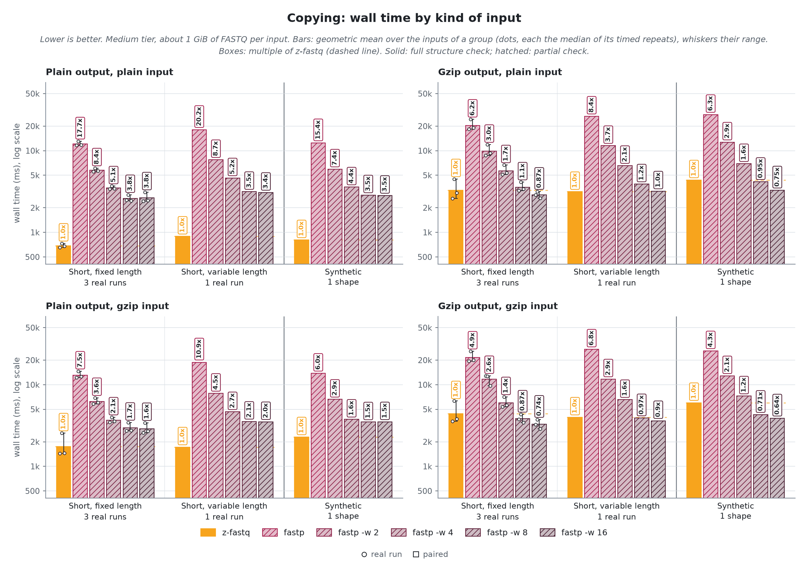
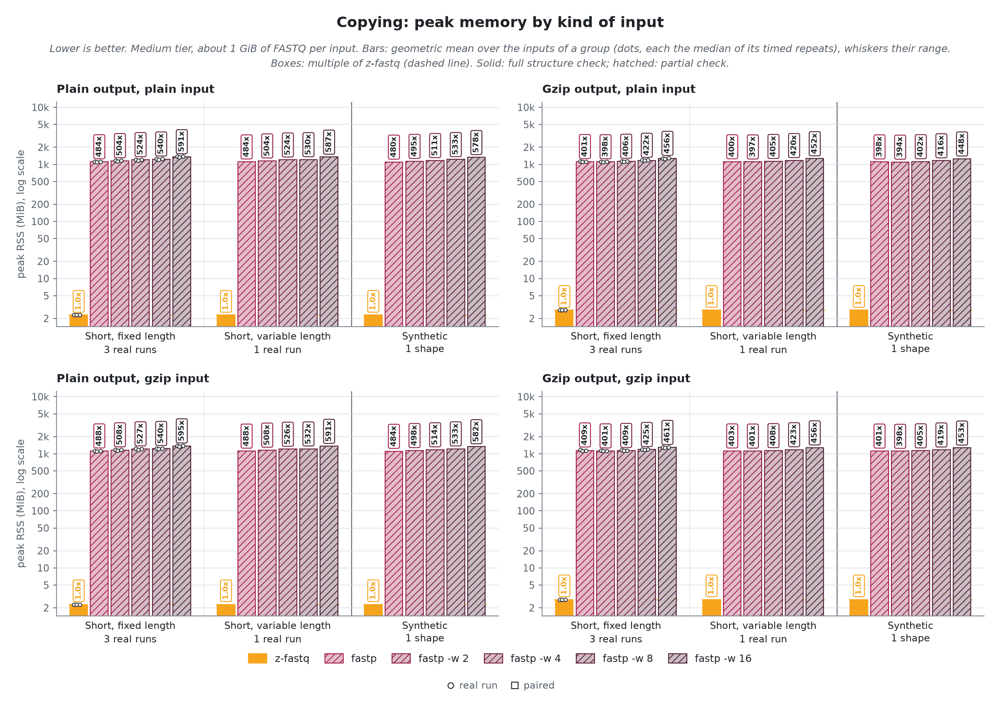
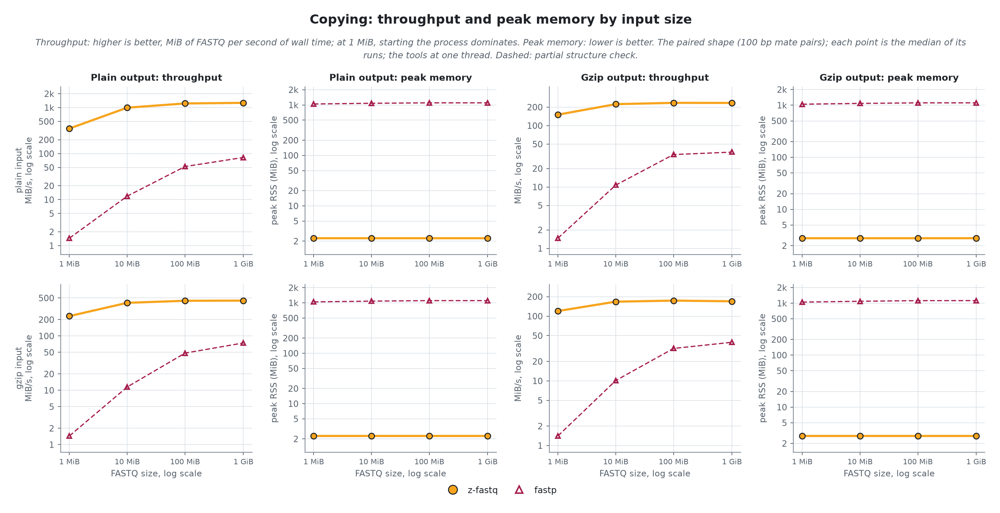

<!-- markdownlint-disable MD013 MD033 MD041 -->

# Processing paired reads
> `z-fastq process` against 3 other processors, on 4 real sequencing runs and 1 synthetic shape, plain and gzip. A tool is timed only where its outputs were right; time and memory come from the same run, on one CPU, a threaded variant on as many cores as its threads.

- `z-fastq`: *0.1.0 at 246bbb1*
- `machine`: *Ryzen 9 3950X, Linux 7.2.12; one CPU per run, threaded variants on as many cores as threads*
- `runner`: *zebrac 0.6.2 with zexec*
- `data`:
  - **Real**: *4 public sequencing runs, 1 GiB each, pooled in the bars by the kind of reads they hold*
    - `Short, fixed length`: *NovaSeq, 150 bp; NovaSeq, Casava headers; BGISEQ, 100 bp*
    - `Short, variable length`: *10x mates, 28 and 150 bp*
  - **Synthetic**: *1 shape generated from real reads, each changing one thing; one group in the bars at 1 GiB, and the scaling lines from 1 MiB to 1 GiB*
    - `paired`: *100 bp mate pairs*
- `date`: *2026-10-30*

## Findings

- **Right answers:** z-fastq wrote the right copies, fastp's records, and FastQC's tables on all 80 checked inputs and rejected every broken pair and record. 3 of the 3 other tools write output from a broken pair or record with exit 0.
- **Copying into plain files:** fastp takes 17.6x z-fastq's time on plain input and 7.7x on gzip, with 483x its memory; at its fastest, 8 threads, 3.68x z-fastq's time for 16.4x its CPU time.
- **Copying into gzip files:** fastp takes 6.6x z-fastq's time on plain input and 5.1x on gzip, with 400x its memory; at its fastest, 16 threads, 0.87x z-fastq's time for 6.3x its CPU time (faster than z-fastq from 16 threads).
- **Trimming, TruSeq settings:** fastp takes 12.2x z-fastq's time on plain input and 9.3x on gzip, with 76x its memory; at its fastest, 16 threads, 1.09x z-fastq's time for 11.3x its CPU time.
- **Trimming, Nextera settings:** fastp takes 9.9x z-fastq's time on plain input and 7.7x on gzip, with 76x its memory; at its fastest, 16 threads, 0.99x z-fastq's time for 9.4x its CPU time (faster than z-fastq from 16 threads).
- **QC tables:** FastQC-Rust takes 2.1x z-fastq's time on plain input and 1.7x on gzip, with 3x its memory; at its fastest, 8 threads, 0.89x z-fastq's time for 3.6x its CPU time (faster than z-fastq from 4 threads); FastQC takes 11.6x z-fastq's time on plain input and 8.1x on gzip, with 25x its memory; at its fastest, 16 threads, 2.87x z-fastq's time for 11.2x its CPU time.

## Compared tools
> *partial* tools do less than z-fastq: fastp checks records less strictly, and the FastQC tools write no reads and check no pairs. A job is `yes` when the tool was right on every input of it, `partly` on some, `-` when the tool has no such job. Threads: z-fastq runs on one; every other tool runs at 1 thread and again at 2, 4, 8, and 16 on as many physical cores, at the 1 GiB inputs, in the same batches as z-fastq. Malformed rejected: of the broken pairs and records in the edge cases, how many the tool rejects.

| Tool        | Class   | Copy | Gzip copy | TruSeq trim | Nextera trim | QC tables | Threads      | Malformed rejected |
| ----------- | ------- | ---- | --------- | ----------- | ------------ | --------- | ------------ | -----------------: |
| z-fastq     | subject | yes  | yes       | yes         | yes          | yes       | 1            |             8 of 8 |
| fastp       | partial | yes  | yes       | yes         | yes          | -         | 1 to 16 (-w) |             0 of 8 |
| FastQC-Rust | partial | -    | -         | -           | -            | yes       | 1 to 16 (-t) |             1 of 8 |
| FastQC      | partial | -    | -         | -           | -            | yes       | 1 to 16 (-t) |             1 of 8 |

- `fastp 1.4.0`: *writes its JSON and HTML report and measures duplication on every run; compression level 4*
- `FastQC-Rust 1.1.0`: *QC tables only, no reads written and no pair checks; the QC tables' reference*
- `FastQC 0.13.0`: *QC tables only, no reads written and no pair checks; a Java program whose JVM starts its own threads*

> [!IMPORTANT]
> fastp computes its QC report and pair duplication on every run, so z-fastq's trimming lanes write the QC summary and measure pair duplication too. In the QC job z-fastq also writes both mates, which it cannot skip, while the FastQC tools write tables only.

## Right answers
> Copies must equal the corpus pairs byte for byte. Trimmed pairs must hold the records fastp 1.4.0 keeps with the same settings, and every field of z-fastq's QC summary must equal fastp's (its own schema and tool names aside); fastp itself is that reference. QC tables must equal FastQC-Rust's `fastqc_data.txt` without its version and file name lines, tied overrepresented rows in sorted order. The edge cases are small inputs where tools differ: each cell shows what the tool printed, and its color whether that was right.

z-fastq returned right outputs on all 80 inputs it was given. Every other tool was right on every input it was given.

> [!CAUTION]
> fastp, FastQC-Rust and FastQC print wrong output and exit 0 on some malformed inputs, so a script cannot tell the pairs are broken.

<picture>
  <source media="(prefers-color-scheme: dark)" srcset="results/figures/edges-dark.png">
  <source media="(prefers-color-scheme: light)" srcset="results/figures/edges-light.png">
  
</picture>

> [!NOTE]
> A cell is the tool's verdict: `accept` (exit 0, outputs right), `reject P001` (with the rule it named), `reject`, `wrong: accept` (exit 0 on a broken pair or record), `wrong: records differ` or `wrong: table R1` (exit 0, other output), `no table` (no table written for a mate), `refused` (rejected a valid input), `crash`, or `-` (the tool has no such job). "tool policy" rows have no single right answer.

## Copying
> Plain output: two mate files into two plain files. Gzip output: two mate files into two gzip files. The real runs and the synthetic pair at 1 GiB, plain and gzip input, in the page cache. z-fastq runs on one CPU; every other tool at 1 thread, and at 2, 4, 8, and 16 threads on as many physical cores, in the same batch.

<picture>
  <source media="(prefers-color-scheme: dark)" srcset="results/figures/copying-overview-dark.png">
  <source media="(prefers-color-scheme: light)" srcset="results/figures/copying-overview-light.png">
  
</picture>

z-fastq itself takes, geometric means over the 1 GiB inputs: Plain output, 0.75 s and 2.3 MiB on plain input, 1.84 s and 2.3 MiB on gzip; Gzip output, 3.45 s and 2.8 MiB on plain input, 4.61 s and 2.8 MiB on gzip. The table gives every tool as a multiple of that.

| Job          | Tool        | Threads | Plain time | Plain CPU | Plain memory | Gzip time | Gzip CPU | Gzip memory |
| ------------ | ----------- | ------: | ---------: | --------: | -----------: | --------: | -------: | ----------: |
| Plain output | z-fastq     |       1 |      1.00x |     1.00x |        1.00x |     1.00x |    1.00x |       1.00x |
| Plain output | fastp       |       1 |     17.64x |    18.03x |      483.50x |     7.74x |    7.70x |     487.15x |
| Plain output | fastp -w 2  |       2 |      8.24x |    15.16x |      501.94x |     3.59x |    6.58x |     505.90x |
| Plain output | fastp -w 4  |       4 |      4.98x |    15.08x |      521.38x |     2.11x |    6.46x |     524.36x |
| Plain output | fastp -w 8  |       8 |      3.68x |    16.40x |      536.58x |     1.73x |    6.88x |     536.85x |
| Plain output | fastp -w 16 |      16 |      3.69x |    18.18x |      587.51x |     1.69x |    7.56x |     591.86x |
| Gzip output  | z-fastq     |       1 |      1.00x |     1.00x |        1.00x |     1.00x |    1.00x |       1.00x |
| Gzip output  | fastp       |       1 |      6.60x |     6.36x |      400.35x |     5.08x |    5.03x |     406.01x |
| Gzip output  | fastp -w 2  |       2 |      3.11x |     5.73x |      396.73x |     2.58x |    4.58x |     400.40x |
| Gzip output  | fastp -w 4  |       4 |      1.76x |     5.71x |      404.75x |     1.37x |    4.52x |     407.78x |
| Gzip output  | fastp -w 8  |       8 |      1.09x |     6.04x |      420.25x |     0.85x |    4.78x |     423.19x |
| Gzip output  | fastp -w 16 |      16 |      0.87x |     6.34x |      453.43x |     0.75x |    4.96x |     458.20x |

<picture>
  <source media="(prefers-color-scheme: dark)" srcset="results/figures/copying-speed-dark.png">
  <source media="(prefers-color-scheme: light)" srcset="results/figures/copying-speed-light.png">
  
</picture>

<picture>
  <source media="(prefers-color-scheme: dark)" srcset="results/figures/copying-memory-dark.png">
  <source media="(prefers-color-scheme: light)" srcset="results/figures/copying-memory-light.png">
  
</picture>

**Plain output.** Output per plain 1 GiB input, mean over 5 inputs: z-fastq 1073.7 MB, fastp 1073.7 MB.

**Gzip output.** Output per plain 1 GiB input, mean over 5 inputs: z-fastq 306.8 MB, fastp 269.1 MB.

Scaling

<picture>
  <source media="(prefers-color-scheme: dark)" srcset="results/figures/copying-scaling-dark.png">
  <source media="(prefers-color-scheme: light)" srcset="results/figures/copying-scaling-light.png">
  
</picture>

**Plain output.** At 1 GiB, z-fastq processes 1.2 to 1.2 GiB/s on plain input and 0.4 to 0.4 GiB/s on gzip input; no other tool is faster there.
z-fastq peaks at 2.29 MiB at every size and shape. No other tool grows by more than a quarter either.

**Gzip output.** At 1 GiB, z-fastq processes 0.2 to 0.2 GiB/s on plain input and 0.2 to 0.2 GiB/s on gzip input. Faster on a single shape there, as throughput over z-fastq's: fastp -w 8 on plain paired (1.05x); fastp -w 8 on gzip paired (1.40x); fastp -w 16 on plain paired (1.34x); fastp -w 16 on gzip paired (1.55x).
z-fastq peaks at 2.79 MiB at every size and shape. No other tool grows by more than a quarter either.

## Trimming
> TruSeq: TruSeq adapters, quality and N filters, minimum length 15 (rnaFusion's settings). Nextera: Nextera adapters, poly-G and quality-tail trimming, filters, minimum length 30 (FRAMEFusion's settings). The real runs and the synthetic pair at 1 GiB, plain and gzip input, in the page cache. z-fastq runs on one CPU; every other tool at 1 thread, and at 2, 4, 8, and 16 threads on as many physical cores, in the same batch.

<picture>
  <source media="(prefers-color-scheme: dark)" srcset="results/figures/trimming-overview-dark.png">
  <source media="(prefers-color-scheme: light)" srcset="results/figures/trimming-overview-light.png">
  
</picture>

z-fastq itself takes, geometric means over the 1 GiB inputs: TruSeq, 3.33 s and 14.7 MiB on plain input, 4.49 s and 14.7 MiB on gzip; Nextera, 3.49 s and 14.7 MiB on plain input, 4.50 s and 14.7 MiB on gzip. The table gives every tool as a multiple of that.

| Job     | Tool        | Threads | Plain time | Plain CPU | Plain memory | Gzip time | Gzip CPU | Gzip memory |
| ------- | ----------- | ------: | ---------: | --------: | -----------: | --------: | -------: | ----------: |
| TruSeq  | z-fastq     |       1 |      1.00x |     1.00x |        1.00x |     1.00x |    1.00x |       1.00x |
| TruSeq  | fastp       |       1 |     12.20x |    12.09x |       75.87x |     9.32x |    9.15x |      76.57x |
| TruSeq  | fastp -w 2  |       2 |      5.79x |    11.19x |       78.65x |     4.38x |    8.44x |      79.02x |
| TruSeq  | fastp -w 4  |       4 |      2.97x |    10.73x |       81.02x |     2.26x |    8.14x |      81.64x |
| TruSeq  | fastp -w 8  |       8 |      1.65x |    10.97x |       85.42x |     1.25x |    8.29x |      86.14x |
| TruSeq  | fastp -w 16 |      16 |      1.09x |    11.35x |       92.67x |     0.90x |    8.73x |      93.46x |
| Nextera | z-fastq     |       1 |      1.00x |     1.00x |        1.00x |     1.00x |    1.00x |       1.00x |
| Nextera | fastp       |       1 |      9.86x |     9.77x |       75.88x |     7.72x |    7.56x |      76.49x |
| Nextera | fastp -w 2  |       2 |      4.55x |     9.03x |       78.15x |     3.64x |    7.01x |      78.59x |
| Nextera | fastp -w 4  |       4 |      2.42x |     8.79x |       80.62x |     1.93x |    6.82x |      81.10x |
| Nextera | fastp -w 8  |       8 |      1.33x |     8.90x |       84.85x |     1.09x |    6.98x |      85.52x |
| Nextera | fastp -w 16 |      16 |      0.99x |     9.43x |       92.02x |     0.84x |    7.30x |      92.68x |

<picture>
  <source media="(prefers-color-scheme: dark)" srcset="results/figures/trimming-speed-dark.png">
  <source media="(prefers-color-scheme: light)" srcset="results/figures/trimming-speed-light.png">
  
</picture>

<picture>
  <source media="(prefers-color-scheme: dark)" srcset="results/figures/trimming-memory-dark.png">
  <source media="(prefers-color-scheme: light)" srcset="results/figures/trimming-memory-light.png">
  
</picture>

**TruSeq.** Output per plain 1 GiB input, mean over 5 inputs: z-fastq 1025.4 MB, fastp 1025.4 MB.

**Nextera.** Output per plain 1 GiB input, mean over 5 inputs: z-fastq 829.3 MB, fastp 829.3 MB.

Scaling

<picture>
  <source media="(prefers-color-scheme: dark)" srcset="results/figures/trimming-scaling-dark.png">
  <source media="(prefers-color-scheme: light)" srcset="results/figures/trimming-scaling-light.png">
  
</picture>

**TruSeq.** At 1 GiB, z-fastq processes 0.3 to 0.3 GiB/s on plain input and 0.2 to 0.2 GiB/s on gzip input. Faster on a single shape there, as throughput over z-fastq's: fastp -w 16 on gzip paired (1.21x).
z-fastq peaks at 4.54 to 4.79 MiB across sizes and shapes. No other tool grows by more than a quarter either.

**Nextera.** At 1 GiB, z-fastq processes 0.3 to 0.3 GiB/s on plain input and 0.2 to 0.2 GiB/s on gzip input. Faster on a single shape there, as throughput over z-fastq's: fastp -w 8 on gzip paired (1.05x); fastp -w 16 on plain paired (1.05x); fastp -w 16 on gzip paired (1.29x).
z-fastq peaks at 4.54 to 4.79 MiB across sizes and shapes. No other tool grows by more than a quarter either.

## QC tables
> FastQC tables: FastQC tables for both mates, no trimming. The real runs and the synthetic pair at 1 GiB, plain and gzip input, in the page cache. z-fastq runs on one CPU; every other tool at 1 thread, and at 2, 4, 8, and 16 threads on as many physical cores, in the same batch.

<picture>
  <source media="(prefers-color-scheme: dark)" srcset="results/figures/qc-overview-dark.png">
  <source media="(prefers-color-scheme: light)" srcset="results/figures/qc-overview-light.png">
  
</picture>

z-fastq itself takes, geometric means over the 1 GiB inputs: FastQC tables, 1.91 s and 10.2 MiB on plain input, 2.99 s and 10.1 MiB on gzip. The table gives every tool as a multiple of that.

| Job           | Tool              | Threads | Plain time | Plain CPU | Plain memory | Gzip time | Gzip CPU | Gzip memory |
| ------------- | ----------------- | ------: | ---------: | --------: | -----------: | --------: | -------: | ----------: |
| FastQC tables | z-fastq           |       1 |      1.00x |     1.00x |        1.00x |     1.00x |    1.00x |       1.00x |
| FastQC tables | FastQC-Rust       |       1 |      2.13x |     2.18x |        2.83x |     1.72x |    1.74x |       2.98x |
| FastQC tables | FastQC-Rust -t 2  |       2 |      1.17x |     2.20x |        4.36x |     0.95x |    1.77x |       4.60x |
| FastQC tables | FastQC-Rust -t 4  |       4 |      0.97x |     2.40x |        6.24x |     0.74x |    1.80x |       6.95x |
| FastQC tables | FastQC-Rust -t 8  |       8 |      0.89x |     3.63x |        6.22x |     0.46x |    2.32x |       9.81x |
| FastQC tables | FastQC-Rust -t 16 |      16 |      1.22x |     5.18x |        5.97x |     0.76x |    3.63x |       9.62x |
| FastQC tables | FastQC            |       1 |     11.59x |    10.90x |       24.67x |     8.10x |    7.65x |      24.75x |
| FastQC tables | FastQC -t 2       |       2 |      9.25x |    10.76x |       34.11x |     5.95x |    7.76x |      32.99x |
| FastQC tables | FastQC -t 4       |       4 |      4.62x |    10.69x |       37.27x |     2.94x |    7.62x |      36.71x |
| FastQC tables | FastQC -t 8       |       8 |      2.88x |    11.10x |       69.03x |     1.81x |    7.92x |      64.48x |
| FastQC tables | FastQC -t 16      |      16 |      2.87x |    11.17x |       70.50x |     1.81x |    7.92x |      64.00x |

<picture>
  <source media="(prefers-color-scheme: dark)" srcset="results/figures/qc-speed-dark.png">
  <source media="(prefers-color-scheme: light)" srcset="results/figures/qc-speed-light.png">
  
</picture>

<picture>
  <source media="(prefers-color-scheme: dark)" srcset="results/figures/qc-memory-dark.png">
  <source media="(prefers-color-scheme: light)" srcset="results/figures/qc-memory-light.png">
  
</picture>

**FastQC tables.** Output per plain 1 GiB input, mean over 5 inputs: z-fastq 1073.9 MB, FastQC-Rust 0.8 MB, FastQC 0.8 MB.

Scaling

<picture>
  <source media="(prefers-color-scheme: dark)" srcset="results/figures/qc-scaling-dark.png">
  <source media="(prefers-color-scheme: light)" srcset="results/figures/qc-scaling-light.png">
  
</picture>

**FastQC tables.** At 1 GiB, z-fastq processes 0.5 to 0.5 GiB/s on plain input and 0.3 to 0.3 GiB/s on gzip input. Faster on a single shape there, as throughput over z-fastq's: FastQC-Rust -t 2 on gzip paired (1.18x); FastQC-Rust -t 4 on plain paired (1.11x); FastQC-Rust -t 4 on gzip paired (1.61x); FastQC-Rust -t 8 on gzip paired (2.58x); FastQC-Rust -t 16 on gzip paired (1.25x).
z-fastq peaks at 2.79 to 4.29 MiB across sizes and shapes. Memory that grows with the input: FastQC by 1.3x on plain paired.

## Reproducibility

How it was measured

Every tool runs through `zexec -r` inside one zebrac batch per case, held to one CPU core by a systemd scope with a CPU quota and a 16G memory cap; a batch with threaded variants holds as many physical cores as its largest lane, one logical CPU each, with each lane pinned to its own cores and z-fastq to one, after the input was read once so every run reads from the page cache. zebrac gives wall time; zexec records each run's peak memory, CPU time, and minor faults for the tool alone. Peak RSS uses the kernel high-water counter, not an exact allocation count. Quick comparisons treat differences smaller than 256 KiB as inconclusive. Runs per tier, each after one warmup: tiny 31, xsmall 21, small 11, medium 3; sizes 1 MiB to 1 GiB. Generated by `bench/process/run.sh release` on 2026-10-30.

Identity

- `z-fastq`: *0.1.0 at 246bbb1*
- `zebrac`: *0.6.2*
- `zexec`: *15000 bytes, static, no libc*
- `kernel`: *7.2.12-200.fc44.x86_64*
- `cpu`: *AMD Ryzen 9 3950X 16-Core Processor*
- `load at batch start`: *1.82 to 8.71*

Commands

- `z-fastq`: *zig-out/bin/z-fastq process --out1 {stem}_1.fq --out2 {stem}_2.fq IN*
- `fastp`: *tools/bin/fastp -i IN -I IN -o {stem}_1.fq -O {stem}_2.fq -A -G -Q -L -w 1 -j {stem}.json -h {stem}.html*
- `fastp -w 2`: *tools/bin/fastp -i IN -I IN -o {stem}_1.fq -O {stem}_2.fq -A -G -Q -L -w 2 -j {stem}.json -h {stem}.html*
- `fastp -w 4`: *tools/bin/fastp -i IN -I IN -o {stem}_1.fq -O {stem}_2.fq -A -G -Q -L -w 4 -j {stem}.json -h {stem}.html*
- `fastp -w 8`: *tools/bin/fastp -i IN -I IN -o {stem}_1.fq -O {stem}_2.fq -A -G -Q -L -w 8 -j {stem}.json -h {stem}.html*
- `fastp -w 16`: *tools/bin/fastp -i IN -I IN -o {stem}_1.fq -O {stem}_2.fq -A -G -Q -L -w 16 -j {stem}.json -h {stem}.html*
- `FastQC-Rust`: *tools/bin/fastqc-rust --threads 1 -o {stem}.qc IN*
- `FastQC-Rust -t 2`: *tools/bin/fastqc-rust --threads 2 -o {stem}.qc IN*
- `FastQC-Rust -t 4`: *tools/bin/fastqc-rust --threads 4 -o {stem}.qc IN*
- `FastQC-Rust -t 8`: *tools/bin/fastqc-rust --threads 8 -o {stem}.qc IN*
- `FastQC-Rust -t 16`: *tools/bin/fastqc-rust --threads 16 -o {stem}.qc IN*
- `FastQC`: *tools/bin/fastqc --threads 1 --quiet --outdir {stem}.qc IN*
- `FastQC -t 2`: *tools/bin/fastqc --threads 2 --quiet --outdir {stem}.qc IN*
- `FastQC -t 4`: *tools/bin/fastqc --threads 4 --quiet --outdir {stem}.qc IN*
- `FastQC -t 8`: *tools/bin/fastqc --threads 8 --quiet --outdir {stem}.qc IN*
- `FastQC -t 16`: *tools/bin/fastqc --threads 16 --quiet --outdir {stem}.qc IN*
- `z-fastq`, copy-gzip: *zig-out/bin/z-fastq process --gzip --out1 {stem}_1.fq.gz --out2 {stem}_2.fq.gz IN*
- `fastp`, copy-gzip: *tools/bin/fastp -i IN -I IN -o {stem}_1.fq.gz -O {stem}_2.fq.gz -A -G -Q -L -w 1 -j {stem}.json -h {stem}.html*
- `fastp -w 2`, copy-gzip: *tools/bin/fastp -i IN -I IN -o {stem}_1.fq.gz -O {stem}_2.fq.gz -A -G -Q -L -w 2 -j {stem}.json -h {stem}.html*
- `fastp -w 4`, copy-gzip: *tools/bin/fastp -i IN -I IN -o {stem}_1.fq.gz -O {stem}_2.fq.gz -A -G -Q -L -w 4 -j {stem}.json -h {stem}.html*
- `fastp -w 8`, copy-gzip: *tools/bin/fastp -i IN -I IN -o {stem}_1.fq.gz -O {stem}_2.fq.gz -A -G -Q -L -w 8 -j {stem}.json -h {stem}.html*
- `fastp -w 16`, copy-gzip: *tools/bin/fastp -i IN -I IN -o {stem}_1.fq.gz -O {stem}_2.fq.gz -A -G -Q -L -w 16 -j {stem}.json -h {stem}.html*
- `z-fastq`, trim-truseq: *zig-out/bin/z-fastq process --adapter1 AGATCGGAAGAGCACACGTCTGAACTCCAGTCA --adapter2 AGATCGGAAGAGCGTCGTGTAGGGAAAGAGTGT --low-quality 15 --max-low-quality-percent 40 --max-n 5 --min-length 15 --pair-duplication --qc-summary {stem}.json --out1 {stem}_1.fq --out2 {stem}_2.fq IN*
- `fastp`, trim-truseq: *tools/bin/fastp -i IN -I IN -o {stem}_1.fq -O {stem}_2.fq --adapter_sequence AGATCGGAAGAGCACACGTCTGAACTCCAGTCA --adapter_sequence_r2 AGATCGGAAGAGCGTCGTGTAGGGAAAGAGTGT --disable_trim_poly_g -q 15 -u 40 -n 5 -l 15 -w 1 -j {stem}.json -h {stem}.html*
- `fastp -w 2`, trim-truseq: *tools/bin/fastp -i IN -I IN -o {stem}_1.fq -O {stem}_2.fq --adapter_sequence AGATCGGAAGAGCACACGTCTGAACTCCAGTCA --adapter_sequence_r2 AGATCGGAAGAGCGTCGTGTAGGGAAAGAGTGT --disable_trim_poly_g -q 15 -u 40 -n 5 -l 15 -w 2 -j {stem}.json -h {stem}.html*
- `fastp -w 4`, trim-truseq: *tools/bin/fastp -i IN -I IN -o {stem}_1.fq -O {stem}_2.fq --adapter_sequence AGATCGGAAGAGCACACGTCTGAACTCCAGTCA --adapter_sequence_r2 AGATCGGAAGAGCGTCGTGTAGGGAAAGAGTGT --disable_trim_poly_g -q 15 -u 40 -n 5 -l 15 -w 4 -j {stem}.json -h {stem}.html*
- `fastp -w 8`, trim-truseq: *tools/bin/fastp -i IN -I IN -o {stem}_1.fq -O {stem}_2.fq --adapter_sequence AGATCGGAAGAGCACACGTCTGAACTCCAGTCA --adapter_sequence_r2 AGATCGGAAGAGCGTCGTGTAGGGAAAGAGTGT --disable_trim_poly_g -q 15 -u 40 -n 5 -l 15 -w 8 -j {stem}.json -h {stem}.html*
- `fastp -w 16`, trim-truseq: *tools/bin/fastp -i IN -I IN -o {stem}_1.fq -O {stem}_2.fq --adapter_sequence AGATCGGAAGAGCACACGTCTGAACTCCAGTCA --adapter_sequence_r2 AGATCGGAAGAGCGTCGTGTAGGGAAAGAGTGT --disable_trim_poly_g -q 15 -u 40 -n 5 -l 15 -w 16 -j {stem}.json -h {stem}.html*
- `z-fastq`, trim-nextera: *zig-out/bin/z-fastq process --adapter1 CTGTCTCTTATACACATCT --adapter2 CTGTCTCTTATACACATCT --trim-poly-g 10 --trim-tail-window 4 --trim-tail-quality 20 --low-quality 15 --max-low-quality-percent 40 --max-n 5 --min-length 30 --pair-duplication --qc-summary {stem}.json --out1 {stem}_1.fq --out2 {stem}_2.fq IN*
- `fastp`, trim-nextera: *tools/bin/fastp -i IN -I IN -o {stem}_1.fq -O {stem}_2.fq --adapter_sequence CTGTCTCTTATACACATCT --adapter_sequence_r2 CTGTCTCTTATACACATCT --trim_poly_g --poly_g_min_len 10 --cut_tail --cut_tail_window_size 4 --cut_tail_mean_quality 20 -q 15 -u 40 -n 5 -l 30 -w 1 -j {stem}.json -h {stem}.html*
- `fastp -w 2`, trim-nextera: *tools/bin/fastp -i IN -I IN -o {stem}_1.fq -O {stem}_2.fq --adapter_sequence CTGTCTCTTATACACATCT --adapter_sequence_r2 CTGTCTCTTATACACATCT --trim_poly_g --poly_g_min_len 10 --cut_tail --cut_tail_window_size 4 --cut_tail_mean_quality 20 -q 15 -u 40 -n 5 -l 30 -w 2 -j {stem}.json -h {stem}.html*
- `fastp -w 4`, trim-nextera: *tools/bin/fastp -i IN -I IN -o {stem}_1.fq -O {stem}_2.fq --adapter_sequence CTGTCTCTTATACACATCT --adapter_sequence_r2 CTGTCTCTTATACACATCT --trim_poly_g --poly_g_min_len 10 --cut_tail --cut_tail_window_size 4 --cut_tail_mean_quality 20 -q 15 -u 40 -n 5 -l 30 -w 4 -j {stem}.json -h {stem}.html*
- `fastp -w 8`, trim-nextera: *tools/bin/fastp -i IN -I IN -o {stem}_1.fq -O {stem}_2.fq --adapter_sequence CTGTCTCTTATACACATCT --adapter_sequence_r2 CTGTCTCTTATACACATCT --trim_poly_g --poly_g_min_len 10 --cut_tail --cut_tail_window_size 4 --cut_tail_mean_quality 20 -q 15 -u 40 -n 5 -l 30 -w 8 -j {stem}.json -h {stem}.html*
- `fastp -w 16`, trim-nextera: *tools/bin/fastp -i IN -I IN -o {stem}_1.fq -O {stem}_2.fq --adapter_sequence CTGTCTCTTATACACATCT --adapter_sequence_r2 CTGTCTCTTATACACATCT --trim_poly_g --poly_g_min_len 10 --cut_tail --cut_tail_window_size 4 --cut_tail_mean_quality 20 -q 15 -u 40 -n 5 -l 30 -w 16 -j {stem}.json -h {stem}.html*
- `z-fastq`, qc-tables: *zig-out/bin/z-fastq process --qc-tables {stem}.qc --contaminants tools/.local/fastqc-current/runtime/Configuration/contaminant_list.txt --out1 {stem}_1.fq --out2 {stem}_2.fq IN*

Quick-check cases for peer and ab

Picked from these results: per family, group, and format, the case where z-fastq is closest to, or furthest behind, its fastest rival of any class. `run.sh peer` times z-fastq against a cached reference of the rival on each; `run.sh ab REV` times two z-fastq builds on each.

- `copy-plain: Short, fixed length, plain`: *NovaSeq, Casava headers*; rival fastp -w 8 at 3.58x z-fastq's time
- `copy-plain: Short, variable length, plain`: *10x mates, 28 and 150 bp*; rival fastp -w 16 at 3.44x z-fastq's time
- `copy-plain: Synthetic, plain`: *paired: 100 bp mate pairs*; rival fastp -w 16 at 3.50x z-fastq's time
- `copy-plain: Short, fixed length, gzip`: *BGISEQ, 100 bp*; rival fastp -w 16 at 1.34x z-fastq's time
- `copy-plain: Short, variable length, gzip`: *10x mates, 28 and 150 bp*; rival fastp -w 16 at 2.04x z-fastq's time
- `copy-plain: Synthetic, gzip`: *paired: 100 bp mate pairs*; rival fastp -w 8 at 1.53x z-fastq's time
- `copy-gzip: Short, fixed length, plain`: *BGISEQ, 100 bp*; rival fastp -w 16 at 0.70x z-fastq's time
- `copy-gzip: Short, variable length, plain`: *10x mates, 28 and 150 bp*; rival fastp -w 16 at 1.02x z-fastq's time
- `copy-gzip: Synthetic, plain`: *paired: 100 bp mate pairs*; rival fastp -w 16 at 0.75x z-fastq's time
- `copy-gzip: Short, fixed length, gzip`: *BGISEQ, 100 bp*; rival fastp -w 16 at 0.59x z-fastq's time
- `copy-gzip: Short, variable length, gzip`: *10x mates, 28 and 150 bp*; rival fastp -w 16 at 0.90x z-fastq's time
- `copy-gzip: Synthetic, gzip`: *paired: 100 bp mate pairs*; rival fastp -w 16 at 0.64x z-fastq's time
- `trim-truseq: Short, fixed length, plain`: *BGISEQ, 100 bp*; rival fastp -w 16 at 1.02x z-fastq's time
- `trim-truseq: Short, variable length, plain`: *10x mates, 28 and 150 bp*; rival fastp -w 16 at 1.21x z-fastq's time
- `trim-truseq: Synthetic, plain`: *paired: 100 bp mate pairs*; rival fastp -w 16 at 1.07x z-fastq's time
- `trim-truseq: Short, fixed length, gzip`: *BGISEQ, 100 bp*; rival fastp -w 16 at 0.77x z-fastq's time
- `trim-truseq: Short, variable length, gzip`: *10x mates, 28 and 150 bp*; rival fastp -w 16 at 1.00x z-fastq's time
- `trim-truseq: Synthetic, gzip`: *paired: 100 bp mate pairs*; rival fastp -w 16 at 0.83x z-fastq's time
- `trim-nextera: Short, fixed length, plain`: *NovaSeq, 150 bp*; rival fastp -w 16 at 0.95x z-fastq's time
- `trim-nextera: Short, variable length, plain`: *10x mates, 28 and 150 bp*; rival fastp -w 16 at 1.02x z-fastq's time
- `trim-nextera: Synthetic, plain`: *paired: 100 bp mate pairs*; rival fastp -w 16 at 0.95x z-fastq's time
- `trim-nextera: Short, fixed length, gzip`: *BGISEQ, 100 bp*; rival fastp -w 16 at 0.77x z-fastq's time
- `trim-nextera: Short, variable length, gzip`: *10x mates, 28 and 150 bp*; rival fastp -w 16 at 0.90x z-fastq's time
- `trim-nextera: Synthetic, gzip`: *paired: 100 bp mate pairs*; rival fastp -w 16 at 0.77x z-fastq's time
- `qc-tables: Short, fixed length, plain`: *NovaSeq, Casava headers*; rival FastQC-Rust -t 8 at 0.66x z-fastq's time
- `qc-tables: Short, variable length, plain`: *10x mates, 28 and 150 bp*; rival FastQC-Rust -t 8 at 0.87x z-fastq's time
- `qc-tables: Synthetic, plain`: *paired: 100 bp mate pairs*; rival FastQC-Rust -t 4 at 0.90x z-fastq's time
- `qc-tables: Short, fixed length, gzip`: *BGISEQ, 100 bp*; rival FastQC-Rust -t 8 at 0.41x z-fastq's time
- `qc-tables: Short, variable length, gzip`: *10x mates, 28 and 150 bp*; rival FastQC-Rust -t 8 at 0.56x z-fastq's time
- `qc-tables: Synthetic, gzip`: *paired: 100 bp mate pairs*; rival FastQC-Rust -t 8 at 0.39x z-fastq's time

Hardware counters (user space, plain medium-tier inputs, geometric means)

| Tool        | Instructions per byte | Instructions per cycle | Cache misses per MiB | Branch misses per MiB |
| ----------- | --------------------: | ---------------------: | -------------------: | --------------------: |
| z-fastq     |                  4.03 |                   2.96 |                 4601 |                   921 |
| fastp       |                 80.94 |                   2.42 |                95194 |                162945 |
| fastp -w 2  |                 69.70 |                   2.28 |               111935 |                138626 |
| fastp -w 4  |                 64.09 |                   2.02 |               152522 |                123235 |
| fastp -w 8  |                 61.35 |                   1.76 |               166776 |                113909 |
| fastp -w 16 |                 60.19 |                   1.63 |               169769 |                108585 |

