<!-- markdownlint-disable MD013 MD033 MD041 -->

# Processing paired reads
> `z-fastq process` against 7 other tools, on 4 real sequencing runs and 1 synthetic shape, plain and gzip. A tool is timed only where its outputs were right; time and memory come from the same run, on one CPU, a threaded variant on as many cores as its threads.

- `z-fastq`: *0.3.0*
- `machine`: *Ryzen 9 3950X, Linux; one CPU per run, threaded variants on as many cores as threads*
- `runner`: *zebrac 0.6.2 with zexec*
- `data`:
  - **Real**: *4 public sequencing runs, 1 GiB each, pooled in the bars by the kind of reads they hold*
    - `Short, fixed length`: *NovaSeq, 150 bp; NovaSeq, Casava headers; BGISEQ, 100 bp*
    - `Short, variable length`: *10x mates, 28 and 150 bp*
  - **Synthetic**: *1 shape generated from real reads, each changing one thing; one group in the bars at 1 GiB, and the scaling lines from 1 MiB to 1 GiB*
    - `paired`: *100 bp mate pairs*

## Findings

- **Right answers:** z-fastq wrote the right copies, fastp's records, and FastQC's tables on all 52 checked inputs and rejected every broken pair and record. 3 of the 7 other tools write output from a broken pair or record with exit 0.
- **Same reads as fastp:** z-fastq and fasterp write exactly the reads fastp 1.4.0 writes, on every input of both trimming jobs; with their own trimming rules, chelae 97.24 to 99.48%, Trim Galore 65.57 to 65.71%, fastq-trim 96.76% of fastp's reads come out the same.
- **Reading and writing a pair:** z-fastq copies one 1 GiB pair to plain files in 590 ms and to gzip files in 2.47 s; fastp takes 11.61 s and 18.19 s at one thread, holding 1.1 GiB.
- **Gzip output size:** on that pair, z-fastq's default `fast` preset writes 216.4 MB, 16% more than fastp's 185.9 MB at its default level 4; `--gzip-preset even` or `dense` writes less, more slowly.
- **Trimming, TruSeq settings:**
  - fastp takes 16.4x z-fastq's time on plain input and 12.2x on gzip, with 125x its memory; at its fastest, 16 threads, 1.42x z-fastq's time for 17.3x its CPU time.
  - fasterp takes 8.5x z-fastq's time on plain input and 6.7x on gzip, with 20x its memory; at its fastest, 16 threads, 0.82x z-fastq's time for 10.5x its CPU time (faster than z-fastq from 16 threads).
  - chelae takes 1.1x z-fastq's time on plain input and 1.1x on gzip, with 5.7x its memory; at its fastest, 8 threads, 0.19x z-fastq's time for 1.4x its CPU time (faster than z-fastq from 2 threads).
  - Trim Galore takes 4.7x z-fastq's time on plain input and 3.9x on gzip, with 1.3x its memory; at its fastest, 16 threads, 0.35x z-fastq's time for 5.6x its CPU time (faster than z-fastq from 8 threads).
  - fastq-trim takes 7.5x z-fastq's time on plain input and 8.1x on gzip, with 0.15x its memory.
- **Trimming, Nextera settings:**
  - fastp takes 12.9x z-fastq's time on plain input and 10.0x on gzip, with 125x its memory; at its fastest, 16 threads, 1.52x z-fastq's time for 14.8x its CPU time.
  - fasterp takes 5.1x z-fastq's time on plain input and 4.4x on gzip, with 18x its memory; at its fastest, 16 threads, 0.68x z-fastq's time for 6.9x its CPU time (faster than z-fastq from 16 threads).
  - chelae takes 1.0x z-fastq's time on plain input and 1.0x on gzip, with 5.7x its memory; at its fastest, 16 threads, 0.23x z-fastq's time for 1.6x its CPU time (faster than z-fastq from 2 threads).
  - Trim Galore takes 3.0x z-fastq's time on plain input and 2.6x on gzip, with 1.4x its memory; at its fastest, 16 threads, 0.33x z-fastq's time for 4.0x its CPU time (faster than z-fastq from 4 threads).
- **QC tables:**
  - FastQC-Rust takes 2.6x z-fastq's time on plain input and 2.2x on gzip, with 4.5x its memory; at its fastest, 8 threads, 1.15x z-fastq's time for 5.1x its CPU time.
  - FastQC takes 14.1x z-fastq's time on plain input and 10.4x on gzip, with 39x its memory; at its fastest, 8 threads, 4.46x z-fastq's time for 17.7x its CPU time.

## Compared tools
> *partial* tools do less than z-fastq: fastp checks records less strictly, and the FastQC tools write no reads and check no pairs. A job is `yes` when the tool was right on every input of it, `partly` on some, `-` when the tool has no such job. Trimming rules: fastp's, or the tool's own (see Same reads as fastp). Threads: z-fastq runs on one; every other tool runs at its one-thread setting on every input, and at 2, 4, 8, and 16 threads on as many physical cores on one pair at the 1 GiB tier, in the same batches as z-fastq; copying runs every tool on one. Malformed rejected: of the broken pairs and records in the edge cases, how many the tool rejects.

| Tool        | Class   | Trimming rules      | Copy to plain | Copy to gzip | TruSeq trim | Nextera trim | QC tables | Threads           | Malformed rejected |
| ----------- | ------- | ------------------- | ------------- | ------------ | ----------- | ------------ | --------- | ----------------- | -----------------: |
| z-fastq     | subject | fastp's             | yes           | yes          | yes         | yes          | yes       | 1                 |             8 of 8 |
| fastp       | partial | fastp's (reference) | yes           | yes          | yes         | yes          | -         | 1 to 16 (-w)      |             0 of 6 |
| FastQC-Rust | partial | -                   | -             | -            | -           | -            | yes       | 1 to 16 (-t)      |             1 of 2 |
| FastQC      | partial | -                   | -             | -            | -           | -            | yes       | 1 to 16 (-t)      |             1 of 2 |
| fasterp     | partial | fastp's             | -             | -            | yes         | yes          | -         | 1 to 16 (-w)      |                  - |
| chelae      | partial | its own             | -             | -            | yes         | yes          | -         | 1 to 16 (-t)      |                  - |
| Trim Galore | partial | its own             | -             | -            | yes         | yes          | -         | 1 to 16 (--cores) |                  - |
| fastq-trim  | partial | its own             | -             | -            | yes         | -            | -         | 1                 |                  - |

- `fastp 1.4.0`: *writes its JSON and HTML report and measures duplication on every run; compression level 4*
- `FastQC-Rust 1.1.0`: *QC tables only, no reads written and no pair checks; the QC tables' reference*
- `FastQC 0.13.0`: *QC tables only, no reads written and no pair checks; a Java program whose JVM starts its own threads*
- `fasterp 0.3.0`: *fastp's interface and records in Rust; writes its JSON and HTML report and measures duplication on every run; reader, writer, and compression threads beside its -w workers*
- `chelae 0.2.1`: *its own trimming rules (paired-end overlap, adapter matching, fastp-style filters); checks pair names; a reader per input and a writer per output beside its -t workers*
- `Trim Galore 2.5.0`: *Cutadapt's trimming rules, as nf-core runs it: a single 3' base matching the adapter is trimmed (stringency 1); no low-quality-fraction filter; --cores 1 is one thread*
- `fastq-trim 0.1.4`: *its own trimming rules, with Q20 trimming of both ends always on; no poly-G, overlap, or N handling; one thread; TruSeq job only, on the runs whose read names hold a space (it stops on mates named /1 and /2)*

> [!IMPORTANT]
> fastp and fasterp compute a QC report and pair duplication on every run, so z-fastq's trimming lanes write the QC summary and measure pair duplication too. chelae, Trim Galore, and fastq-trim compute neither, and z-fastq still does in the same batches. In the QC job z-fastq also writes both mates, which it cannot skip, while the FastQC tools write tables only.

## Right answers
> Copies must equal the corpus pairs byte for byte. Trimmed pairs must hold the records fastp 1.4.0 keeps with the same settings, and every field of z-fastq's QC summary must equal fastp's (its own schema and tool names aside); fastp itself is that reference. Tools with their own trimming rules (chelae, Trim Galore, fastq-trim) must write every pair as a cut of its input pair, mates in step and in input order. QC tables must equal FastQC-Rust's `fastqc_data.txt` without its version and file name lines, tied overrepresented rows in sorted order. The edge cases are small inputs where tools differ: each cell shows what the tool printed, and its color whether that was right.

z-fastq returned right outputs on all 52 inputs it was timed on. Every other tool was right on every input it was timed on.

> [!CAUTION]
> On the edge cases below, fastp, FastQC-Rust and FastQC print wrong output and exit 0 on some malformed inputs, so a script cannot tell the pairs are broken. fastq-trim crashes on some valid inputs.

<picture>
  <source media="(prefers-color-scheme: dark)" srcset="results/figures/edges-dark.png">
  <source media="(prefers-color-scheme: light)" srcset="results/figures/edges-light.png">
  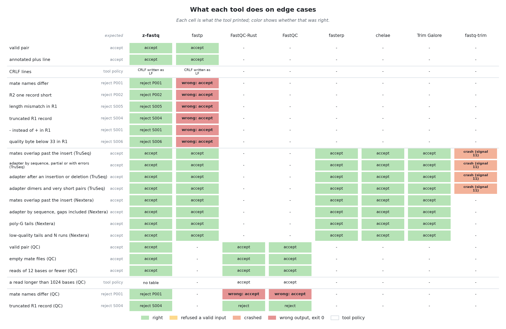
</picture>

> [!NOTE]
> A cell is the tool's verdict: `accept` (exit 0, outputs right), `reject P001` (with the rule it named), `reject`, `wrong: accept` (exit 0 on a broken pair or record), `wrong: records differ` or `wrong: table R1` (exit 0, other output), `no table` (no table written for a mate), `refused` (rejected a valid input), `crash`, or `-` (the tool has no such job). "tool policy" rows have no single right answer.

## Same reads as fastp
> Of the reads fastp 1.4.0 writes with the same settings, the share each tool writes exactly (name, bases, and qualities), both mates, mean over the 1 GiB inputs; pairs kept as a share of fastp's; and on how many inputs every read is the same (an input on which fastp keeps no pair counts when the tool keeps none either). Tools with fastp's rules must match it to be right. Tools with their own rules are right when every pair they write is a cut of its input pair in input order; this column then shows how far their rules lead from fastp's, not an error.

| Job     | Tool        | Trimming rules | Same reads as fastp | Pairs kept, of fastp's | Inputs identical |
| ------- | ----------- | -------------- | ------------------: | ---------------------: | ---------------: |
| TruSeq  | z-fastq     | fastp's        |             100.00% |                100.00% |         10 of 10 |
| TruSeq  | fastp       | fastp's        |             100.00% |                100.00% |         10 of 10 |
| TruSeq  | fasterp     | fastp's        |             100.00% |                100.00% |         10 of 10 |
| TruSeq  | chelae      | its own        |              97.24% |                 97.96% |          0 of 10 |
| TruSeq  | Trim Galore | its own        |              65.71% |                 99.38% |          0 of 10 |
| TruSeq  | fastq-trim  | its own        |              96.76% |                101.79% |           0 of 6 |
| Nextera | z-fastq     | fastp's        |             100.00% |                100.00% |         10 of 10 |
| Nextera | fastp       | fastp's        |             100.00% |                100.00% |         10 of 10 |
| Nextera | fasterp     | fastp's        |             100.00% |                100.00% |         10 of 10 |
| Nextera | chelae      | its own        |              99.48% |                100.02% |          2 of 10 |
| Nextera | Trim Galore | its own        |              65.57% |                100.03% |          2 of 10 |

## What each step costs
> Copying reads both mates, checks every pair, and writes them, with nothing else: what every job of `process` pays before its own work. One pair at 1 GiB, every tool on one CPU; each trim on the same pair, from its own job below.

<picture>
  <source media="(prefers-color-scheme: dark)" srcset="results/figures/steps-dark.png">
  <source media="(prefers-color-scheme: light)" srcset="results/figures/steps-light.png">
  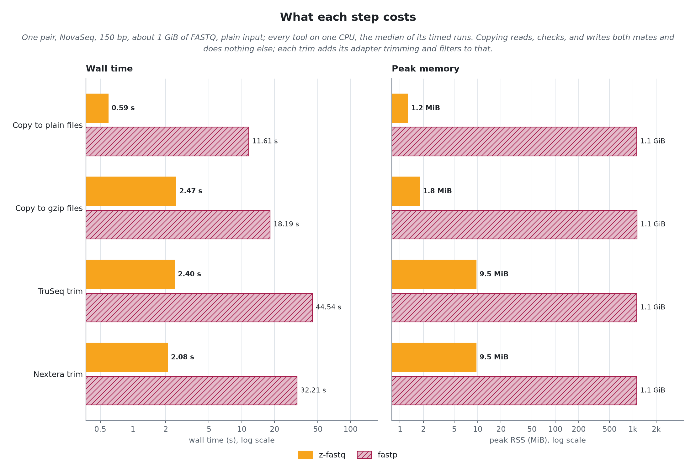
</picture>

| Step                | Tool    | Plain wall | Plain peak memory | Gzip wall | Gzip peak memory |
| ------------------- | ------- | ---------: | ----------------: | --------: | ---------------: |
| Copy to plain files | z-fastq |     590 ms |          1.25 MiB |    1.20 s |         1.25 MiB |
| Copy to plain files | fastp   |    11.61 s |           1.1 GiB |   12.34 s |          1.1 GiB |
| Copy to gzip files  | z-fastq |     2.47 s |          1.78 MiB |    3.08 s |         1.78 MiB |
| Copy to gzip files  | fastp   |    18.19 s |           1.1 GiB |   19.00 s |          1.1 GiB |
| TruSeq trim         | z-fastq |     2.40 s |          9.53 MiB |    2.70 s |         9.28 MiB |
| TruSeq trim         | fastp   |    44.54 s |           1.1 GiB |   40.21 s |          1.1 GiB |
| Nextera trim        | z-fastq |     2.08 s |          9.53 MiB |    2.69 s |         9.53 MiB |
| Nextera trim        | fastp   |    32.21 s |           1.1 GiB |   33.24 s |          1.1 GiB |

On this pair (NovaSeq, 150 bp), copying to plain files takes z-fastq 590 ms with 1.25 MiB: reading, checking, and writing are 25% of its 2.40 s TruSeq trim. fastp needs 11.61 s with 1.1 GiB for the same copy, 26% of its 44.54 s trim. Copying to gzip files instead takes z-fastq 2.47 s: compressing both mates adds 1.88 s, against 1.81 s that TruSeq trimming adds.

## Trimming
> TruSeq: TruSeq adapters, quality and N filters, minimum length 15 (rnaFusion's settings). Nextera: Nextera adapters, poly-G and quality-tail trimming, filters, minimum length 30 (FRAMEFusion's settings). The real runs and the synthetic pair at 1 GiB, plain and gzip input, in the page cache, every tool on one CPU. The other tools at 2 to 16 threads are in the threads part below.

<picture>
  <source media="(prefers-color-scheme: dark)" srcset="results/figures/trimming-overview-dark.png">
  <source media="(prefers-color-scheme: light)" srcset="results/figures/trimming-overview-light.png">
  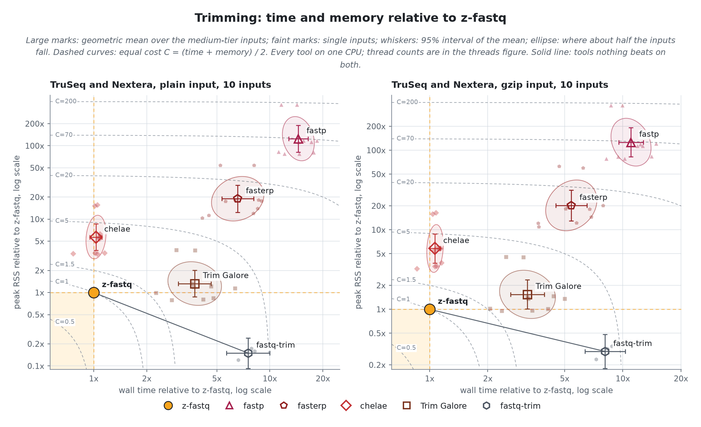
</picture>

Geometric means over the 1 GiB inputs: z-fastq's own wall time, CPU time, and memory, and every other tool's as a multiple of them. CPU time counts every thread a tool starts at its one-thread setting.

| Job     | Tool        | Plain time | Plain CPU | Plain memory | Gzip time | Gzip CPU | Gzip memory |
| ------- | ----------- | ---------: | --------: | -----------: | --------: | -------: | ----------: |
| TruSeq  | z-fastq     |     2.80 s |    2.39 s |     8.94 MiB |    3.60 s |   3.29 s |    8.86 MiB |
| TruSeq  | fastp       |     16.36x |    16.29x |      124.69x |    12.19x |   12.09x |     126.75x |
| TruSeq  | fasterp     |      8.46x |     8.79x |       19.66x |     6.66x |    6.80x |      20.84x |
| TruSeq  | chelae      |      1.07x |     1.05x |        5.66x |     1.09x |    1.08x |       5.89x |
| TruSeq  | Trim Galore |      4.66x |     4.89x |        1.29x |     3.92x |    3.94x |       1.54x |
| TruSeq  | fastq-trim  |      7.52x |     7.59x |        0.15x |     8.10x |    8.19x |       0.30x |
| Nextera | z-fastq     |     2.85 s |    2.54 s |     8.91 MiB |    3.54 s |   3.39 s |    8.91 MiB |
| Nextera | fastp       |     12.88x |    12.77x |      124.98x |     9.98x |    9.76x |     125.93x |
| Nextera | fasterp     |      5.10x |     5.31x |       18.31x |     4.40x |    4.29x |      19.71x |
| Nextera | chelae      |      0.99x |     0.98x |        5.75x |     1.05x |    1.05x |       5.75x |
| Nextera | Trim Galore |      3.01x |     3.02x |        1.36x |     2.63x |    2.62x |       1.54x |

<picture>
  <source media="(prefers-color-scheme: dark)" srcset="results/figures/trimming-speed-dark.png">
  <source media="(prefers-color-scheme: light)" srcset="results/figures/trimming-speed-light.png">
  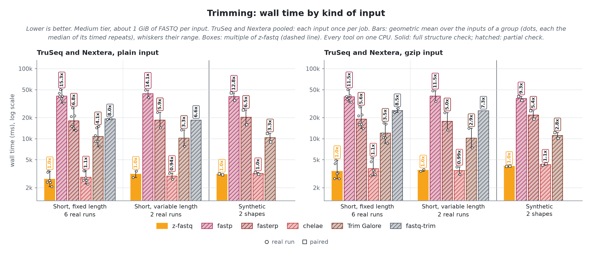
</picture>

<picture>
  <source media="(prefers-color-scheme: dark)" srcset="results/figures/trimming-memory-dark.png">
  <source media="(prefers-color-scheme: light)" srcset="results/figures/trimming-memory-light.png">
  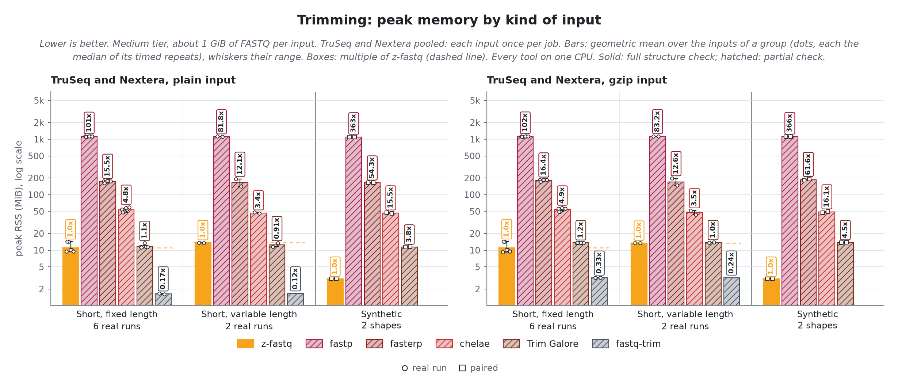
</picture>

**TruSeq.** Output per plain 1 GiB input, mean over 5 inputs: z-fastq 1025.4 MB, fastp 1025.4 MB, fasterp 1025.4 MB, chelae 1013.4 MB, Trim Galore 1023.8 MB, fastq-trim 1062.0 MB.

**Nextera.** Output per plain 1 GiB input, mean over 5 inputs: z-fastq 829.3 MB, fastp 829.3 MB, fasterp 829.3 MB, chelae 829.9 MB, Trim Galore 831.7 MB.

### Trimming: threads
> Each other tool at 1, 2, 4, 8, and 16 threads on as many physical cores (one hardware thread each), z-fastq on one, in the same batches, on one pair at 1 GiB (NovaSeq, 150 bp), plain and gzip input. Cores used is CPU time over wall time.

<picture>
  <source media="(prefers-color-scheme: dark)" srcset="results/figures/trimming-threads-dark.png">
  <source media="(prefers-color-scheme: light)" srcset="results/figures/trimming-threads-light.png">
  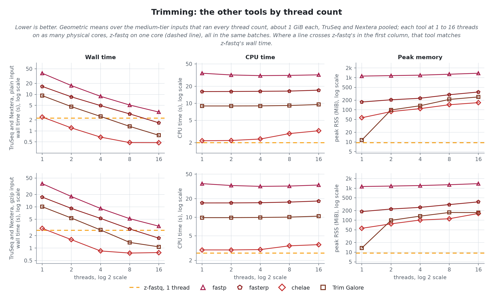
</picture>

| Job     | Tool        | Threads | Plain wall s | Plain CPU s | Plain cores used | Plain peak MiB | Gzip wall s | Gzip CPU s | Gzip cores used | Gzip peak MiB |
| ------- | ----------- | ------: | -----------: | ----------: | ---------------: | -------------: | ----------: | ---------: | --------------: | ------------: |
| TruSeq  | z-fastq     |       1 |         2.40 |        2.02 |              0.8 |            9.5 |        2.70 |       2.65 |             1.0 |           9.3 |
| TruSeq  | fastp       |       1 |        44.54 |       37.91 |              0.9 |         1119.3 |       40.21 |      38.85 |             1.0 |        1127.6 |
| TruSeq  | fastp       |       2 |        19.75 |       35.08 |              1.8 |         1162.1 |       19.82 |      36.29 |             1.8 |        1163.8 |
| TruSeq  | fastp       |       4 |         9.80 |       33.94 |              3.5 |         1200.6 |        9.92 |      34.99 |             3.5 |        1211.8 |
| TruSeq  | fastp       |       8 |         5.30 |       34.41 |              6.5 |         1278.6 |        5.62 |      34.91 |             6.2 |        1281.6 |
| TruSeq  | fastp       |      16 |         3.41 |       34.82 |             10.2 |         1372.6 |        3.47 |      36.12 |            10.4 |        1386.3 |
| TruSeq  | fasterp     |       1 |        20.75 |       20.26 |              1.0 |          175.0 |       21.34 |      21.19 |             1.0 |         186.7 |
| TruSeq  | fasterp     |       2 |        10.76 |       20.40 |              1.9 |          205.1 |       11.54 |      21.23 |             1.8 |         221.0 |
| TruSeq  | fasterp     |       4 |         6.16 |       20.58 |              3.3 |          229.8 |        6.31 |      21.41 |             3.4 |         253.7 |
| TruSeq  | fasterp     |       8 |         3.29 |       20.71 |              6.3 |          295.5 |        3.63 |      22.15 |             6.1 |         307.1 |
| TruSeq  | fasterp     |      16 |         1.97 |       21.16 |             10.7 |          354.2 |        2.22 |      23.12 |            10.4 |         364.1 |
| TruSeq  | chelae      |       1 |         2.56 |        2.16 |              0.8 |           53.9 |        2.96 |       2.91 |             1.0 |          56.0 |
| TruSeq  | chelae      |       2 |         1.23 |        2.17 |              1.8 |           90.0 |        1.64 |       2.92 |             1.8 |          80.0 |
| TruSeq  | chelae      |       4 |         0.67 |        2.27 |              3.4 |          108.1 |        0.84 |       2.97 |             3.5 |         102.1 |
| TruSeq  | chelae      |       8 |         0.47 |        2.85 |              6.1 |          140.0 |        0.75 |       3.33 |             4.5 |         114.3 |
| TruSeq  | chelae      |      16 |         0.47 |        3.25 |              6.9 |          166.2 |        0.78 |       3.59 |             4.6 |         164.2 |
| TruSeq  | Trim Galore |       1 |        11.15 |       10.88 |              1.0 |           11.6 |       11.80 |      11.63 |             1.0 |          13.5 |
| TruSeq  | Trim Galore |       2 |         5.54 |       10.79 |              1.9 |           97.9 |        6.25 |      11.68 |             1.9 |          97.9 |
| TruSeq  | Trim Galore |       4 |         3.02 |       10.82 |              3.6 |          134.0 |        3.22 |      11.73 |             3.6 |         133.8 |
| TruSeq  | Trim Galore |       8 |         1.52 |       10.92 |              7.2 |          197.7 |        1.62 |      11.84 |             7.3 |         191.6 |
| TruSeq  | Trim Galore |      16 |         0.83 |       11.25 |             13.5 |          319.9 |        1.09 |      12.34 |            11.3 |         191.9 |
| TruSeq  | fastq-trim  |       1 |        18.93 |       16.61 |              0.9 |            1.7 |       23.70 |      23.29 |             1.0 |           3.2 |
| Nextera | z-fastq     |       1 |         2.08 |        1.99 |              1.0 |            9.5 |        2.69 |       2.60 |             1.0 |           9.5 |
| Nextera | fastp       |       1 |        32.21 |       30.75 |              1.0 |         1119.6 |       33.24 |      31.68 |             1.0 |        1127.6 |
| Nextera | fastp       |       2 |        15.33 |       28.89 |              1.9 |         1152.8 |       16.04 |      29.51 |             1.8 |        1163.6 |
| Nextera | fastp       |       4 |         7.99 |       28.27 |              3.5 |         1193.1 |        8.44 |      28.73 |             3.4 |        1207.6 |
| Nextera | fastp       |       8 |         4.93 |       28.43 |              5.8 |         1279.3 |        4.76 |      29.44 |             6.2 |        1282.1 |
| Nextera | fastp       |      16 |         3.16 |       29.36 |              9.3 |         1372.8 |        3.35 |      30.70 |             9.2 |        1383.1 |
| Nextera | fasterp     |       1 |        13.16 |       12.87 |              1.0 |          174.9 |       13.98 |      13.74 |             1.0 |         185.2 |
| Nextera | fasterp     |       2 |         6.80 |       12.86 |              1.9 |          204.9 |        7.31 |      13.75 |             1.9 |         225.1 |
| Nextera | fasterp     |       4 |         3.95 |       12.94 |              3.3 |          227.9 |        4.37 |      13.83 |             3.2 |         249.6 |
| Nextera | fasterp     |       8 |         2.60 |       13.10 |              5.0 |          293.4 |        2.35 |      14.02 |             6.0 |         307.3 |
| Nextera | fasterp     |      16 |         1.41 |       13.81 |              9.8 |          362.1 |        1.37 |      14.54 |            10.6 |         382.6 |
| Nextera | chelae      |       1 |         2.26 |        2.17 |              1.0 |           59.8 |        3.07 |       3.00 |             1.0 |          55.8 |
| Nextera | chelae      |       2 |         1.19 |        2.21 |              1.9 |           86.0 |        1.57 |       2.98 |             1.9 |          73.8 |
| Nextera | chelae      |       4 |         0.68 |        2.38 |              3.5 |          109.9 |        0.87 |       3.01 |             3.5 |          99.9 |
| Nextera | chelae      |       8 |         0.49 |        2.96 |              6.0 |          148.0 |        0.77 |       3.55 |             4.6 |         107.9 |
| Nextera | chelae      |      16 |         0.48 |        3.26 |              6.8 |          168.2 |        0.78 |       3.60 |             4.6 |         160.2 |
| Nextera | Trim Galore |       1 |         7.66 |        7.38 |              1.0 |           11.4 |        8.62 |       8.35 |             1.0 |          13.5 |
| Nextera | Trim Galore |       2 |         3.86 |        7.45 |              1.9 |           99.8 |        4.60 |       8.32 |             1.8 |         100.0 |
| Nextera | Trim Galore |       4 |         2.06 |        7.48 |              3.6 |          133.7 |        2.36 |       8.40 |             3.6 |         134.0 |
| Nextera | Trim Galore |       8 |         1.16 |        7.65 |              6.6 |          223.7 |        1.17 |       8.53 |             7.3 |         158.0 |
| Nextera | Trim Galore |      16 |         0.69 |        8.03 |             11.6 |          198.0 |        1.07 |       8.80 |             8.3 |         155.9 |

**TruSeq.** fastp does not match z-fastq on one core at any thread count up to 16, on plain or gzip input. fasterp matches z-fastq on one core from 16 threads on plain input (0.82x z-fastq's time for 10.5x its CPU time), and from 16 threads on gzip input (0.82x z-fastq's time for 8.7x its CPU time). chelae matches z-fastq on one core from 2 threads on plain input (0.51x z-fastq's time for 1.1x its CPU time), and from 2 threads on gzip input (0.61x z-fastq's time for 1.1x its CPU time). Trim Galore matches z-fastq on one core from 8 threads on plain input (0.63x z-fastq's time for 5.4x its CPU time), and from 8 threads on gzip input (0.60x z-fastq's time for 4.5x its CPU time). fastq-trim does not match z-fastq on one core at any thread count up to 1, on plain or gzip input.

**Nextera.** fastp does not match z-fastq on one core at any thread count up to 16, on plain or gzip input. fasterp matches z-fastq on one core from 16 threads on plain input (0.68x z-fastq's time for 6.9x its CPU time), and from 8 threads on gzip input (0.87x z-fastq's time for 5.4x its CPU time). chelae matches z-fastq on one core from 2 threads on plain input (0.57x z-fastq's time for 1.1x its CPU time), and from 2 threads on gzip input (0.58x z-fastq's time for 1.1x its CPU time). Trim Galore matches z-fastq on one core from 4 threads on plain input (0.99x z-fastq's time for 3.8x its CPU time), and from 4 threads on gzip input (0.88x z-fastq's time for 3.2x its CPU time).

### Trimming: scaling
> The synthetic pair from 1 MiB to 1 GiB, every tool on one CPU: throughput and peak memory by input size.

<picture>
  <source media="(prefers-color-scheme: dark)" srcset="results/figures/trimming-scaling-dark.png">
  <source media="(prefers-color-scheme: light)" srcset="results/figures/trimming-scaling-light.png">
  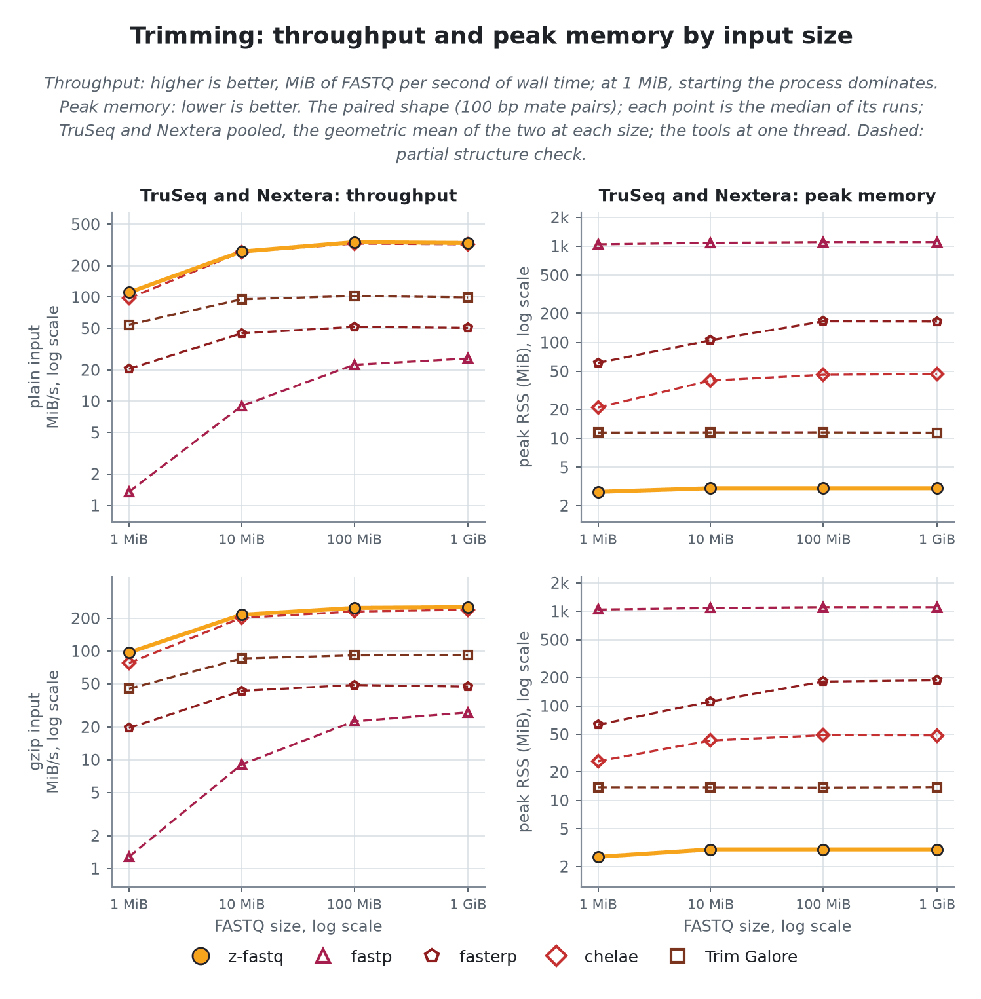
</picture>

**TruSeq.** At 1 GiB, z-fastq processes 0.3 GiB/s on plain input and 0.2 GiB/s on gzip input; no other tool is faster there.
z-fastq peaks at 2.53 to 3.03 MiB across the sizes of the paired shape. Memory that grows with the input: fasterp by 2.9x on gzip paired; chelae by 2.2x on plain paired.
**Nextera.** At 1 GiB, z-fastq processes 0.3 GiB/s on plain input and 0.2 GiB/s on gzip input; no other tool is faster there.
z-fastq peaks at 2.53 to 3.03 MiB across the sizes of the paired shape. Memory that grows with the input: fasterp by 3.0x on gzip paired; chelae by 2.3x on plain paired.

## QC tables
> FastQC tables: FastQC tables for both mates, no trimming. The real runs and the synthetic pair at 1 GiB, plain and gzip input, in the page cache, every tool on one CPU. The other tools at 2 to 16 threads are in the threads part below.

<picture>
  <source media="(prefers-color-scheme: dark)" srcset="results/figures/qc-overview-dark.png">
  <source media="(prefers-color-scheme: light)" srcset="results/figures/qc-overview-light.png">
  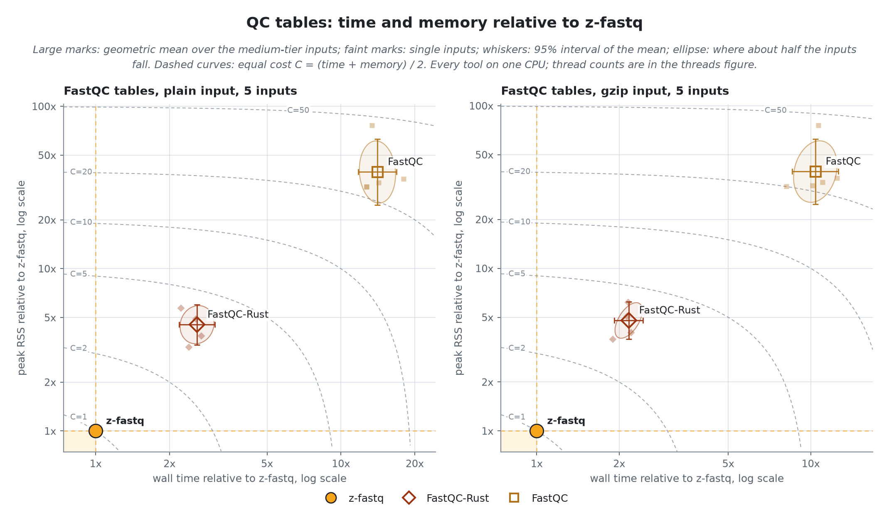
</picture>

Geometric means over the 1 GiB inputs: z-fastq's own wall time, CPU time, and memory, and every other tool's as a multiple of them. CPU time counts every thread a tool starts at its one-thread setting.

| Job           | Tool        | Plain time | Plain CPU | Plain memory | Gzip time | Gzip CPU | Gzip memory |
| ------------- | ----------- | ---------: | --------: | -----------: | --------: | -------: | ----------: |
| FastQC tables | z-fastq     |     1.60 s |    1.51 s |     6.37 MiB |    2.57 s |   2.44 s |    6.37 MiB |
| FastQC tables | FastQC-Rust |      2.59x |     2.66x |        4.52x |     2.17x |    2.14x |       4.78x |
| FastQC tables | FastQC      |     14.09x |    13.41x |       39.40x |    10.39x |    9.74x |      39.38x |

<picture>
  <source media="(prefers-color-scheme: dark)" srcset="results/figures/qc-speed-dark.png">
  <source media="(prefers-color-scheme: light)" srcset="results/figures/qc-speed-light.png">
  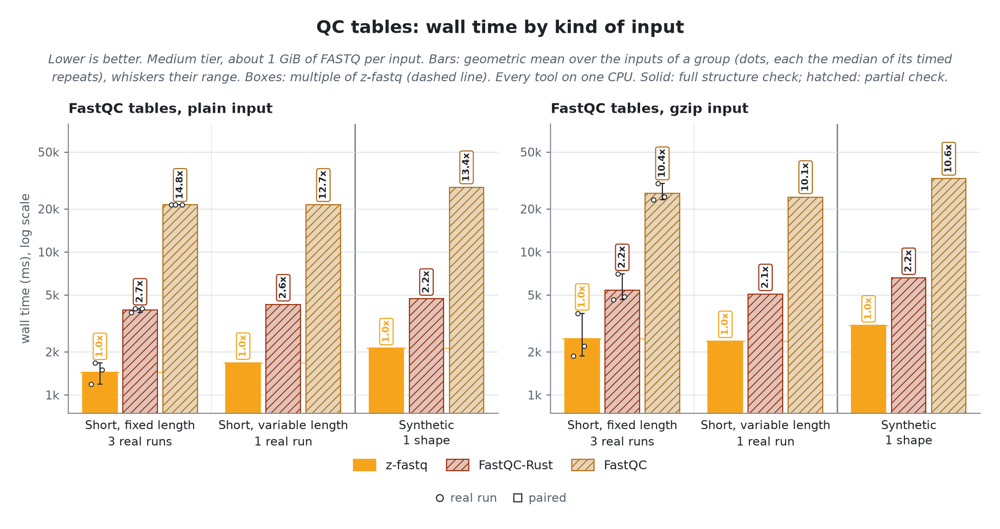
</picture>

<picture>
  <source media="(prefers-color-scheme: dark)" srcset="results/figures/qc-memory-dark.png">
  <source media="(prefers-color-scheme: light)" srcset="results/figures/qc-memory-light.png">
  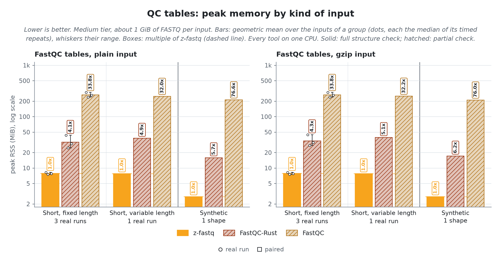
</picture>

**FastQC tables.** Output per plain 1 GiB input, mean over 5 inputs: z-fastq 1073.9 MB (both mates in full, which this job cannot skip, and its tables), FastQC-Rust 0.8 MB (tables only), FastQC 0.8 MB (tables only).

### QC tables: threads
> Each other tool at 1, 2, 4, 8, and 16 threads on as many physical cores (one hardware thread each), z-fastq on one, in the same batches, on one pair at 1 GiB (NovaSeq, 150 bp), plain and gzip input. Cores used is CPU time over wall time.

<picture>
  <source media="(prefers-color-scheme: dark)" srcset="results/figures/qc-threads-dark.png">
  <source media="(prefers-color-scheme: light)" srcset="results/figures/qc-threads-light.png">
  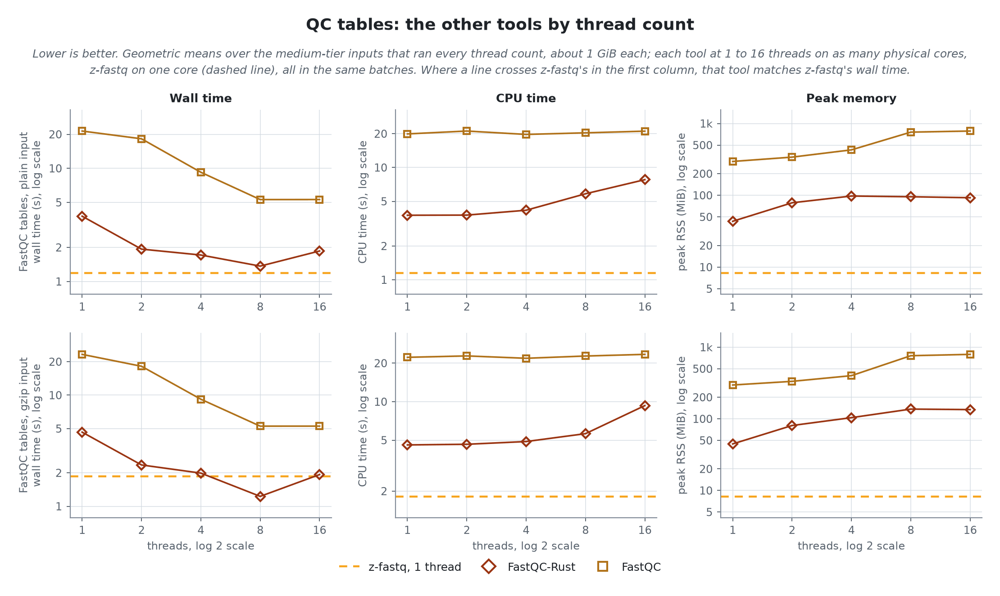
</picture>

| Job           | Tool        | Threads | Plain wall s | Plain CPU s | Plain cores used | Plain peak MiB | Gzip wall s | Gzip CPU s | Gzip cores used | Gzip peak MiB |
| ------------- | ----------- | ------: | -----------: | ----------: | ---------------: | -------------: | ----------: | ---------: | --------------: | ------------: |
| FastQC tables | z-fastq     |       1 |         1.19 |        1.15 |              1.0 |            8.3 |        1.87 |       1.82 |             1.0 |           8.3 |
| FastQC tables | FastQC-Rust |       1 |         3.78 |        3.76 |              1.0 |           43.5 |        4.65 |       4.59 |             1.0 |          44.7 |
| FastQC tables | FastQC-Rust |       2 |         1.93 |        3.77 |              1.9 |           78.7 |        2.35 |       4.65 |             2.0 |          80.7 |
| FastQC tables | FastQC-Rust |       4 |         1.71 |        4.16 |              2.4 |           97.7 |        1.99 |       4.88 |             2.5 |         103.9 |
| FastQC tables | FastQC-Rust |       8 |         1.37 |        5.83 |              4.3 |           95.5 |        1.23 |       5.62 |             4.6 |         136.8 |
| FastQC tables | FastQC-Rust |      16 |         1.86 |        7.79 |              4.2 |           92.5 |        1.93 |       9.32 |             4.8 |         134.6 |
| FastQC tables | FastQC      |       1 |        21.37 |       19.92 |              0.9 |          296.1 |       23.28 |      22.22 |             1.0 |         296.7 |
| FastQC tables | FastQC      |       2 |        18.25 |       21.13 |              1.2 |          340.1 |       18.20 |      22.78 |             1.3 |         333.6 |
| FastQC tables | FastQC      |       4 |         9.23 |       19.71 |              2.1 |          429.2 |        9.19 |      21.84 |             2.4 |         400.5 |
| FastQC tables | FastQC      |       8 |         5.30 |       20.37 |              3.8 |          757.7 |        5.26 |      22.74 |             4.3 |         760.6 |
| FastQC tables | FastQC      |      16 |         5.30 |       21.07 |              4.0 |          785.0 |        5.26 |      23.43 |             4.5 |         794.1 |

**FastQC tables.** FastQC-Rust matches z-fastq on one core from 8 threads on gzip input (0.66x z-fastq's time for 3.1x its CPU time); on plain input no thread count up to 16 does. FastQC does not match z-fastq on one core at any thread count up to 16, on plain or gzip input.

### QC tables: scaling
> The synthetic pair from 1 MiB to 1 GiB, every tool on one CPU: throughput and peak memory by input size.

<picture>
  <source media="(prefers-color-scheme: dark)" srcset="results/figures/qc-scaling-dark.png">
  <source media="(prefers-color-scheme: light)" srcset="results/figures/qc-scaling-light.png">
  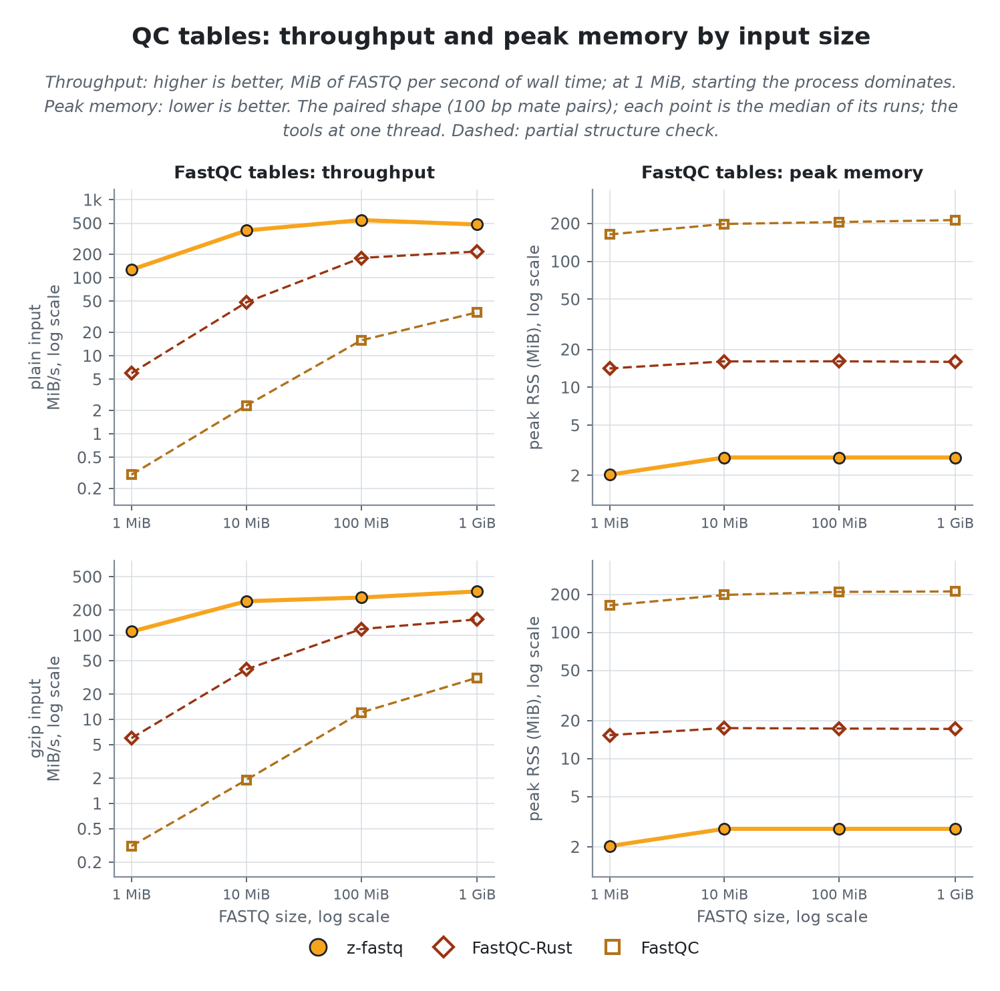
</picture>

**FastQC tables.** At 1 GiB, z-fastq processes 0.5 GiB/s on plain input and 0.3 GiB/s on gzip input; no other tool is faster there.
z-fastq peaks at 2.03 to 2.78 MiB across the sizes of the paired shape. Memory that grows with the input: FastQC by 1.3x on plain paired.

## Reproducibility

How it was measured

Every tool runs through `zexec -r` inside one zebrac batch per case, held to one CPU core by a systemd scope with a CPU quota and a 16G memory cap; a batch with threaded variants holds as many physical cores as its largest lane, one logical CPU each, with each lane pinned to its own cores and z-fastq to one, after the input was read once so every run reads from the page cache. zebrac gives wall time; zexec records each run's peak memory, CPU time, and minor faults for the tool alone. Peak RSS is the kernel's peak counter that `wait4` reports, which can lag the true peak by up to about 0.5 MiB, so memory differences smaller than that are inconclusive. Runs per tier, each after one warmup: tiny 31, xsmall 21, small 11, medium 3; sizes 1 MiB to 1 GiB. Timed by `bench/process/run.sh release`.

Identity

- `z-fastq`: *0.3.0*
- `zebrac`: *0.6.2*
- `zexec`: *15000 bytes, static, no libc*
- `cpu`: *AMD Ryzen 9 3950X 16-Core Processor*
- `load at batch start`: *2.60 to 8.10*

Commands

- `z-fastq`: *zig-out/bin/z-fastq process --out1 {stem}_1.fq --out2 {stem}_2.fq IN*
- `fastp`: *tools/bin/fastp -i IN -I IN -o {stem}_1.fq -O {stem}_2.fq -A -G -Q -L -w 1 -j {stem}.json -h {stem}.html*; also with -w 2, -w 4, -w 8, -w 16
- `FastQC-Rust`: *tools/bin/fastqc-rust --threads 1 -o {stem}.qc IN*; also with -t 2, -t 4, -t 8, -t 16
- `FastQC`: *tools/bin/fastqc --threads 1 --quiet --outdir {stem}.qc IN*; also with -t 2, -t 4, -t 8, -t 16
- `fasterp`: *tools/bin/fasterp -i IN -I IN -o {stem}_1.fq -O {stem}_2.fq --adapter_sequence AGATCGGAAGAGCACACGTCTGAACTCCAGTCA --adapter_sequence_r2 AGATCGGAAGAGCGTCGTGTAGGGAAAGAGTGT --disable_trim_poly_g -q 15 -u 40 -n 5 -l 15 -w 1 -j {stem}.json -h {stem}.html*; also with -w 2, -w 4, -w 8, -w 16
- `chelae`: *tools/bin/chelae trim -i IN IN -o {stem}_1.fq {stem}_2.fq -a AGATCGGAAGAGCACACGTCTGAACTCCAGTCA AGATCGGAAGAGCGTCGTGTAGGGAAAGAGTGT --trim-polyg 0 --filter-low-qual 15:0.4 --filter-max-ns 5 -l 15 -t 1*; also with -t 2, -t 4, -t 8, -t 16
- `Trim Galore`: *tools/bin/trim_galore --paired -a AGATCGGAAGAGCACACGTCTGAACTCCAGTCA -a2 AGATCGGAAGAGCGTCGTGTAGGGAAAGAGTGT --no_poly_g -q 0 --max_n 5 --length 15 --dont_gzip --no_report_file --cores 1 --basename o -o {stem}.tg IN IN*; also with --cores 2, --cores 4, --cores 8, --cores 16
- `fastq-trim`: *tools/bin/fastq-trim --3p-adapter1 AGATCGGAAGAGCACACGTCTGAACTCCAGTCA --3p-adapter2 AGATCGGAAGAGCGTCGTGTAGGGAAAGAGTGT --min-length 15 --min-qual 1 IN {stem}_1.fq IN {stem}_2.fq*
- `z-fastq`, Trimming, TruSeq settings: *zig-out/bin/z-fastq process --adapter1 AGATCGGAAGAGCACACGTCTGAACTCCAGTCA --adapter2 AGATCGGAAGAGCGTCGTGTAGGGAAAGAGTGT --low-quality 15 --max-low-quality-percent 40 --max-n 5 --min-length 15 --pair-duplication --qc-summary {stem}.json --out1 {stem}_1.fq --out2 {stem}_2.fq IN*
- `fastp`, Trimming, TruSeq settings: *tools/bin/fastp -i IN -I IN -o {stem}_1.fq -O {stem}_2.fq --adapter_sequence AGATCGGAAGAGCACACGTCTGAACTCCAGTCA --adapter_sequence_r2 AGATCGGAAGAGCGTCGTGTAGGGAAAGAGTGT --disable_trim_poly_g -q 15 -u 40 -n 5 -l 15 -w 1 -j {stem}.json -h {stem}.html*; also with -w 2, -w 4, -w 8, -w 16
- `fasterp`, Trimming, TruSeq settings: *tools/bin/fasterp -i IN -I IN -o {stem}_1.fq -O {stem}_2.fq --adapter_sequence AGATCGGAAGAGCACACGTCTGAACTCCAGTCA --adapter_sequence_r2 AGATCGGAAGAGCGTCGTGTAGGGAAAGAGTGT --disable_trim_poly_g -q 15 -u 40 -n 5 -l 15 -w 1 -j {stem}.json -h {stem}.html*; also with -w 2, -w 4, -w 8, -w 16
- `chelae`, Trimming, TruSeq settings: *tools/bin/chelae trim -i IN IN -o {stem}_1.fq {stem}_2.fq -a AGATCGGAAGAGCACACGTCTGAACTCCAGTCA AGATCGGAAGAGCGTCGTGTAGGGAAAGAGTGT --trim-polyg 0 --filter-low-qual 15:0.4 --filter-max-ns 5 -l 15 -t 1*; also with -t 2, -t 4, -t 8, -t 16
- `Trim Galore`, Trimming, TruSeq settings: *tools/bin/trim_galore --paired -a AGATCGGAAGAGCACACGTCTGAACTCCAGTCA -a2 AGATCGGAAGAGCGTCGTGTAGGGAAAGAGTGT --no_poly_g -q 0 --max_n 5 --length 15 --dont_gzip --no_report_file --cores 1 --basename o -o {stem}.tg IN IN*; also with --cores 2, --cores 4, --cores 8, --cores 16
- `fastq-trim`, Trimming, TruSeq settings: *tools/bin/fastq-trim --3p-adapter1 AGATCGGAAGAGCACACGTCTGAACTCCAGTCA --3p-adapter2 AGATCGGAAGAGCGTCGTGTAGGGAAAGAGTGT --min-length 15 --min-qual 1 IN {stem}_1.fq IN {stem}_2.fq*
- `z-fastq`, Trimming, Nextera settings: *zig-out/bin/z-fastq process --adapter1 CTGTCTCTTATACACATCT --adapter2 CTGTCTCTTATACACATCT --trim-poly-g 10 --trim-tail-window 4 --trim-tail-quality 20 --low-quality 15 --max-low-quality-percent 40 --max-n 5 --min-length 30 --pair-duplication --qc-summary {stem}.json --out1 {stem}_1.fq --out2 {stem}_2.fq IN*
- `fastp`, Trimming, Nextera settings: *tools/bin/fastp -i IN -I IN -o {stem}_1.fq -O {stem}_2.fq --adapter_sequence CTGTCTCTTATACACATCT --adapter_sequence_r2 CTGTCTCTTATACACATCT --trim_poly_g --poly_g_min_len 10 --cut_tail --cut_tail_window_size 4 --cut_tail_mean_quality 20 -q 15 -u 40 -n 5 -l 30 -w 1 -j {stem}.json -h {stem}.html*; also with -w 2, -w 4, -w 8, -w 16
- `fasterp`, Trimming, Nextera settings: *tools/bin/fasterp -i IN -I IN -o {stem}_1.fq -O {stem}_2.fq --adapter_sequence CTGTCTCTTATACACATCT --adapter_sequence_r2 CTGTCTCTTATACACATCT --trim_poly_g --poly_g_min_len 10 --cut_tail --cut_tail_window_size 4 --cut_tail_mean_quality 20 -q 15 -u 40 -n 5 -l 30 -w 1 -j {stem}.json -h {stem}.html*; also with -w 2, -w 4, -w 8, -w 16
- `chelae`, Trimming, Nextera settings: *tools/bin/chelae trim -i IN IN -o {stem}_1.fq {stem}_2.fq -a CTGTCTCTTATACACATCT CTGTCTCTTATACACATCT --trim-polyg 10 --quality-trim-3p 4:20 --filter-low-qual 15:0.4 --filter-max-ns 5 -l 30 -t 1*; also with -t 2, -t 4, -t 8, -t 16
- `Trim Galore`, Trimming, Nextera settings: *tools/bin/trim_galore --paired --nextera --poly_g -q 20 --max_n 5 --length 30 --dont_gzip --no_report_file --cores 1 --basename o -o {stem}.tg IN IN*; also with --cores 2, --cores 4, --cores 8, --cores 16
- `z-fastq`, QC tables: *zig-out/bin/z-fastq process --qc-tables {stem}.qc --contaminants {fastqc}/Configuration/contaminant_list.txt --out1 {stem}_1.fq --out2 {stem}_2.fq IN*
- `z-fastq`, Copying into gzip files: *zig-out/bin/z-fastq process --gzip --out1 {stem}_1.fq.gz --out2 {stem}_2.fq.gz IN*
- `fastp`, Copying into gzip files: *tools/bin/fastp -i IN -I IN -o {stem}_1.fq.gz -O {stem}_2.fq.gz -A -G -Q -L -w 1 -j {stem}.json -h {stem}.html*

Quick-check cases for peer and ab

Picked from these results: per family, group, and format, the case where z-fastq is closest to, or furthest behind, its fastest rival of any class. `run.sh peer` times z-fastq against a cached reference of the rival on each; `run.sh ab REV` times two z-fastq builds on each.

- `Trimming, TruSeq settings: Short, fixed length, plain`: *NovaSeq, 150 bp*; rival chelae -t 8 at 0.19x z-fastq's time; memory rival fastq-trim
- `Trimming, TruSeq settings: Short, variable length, plain`: *10x mates, 28 and 150 bp*; rival chelae at 1.15x z-fastq's time; memory rival fastq-trim
- `Trimming, TruSeq settings: Synthetic, plain`: *paired: 100 bp mate pairs*; rival chelae at 1.05x z-fastq's time
- `Trimming, TruSeq settings: Short, fixed length, gzip`: *NovaSeq, 150 bp*; rival chelae -t 8 at 0.28x z-fastq's time; memory rival fastq-trim
- `Trimming, TruSeq settings: Short, variable length, gzip`: *10x mates, 28 and 150 bp*; rival chelae at 1.15x z-fastq's time; memory rival fastq-trim
- `Trimming, TruSeq settings: Synthetic, gzip`: *paired: 100 bp mate pairs*; rival chelae at 1.04x z-fastq's time
- `Trimming, Nextera settings: Short, fixed length, plain`: *NovaSeq, 150 bp*; rival chelae -t 16 at 0.23x z-fastq's time
- `Trimming, Nextera settings: Short, variable length, plain`: *10x mates, 28 and 150 bp*; rival chelae at 0.76x z-fastq's time; memory rival Trim Galore
- `Trimming, Nextera settings: Synthetic, plain`: *paired: 100 bp mate pairs*; rival chelae at 1.01x z-fastq's time
- `Trimming, Nextera settings: Short, fixed length, gzip`: *NovaSeq, 150 bp*; rival chelae -t 8 at 0.29x z-fastq's time
- `Trimming, Nextera settings: Short, variable length, gzip`: *10x mates, 28 and 150 bp*; rival chelae at 0.86x z-fastq's time
- `Trimming, Nextera settings: Synthetic, gzip`: *paired: 100 bp mate pairs*; rival chelae at 1.07x z-fastq's time
- `QC tables: Short, fixed length, plain`: *NovaSeq, 150 bp*; rival FastQC-Rust -t 8 at 1.15x z-fastq's time
- `QC tables: Short, variable length, plain`: *10x mates, 28 and 150 bp*; rival FastQC-Rust at 2.56x z-fastq's time
- `QC tables: Synthetic, plain`: *paired: 100 bp mate pairs*; rival FastQC-Rust at 2.22x z-fastq's time
- `QC tables: Short, fixed length, gzip`: *NovaSeq, 150 bp*; rival FastQC-Rust -t 8 at 0.66x z-fastq's time
- `QC tables: Short, variable length, gzip`: *10x mates, 28 and 150 bp*; rival FastQC-Rust at 2.13x z-fastq's time
- `QC tables: Synthetic, gzip`: *paired: 100 bp mate pairs*; rival FastQC-Rust at 2.15x z-fastq's time
- `Copying into plain files: Short, fixed length, plain`: *NovaSeq, 150 bp*; rival fastp at 19.67x z-fastq's time
- `Copying into plain files: Short, fixed length, gzip`: *NovaSeq, 150 bp*; rival fastp at 10.29x z-fastq's time
- `Copying into gzip files: Short, fixed length, plain`: *NovaSeq, 150 bp*; rival fastp at 7.36x z-fastq's time
- `Copying into gzip files: Short, fixed length, gzip`: *NovaSeq, 150 bp*; rival fastp at 6.17x z-fastq's time

Hardware counters (user space, plain medium-tier inputs, geometric means, tools at one thread)

| Job                        | Tool        | Instructions per byte | Instructions per cycle | Cache misses per MiB | Branch misses per MiB |
| -------------------------- | ----------- | --------------------: | ---------------------: | -------------------: | --------------------: |
| Trimming, TruSeq settings  | z-fastq     |                 17.80 |                   2.51 |                30637 |                 26291 |
| Trimming, TruSeq settings  | fastp       |                289.15 |                   2.70 |               248904 |                765611 |
| Trimming, TruSeq settings  | fasterp     |                163.17 |                   2.30 |                67361 |               1143504 |
| Trimming, TruSeq settings  | chelae      |                 17.86 |                   2.67 |                27823 |                 27970 |
| Trimming, TruSeq settings  | Trim Galore |                106.21 |                   2.82 |                29132 |                219730 |
| Trimming, TruSeq settings  | fastq-trim  |                 87.30 |                   1.71 |                12272 |                497115 |
| Trimming, Nextera settings | z-fastq     |                 19.52 |                   2.54 |                30552 |                 28619 |
| Trimming, Nextera settings | fastp       |                244.37 |                   2.74 |               189205 |                706816 |
| Trimming, Nextera settings | fasterp     |                110.36 |                   2.44 |                58268 |                503923 |
| Trimming, Nextera settings | chelae      |                 18.23 |                   2.65 |                26669 |                 30205 |
| Trimming, Nextera settings | Trim Galore |                 62.57 |                   2.57 |                22191 |                166568 |
| QC tables                  | z-fastq     |                  9.59 |                   2.37 |                30976 |                  8809 |
| QC tables                  | FastQC-Rust |                 32.20 |                   2.41 |                26423 |                 44778 |
| QC tables                  | FastQC      |                100.75 |                   1.48 |               391692 |                982036 |
| Copying into plain files   | z-fastq     |                  2.09 |                   2.60 |                 5087 |                   426 |
| Copying into plain files   | fastp       |                 78.70 |                   2.66 |                92450 |                 61382 |
| Copying into gzip files    | z-fastq     |                 19.04 |                   2.39 |                36358 |                 30161 |
| Copying into gzip files    | fastp       |                130.27 |                   2.40 |               141564 |                318779 |

