<!-- markdownlint-disable MD013 MD033 MD041 -->

# Processing paired reads
> `z-fastq process` against 3 other tools, on 4 real sequencing runs and 1 synthetic shape, plain and gzip. A tool is timed only where its outputs were right; time and memory come from the same run, on one CPU, a threaded variant on as many cores as its threads.

- `z-fastq`: *0.1.0, source at 246bbb1*
- `machine`: *Ryzen 9 3950X, Linux 7.2.13; one CPU per run, threaded variants on as many cores as threads*
- `runner`: *zebrac 0.6.2 with zexec*
- `data`:
  - **Real**: *4 public sequencing runs, 1 GiB each, pooled in the bars by the kind of reads they hold*
    - `Short, fixed length`: *NovaSeq, 150 bp; NovaSeq, Casava headers; BGISEQ, 100 bp*
    - `Short, variable length`: *10x mates, 28 and 150 bp*
  - **Synthetic**: *1 shape generated from real reads, each changing one thing; one group in the bars at 1 GiB, and the scaling lines from 1 MiB to 1 GiB*
    - `paired`: *100 bp mate pairs*
- `date`: *2026-10-30*

## Findings

- **Right answers:** z-fastq wrote the right copies, fastp's records, and FastQC's tables on all 52 checked inputs and rejected every broken pair and record. 3 of the 3 other tools write output from a broken pair or record with exit 0.
- **Reading and writing a pair:** z-fastq copies one 1 GiB pair to plain files in 652 ms and to gzip files in 2.60 s; fastp takes 11.63 s and 18.30 s at one thread, holding 1.1 GiB.
- **Gzip output size:** on that pair, z-fastq's default `fast` preset writes 216.4 MB, 16% more than fastp's 185.9 MB at its default level 4; `--gzip-preset even` or `dense` writes less, more slowly.
- **Trimming, TruSeq settings:** fastp takes 12.2x z-fastq's time on plain input and 9.3x on gzip, with 76x its memory; at its fastest, 16 threads, 1.09x z-fastq's time for 11.3x its CPU time.
- **Trimming, Nextera settings:** fastp takes 9.9x z-fastq's time on plain input and 7.7x on gzip, with 76x its memory; at its fastest, 16 threads, 0.99x z-fastq's time for 9.4x its CPU time (faster than z-fastq from 16 threads).
- **QC tables:** FastQC-Rust takes 2.1x z-fastq's time on plain input and 1.7x on gzip, with 3x its memory; at its fastest, 8 threads, 0.89x z-fastq's time for 3.6x its CPU time (faster than z-fastq from 4 threads); FastQC takes 11.6x z-fastq's time on plain input and 8.1x on gzip, with 25x its memory; at its fastest, 16 threads, 2.87x z-fastq's time for 11.2x its CPU time.

## Compared tools
> *partial* tools do less than z-fastq: fastp checks records less strictly, and the FastQC tools write no reads and check no pairs. A job is `yes` when the tool was right on every input of it, `partly` on some, `-` when the tool has no such job. Threads: z-fastq runs on one; in the trimming and QC jobs every other tool runs at 1 thread and again at 2, 4, 8, and 16 on as many physical cores, at the 1 GiB inputs, in the same batches as z-fastq; copying runs every tool on one. Malformed rejected: of the broken pairs and records in the edge cases, how many the tool rejects.

| Tool        | Class   | Copy to plain | Copy to gzip | TruSeq trim | Nextera trim | QC tables | Threads      | Malformed rejected |
| ----------- | ------- | ------------- | ------------ | ----------- | ------------ | --------- | ------------ | -----------------: |
| z-fastq     | subject | yes           | yes          | yes         | yes          | yes       | 1            |             8 of 8 |
| fastp       | partial | yes           | yes          | yes         | yes          | -         | 1 to 16 (-w) |             0 of 8 |
| FastQC-Rust | partial | -             | -            | -           | -            | yes       | 1 to 16 (-t) |             1 of 8 |
| FastQC      | partial | -             | -            | -           | -            | yes       | 1 to 16 (-t) |             1 of 8 |

- `fastp 1.4.0`: *writes its JSON and HTML report and measures duplication on every run; compression level 4*
- `FastQC-Rust 1.1.0`: *QC tables only, no reads written and no pair checks; the QC tables' reference*
- `FastQC 0.13.0`: *QC tables only, no reads written and no pair checks; a Java program whose JVM starts its own threads*

> [!IMPORTANT]
> fastp computes its QC report and pair duplication on every run, so z-fastq's trimming lanes write the QC summary and measure pair duplication too. In the QC job z-fastq also writes both mates, which it cannot skip, while the FastQC tools write tables only.

## Right answers
> Copies must equal the corpus pairs byte for byte. Trimmed pairs must hold the records fastp 1.4.0 keeps with the same settings, and every field of z-fastq's QC summary must equal fastp's (its own schema and tool names aside); fastp itself is that reference. QC tables must equal FastQC-Rust's `fastqc_data.txt` without its version and file name lines, tied overrepresented rows in sorted order. The edge cases are small inputs where tools differ: each cell shows what the tool printed, and its color whether that was right.

z-fastq returned right outputs on all 52 inputs it was timed on. Every other tool was right on every input it was timed on.

> [!CAUTION]
> On the edge cases below, fastp, FastQC-Rust and FastQC print wrong output and exit 0 on some malformed inputs, so a script cannot tell the pairs are broken.

<picture>
  <source media="(prefers-color-scheme: dark)" srcset="results/figures/edges-dark.png">
  <source media="(prefers-color-scheme: light)" srcset="results/figures/edges-light.png">
  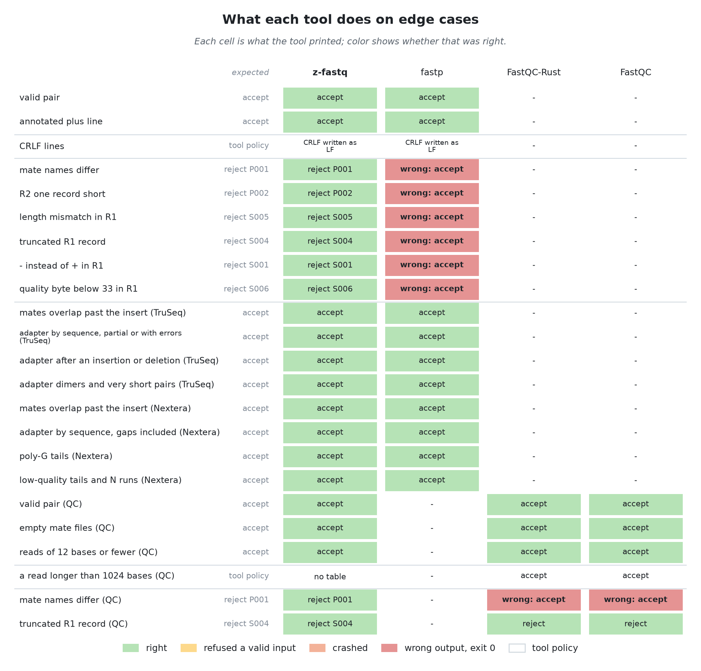
</picture>

> [!NOTE]
> A cell is the tool's verdict: `accept` (exit 0, outputs right), `reject P001` (with the rule it named), `reject`, `wrong: accept` (exit 0 on a broken pair or record), `wrong: records differ` or `wrong: table R1` (exit 0, other output), `no table` (no table written for a mate), `refused` (rejected a valid input), `crash`, or `-` (the tool has no such job). "tool policy" rows have no single right answer.

## What each step costs
> Copying reads both mates, checks every pair, and writes them, with nothing else: what every job of `process` pays before its own work. One pair at 1 GiB, every tool on one CPU; each trim on the same pair, from its own job below.

<picture>
  <source media="(prefers-color-scheme: dark)" srcset="results/figures/steps-dark.png">
  <source media="(prefers-color-scheme: light)" srcset="results/figures/steps-light.png">
  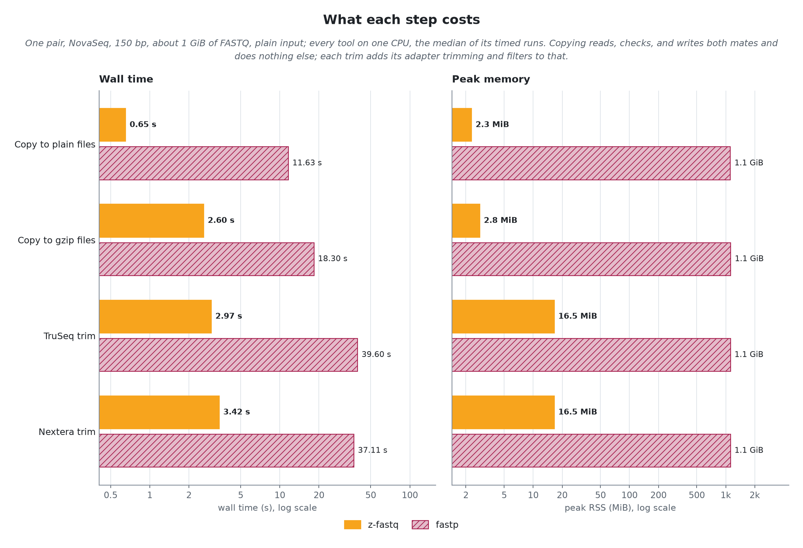
</picture>

| Step                | Tool    | Plain wall | Plain peak memory | Gzip wall | Gzip peak memory |
| ------------------- | ------- | ---------: | ----------------: | --------: | ---------------: |
| Copy to plain files | z-fastq |     652 ms |          2.29 MiB |    1.44 s |         2.29 MiB |
| Copy to plain files | fastp   |    11.63 s |           1.1 GiB |   12.30 s |          1.1 GiB |
| Copy to gzip files  | z-fastq |     2.60 s |          2.79 MiB |    3.59 s |         2.79 MiB |
| Copy to gzip files  | fastp   |    18.30 s |           1.1 GiB |   19.47 s |          1.1 GiB |
| TruSeq trim         | z-fastq |     2.97 s |          16.5 MiB |    3.79 s |         16.5 MiB |
| TruSeq trim         | fastp   |    39.60 s |           1.1 GiB |   40.49 s |          1.1 GiB |
| Nextera trim        | z-fastq |     3.42 s |          16.5 MiB |    3.77 s |         16.5 MiB |
| Nextera trim        | fastp   |    37.11 s |           1.1 GiB |   33.31 s |          1.1 GiB |

On this pair (NovaSeq, 150 bp), copying to plain files takes z-fastq 652 ms with 2.29 MiB: reading, checking, and writing are 22% of its 2.97 s TruSeq trim. fastp needs 11.63 s with 1.1 GiB for the same copy, 29% of its 39.60 s trim. Copying to gzip files instead takes z-fastq 2.60 s: compressing both mates adds 1.95 s, against 2.32 s that TruSeq trimming adds.

## Trimming
> TruSeq: TruSeq adapters, quality and N filters, minimum length 15 (rnaFusion's settings). Nextera: Nextera adapters, poly-G and quality-tail trimming, filters, minimum length 30 (FRAMEFusion's settings). The real runs and the synthetic pair at 1 GiB, plain and gzip input, in the page cache, every tool on one CPU. The other tools at 2 to 16 threads are in the threads part below.

<picture>
  <source media="(prefers-color-scheme: dark)" srcset="results/figures/trimming-overview-dark.png">
  <source media="(prefers-color-scheme: light)" srcset="results/figures/trimming-overview-light.png">
  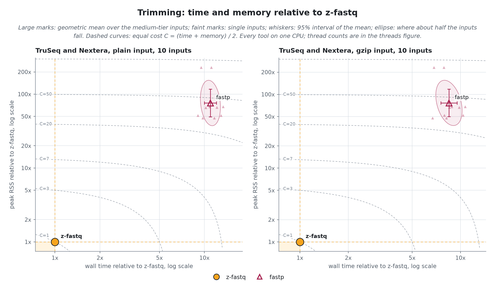
</picture>

Geometric means over the 1 GiB inputs: z-fastq's own time and memory, and every other tool's as a multiple of them.

| Job     | Tool    | Plain time | Plain memory | Gzip time | Gzip memory |
| ------- | ------- | ---------: | -----------: | --------: | ----------: |
| TruSeq  | z-fastq |     3.33 s |     14.7 MiB |    4.49 s |    14.7 MiB |
| TruSeq  | fastp   |     12.20x |       75.87x |     9.32x |      76.57x |
| Nextera | z-fastq |     3.49 s |     14.7 MiB |    4.50 s |    14.7 MiB |
| Nextera | fastp   |      9.86x |       75.88x |     7.72x |      76.49x |

<picture>
  <source media="(prefers-color-scheme: dark)" srcset="results/figures/trimming-speed-dark.png">
  <source media="(prefers-color-scheme: light)" srcset="results/figures/trimming-speed-light.png">
  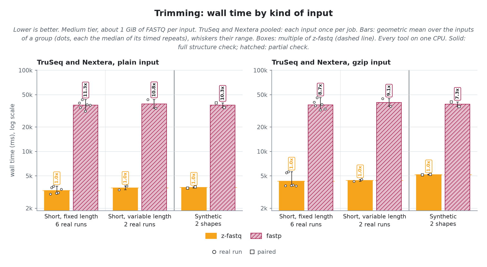
</picture>

<picture>
  <source media="(prefers-color-scheme: dark)" srcset="results/figures/trimming-memory-dark.png">
  <source media="(prefers-color-scheme: light)" srcset="results/figures/trimming-memory-light.png">
  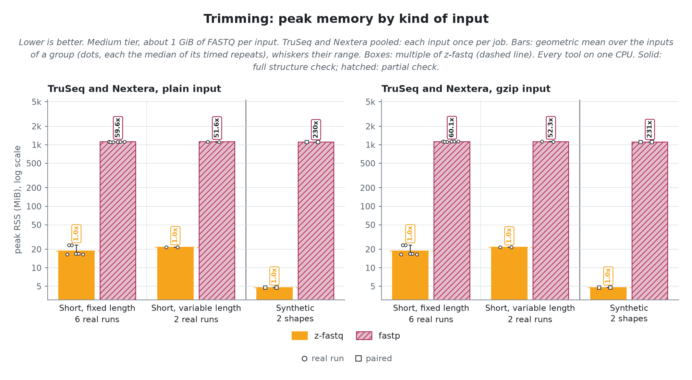
</picture>

**TruSeq.** Output per plain 1 GiB input, mean over 5 inputs: z-fastq 1025.4 MB, fastp 1025.4 MB.

**Nextera.** Output per plain 1 GiB input, mean over 5 inputs: z-fastq 829.3 MB, fastp 829.3 MB.

### Trimming: threads
> Each other tool at 1, 2, 4, 8, and 16 threads on as many physical cores, z-fastq on one, in the same batches, at the 1 GiB inputs. Geometric means over those inputs. Cores used is CPU time over wall time.

<picture>
  <source media="(prefers-color-scheme: dark)" srcset="results/figures/trimming-threads-dark.png">
  <source media="(prefers-color-scheme: light)" srcset="results/figures/trimming-threads-light.png">
  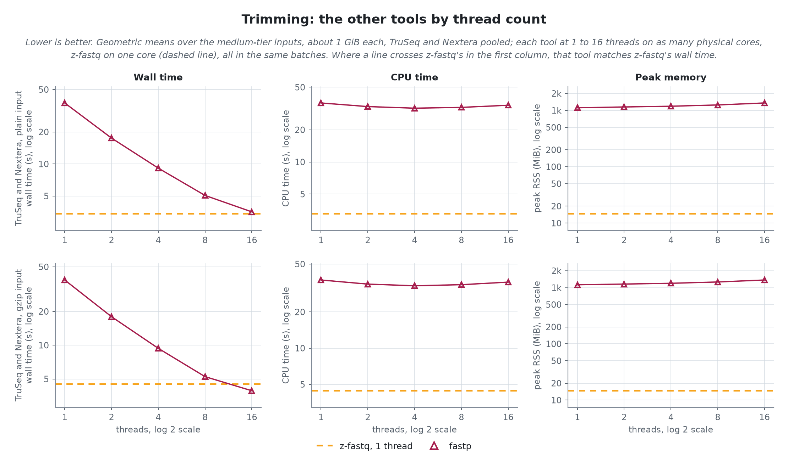
</picture>

| Job     | Tool    | Threads | Plain wall s | Plain CPU s | Plain cores used | Plain peak MiB | Gzip wall s | Gzip CPU s | Gzip cores used | Gzip peak MiB |
| ------- | ------- | ------: | -----------: | ----------: | ---------------: | -------------: | ----------: | ---------: | --------------: | ------------: |
| TruSeq  | z-fastq |       1 |         3.33 |        3.24 |              1.0 |           14.7 |        4.49 |       4.42 |             1.0 |          14.7 |
| TruSeq  | fastp   |       1 |        40.69 |       39.22 |              1.0 |         1114.3 |       41.84 |      40.41 |             1.0 |        1122.8 |
| TruSeq  | fastp   |       2 |        19.32 |       36.30 |              1.9 |         1155.2 |       19.66 |      37.26 |             1.9 |        1158.7 |
| TruSeq  | fastp   |       4 |         9.91 |       34.81 |              3.5 |         1190.1 |       10.14 |      35.92 |             3.5 |        1197.1 |
| TruSeq  | fastp   |       8 |         5.51 |       35.57 |              6.5 |         1254.7 |        5.61 |      36.58 |             6.5 |        1263.2 |
| TruSeq  | fastp   |      16 |         3.64 |       36.80 |             10.1 |         1361.1 |        4.05 |      38.55 |             9.5 |        1370.5 |
| Nextera | z-fastq |       1 |         3.49 |        3.31 |              1.0 |           14.7 |        4.50 |       4.44 |             1.0 |          14.7 |
| Nextera | fastp   |       1 |        34.38 |       32.38 |              0.9 |         1112.8 |       34.78 |      33.57 |             1.0 |        1121.7 |
| Nextera | fastp   |       2 |        15.87 |       29.93 |              1.9 |         1146.1 |       16.42 |      31.11 |             1.9 |        1152.4 |
| Nextera | fastp   |       4 |         8.42 |       29.13 |              3.5 |         1182.2 |        8.68 |      30.30 |             3.5 |        1189.2 |
| Nextera | fastp   |       8 |         4.65 |       29.51 |              6.3 |         1244.3 |        4.90 |      31.00 |             6.3 |        1254.1 |
| Nextera | fastp   |      16 |         3.46 |       31.26 |              9.0 |         1349.4 |        3.80 |      32.43 |             8.5 |        1359.1 |

**TruSeq.** fastp matches z-fastq on one core from 16 threads on gzip input (0.90x z-fastq's time for 8.7x its CPU time); on plain input no thread count up to 16 does.

**Nextera.** fastp matches z-fastq on one core from 16 threads on plain input (0.99x z-fastq's time for 9.4x its CPU time), and from 16 threads on gzip input (0.84x z-fastq's time for 7.3x its CPU time).

Scaling

<picture>
  <source media="(prefers-color-scheme: dark)" srcset="results/figures/trimming-scaling-dark.png">
  <source media="(prefers-color-scheme: light)" srcset="results/figures/trimming-scaling-light.png">
  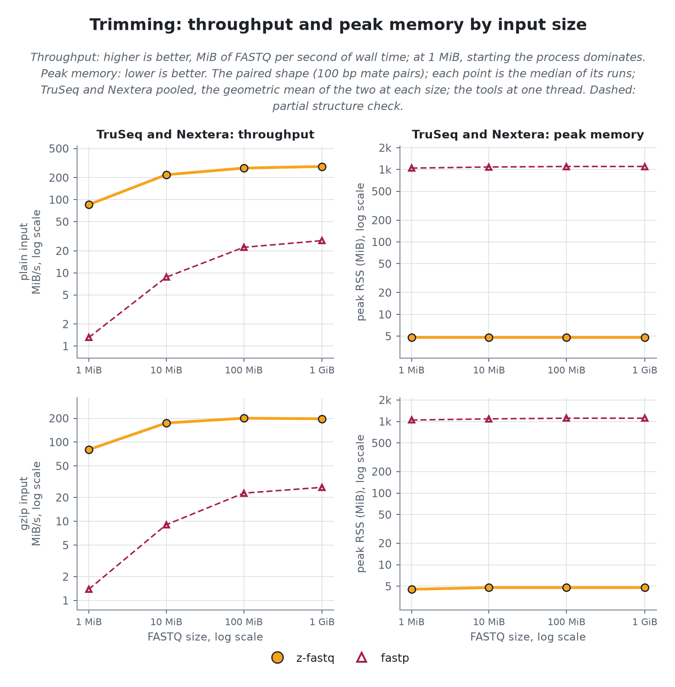
</picture>

**TruSeq and Nextera.** At 1 GiB, z-fastq processes 0.3 GiB/s on plain input and 0.2 GiB/s on gzip input; no other tool is faster there.
z-fastq peaks at 4.79 MiB at every size of the paired shape. No other tool grows by more than a quarter either.

## QC tables
> FastQC tables: FastQC tables for both mates, no trimming. The real runs and the synthetic pair at 1 GiB, plain and gzip input, in the page cache, every tool on one CPU. The other tools at 2 to 16 threads are in the threads part below.

<picture>
  <source media="(prefers-color-scheme: dark)" srcset="results/figures/qc-overview-dark.png">
  <source media="(prefers-color-scheme: light)" srcset="results/figures/qc-overview-light.png">
  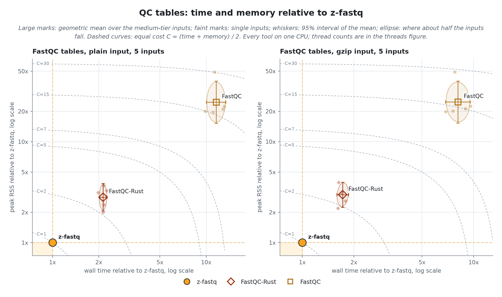
</picture>

Geometric means over the 1 GiB inputs: z-fastq's own time and memory, and every other tool's as a multiple of them.

| Job           | Tool        | Plain time | Plain memory | Gzip time | Gzip memory |
| ------------- | ----------- | ---------: | -----------: | --------: | ----------: |
| FastQC tables | z-fastq     |     1.91 s |     10.2 MiB |    2.99 s |    10.1 MiB |
| FastQC tables | FastQC-Rust |      2.13x |        2.83x |     1.72x |       2.98x |
| FastQC tables | FastQC      |     11.59x |       24.67x |     8.10x |      24.75x |

<picture>
  <source media="(prefers-color-scheme: dark)" srcset="results/figures/qc-speed-dark.png">
  <source media="(prefers-color-scheme: light)" srcset="results/figures/qc-speed-light.png">
  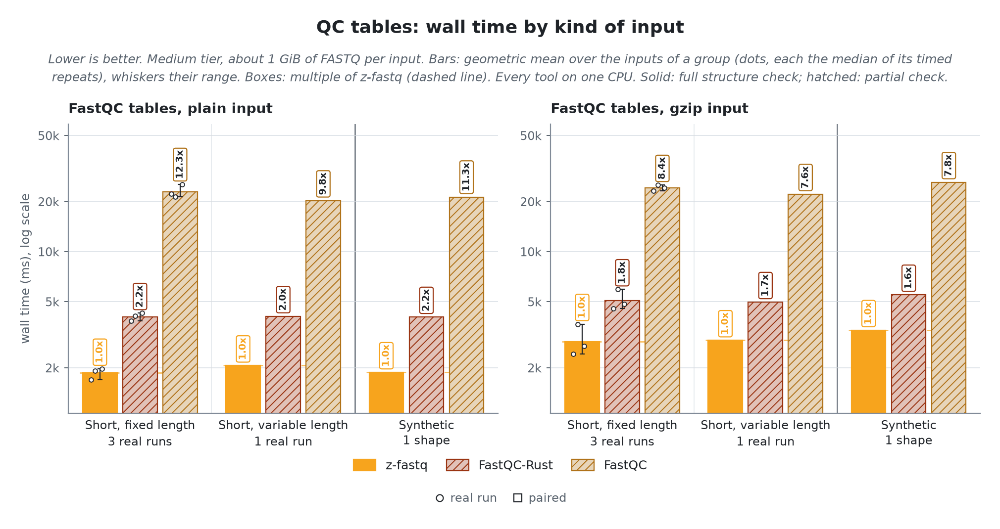
</picture>

<picture>
  <source media="(prefers-color-scheme: dark)" srcset="results/figures/qc-memory-dark.png">
  <source media="(prefers-color-scheme: light)" srcset="results/figures/qc-memory-light.png">
  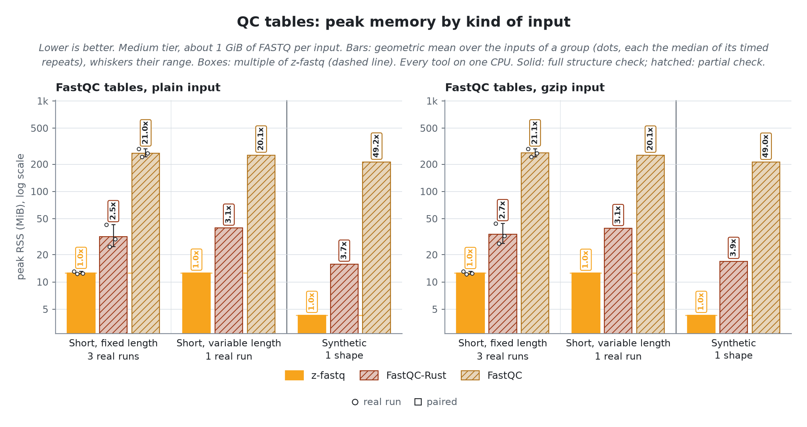
</picture>

**FastQC tables.** Output per plain 1 GiB input, mean over 5 inputs: z-fastq 1073.9 MB (both mates in full, which this job cannot skip, and its tables), FastQC-Rust 0.8 MB (tables only), FastQC 0.8 MB (tables only).

### QC tables: threads
> Each other tool at 1, 2, 4, 8, and 16 threads on as many physical cores, z-fastq on one, in the same batches, at the 1 GiB inputs. Geometric means over those inputs. Cores used is CPU time over wall time.

<picture>
  <source media="(prefers-color-scheme: dark)" srcset="results/figures/qc-threads-dark.png">
  <source media="(prefers-color-scheme: light)" srcset="results/figures/qc-threads-light.png">
  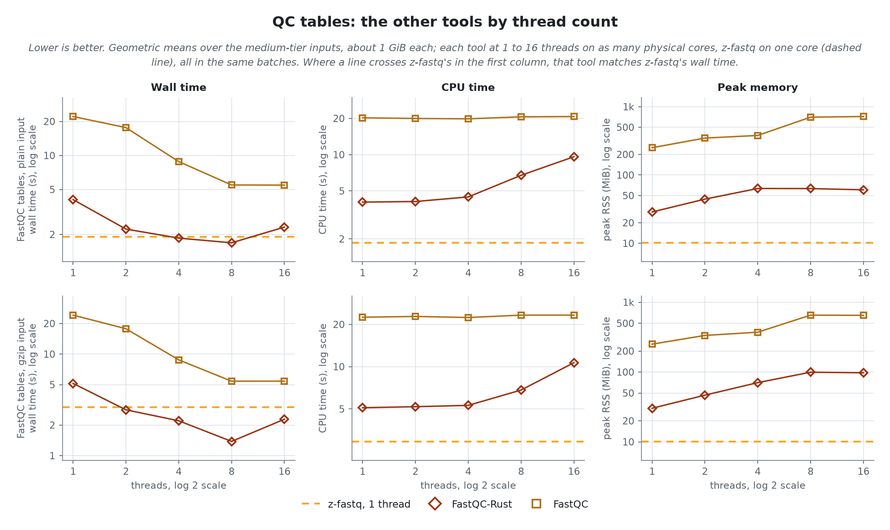
</picture>

| Job           | Tool        | Threads | Plain wall s | Plain CPU s | Plain cores used | Plain peak MiB | Gzip wall s | Gzip CPU s | Gzip cores used | Gzip peak MiB |
| ------------- | ----------- | ------: | -----------: | ----------: | ---------------: | -------------: | ----------: | ---------: | --------------: | ------------: |
| FastQC tables | z-fastq     |       1 |         1.91 |        1.86 |              1.0 |           10.2 |        2.99 |       2.94 |             1.0 |          10.1 |
| FastQC tables | FastQC-Rust |       1 |         4.07 |        4.04 |              1.0 |           28.8 |        5.14 |       5.10 |             1.0 |          30.3 |
| FastQC tables | FastQC-Rust |       2 |         2.23 |        4.08 |              1.8 |           44.3 |        2.83 |       5.19 |             1.8 |          46.7 |
| FastQC tables | FastQC-Rust |       4 |         1.86 |        4.46 |              2.4 |           63.5 |        2.20 |       5.30 |             2.4 |          70.5 |
| FastQC tables | FastQC-Rust |       8 |         1.69 |        6.74 |              4.0 |           63.2 |        1.38 |       6.82 |             4.9 |          99.5 |
| FastQC tables | FastQC-Rust |      16 |         2.32 |        9.61 |              4.1 |           60.7 |        2.28 |      10.68 |             4.7 |          97.6 |
| FastQC tables | FastQC      |       1 |        22.10 |       20.22 |              0.9 |          251.0 |       24.19 |      22.49 |             0.9 |         251.1 |
| FastQC tables | FastQC      |       2 |        17.64 |       19.96 |              1.1 |          347.0 |       17.77 |      22.79 |             1.3 |         334.7 |
| FastQC tables | FastQC      |       4 |         8.82 |       19.83 |              2.2 |          379.2 |        8.77 |      22.38 |             2.6 |         372.3 |
| FastQC tables | FastQC      |       8 |         5.48 |       20.60 |              3.8 |          702.3 |        5.41 |      23.28 |             4.3 |         654.1 |
| FastQC tables | FastQC      |      16 |         5.46 |       20.72 |              3.8 |          717.3 |        5.41 |      23.28 |             4.3 |         649.2 |

**FastQC tables.** FastQC-Rust matches z-fastq on one core from 4 threads on plain input (0.97x z-fastq's time for 2.4x its CPU time), and from 2 threads on gzip input (0.95x z-fastq's time for 1.8x its CPU time). FastQC does not match z-fastq on one core at any thread count up to 16, on plain or gzip input.

Scaling

<picture>
  <source media="(prefers-color-scheme: dark)" srcset="results/figures/qc-scaling-dark.png">
  <source media="(prefers-color-scheme: light)" srcset="results/figures/qc-scaling-light.png">
  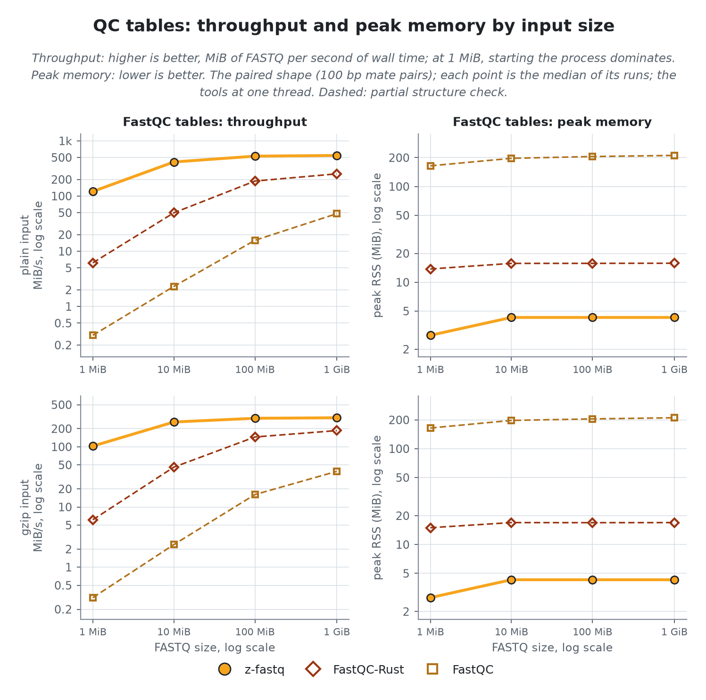
</picture>

**FastQC tables.** At 1 GiB, z-fastq processes 0.5 GiB/s on plain input and 0.3 GiB/s on gzip input; no other tool is faster there.
z-fastq peaks at 2.79 to 4.29 MiB across the sizes of the paired shape. Memory that grows with the input: FastQC by 1.3x on plain paired.

## Reproducibility

How it was measured

Every tool runs through `zexec -r` inside one zebrac batch per case, held to one CPU core by a systemd scope with a CPU quota and a 16G memory cap; a batch with threaded variants holds as many physical cores as its largest lane, one logical CPU each, with each lane pinned to its own cores and z-fastq to one, after the input was read once so every run reads from the page cache. zebrac gives wall time; zexec records each run's peak memory, CPU time, and minor faults for the tool alone. Peak RSS is the kernel's peak counter that `wait4` reports, which can lag the true peak by up to about 0.5 MiB, so memory differences smaller than that are inconclusive. Runs per tier, each after one warmup: tiny 31, xsmall 21, small 11, medium 3; sizes 1 MiB to 1 GiB. Timed by `bench/process/run.sh release`, last on 2026-10-29; this page written on 2026-10-30.

Identity

- `z-fastq`: *0.1.0, source at 246bbb1*
- `zebrac`: *0.6.2*
- `zexec`: *15000 bytes, static, no libc*
- `kernel`: *7.2.13-200.fc44.x86_64*
- `cpu`: *AMD Ryzen 9 3950X 16-Core Processor*
- `load at batch start`: *1.82 to 8.71*

Commands

- `z-fastq`: *zig-out/bin/z-fastq process --out1 {stem}_1.fq --out2 {stem}_2.fq IN*
- `fastp`: *tools/bin/fastp -i IN -I IN -o {stem}_1.fq -O {stem}_2.fq -A -G -Q -L -w 1 -j {stem}.json -h {stem}.html*; also with -w 2, -w 4, -w 8, -w 16
- `FastQC-Rust`: *tools/bin/fastqc-rust --threads 1 -o {stem}.qc IN*; also with -t 2, -t 4, -t 8, -t 16
- `FastQC`: *tools/bin/fastqc --threads 1 --quiet --outdir {stem}.qc IN*; also with -t 2, -t 4, -t 8, -t 16
- `z-fastq`, Trimming, TruSeq settings: *zig-out/bin/z-fastq process --adapter1 AGATCGGAAGAGCACACGTCTGAACTCCAGTCA --adapter2 AGATCGGAAGAGCGTCGTGTAGGGAAAGAGTGT --low-quality 15 --max-low-quality-percent 40 --max-n 5 --min-length 15 --pair-duplication --qc-summary {stem}.json --out1 {stem}_1.fq --out2 {stem}_2.fq IN*
- `fastp`, Trimming, TruSeq settings: *tools/bin/fastp -i IN -I IN -o {stem}_1.fq -O {stem}_2.fq --adapter_sequence AGATCGGAAGAGCACACGTCTGAACTCCAGTCA --adapter_sequence_r2 AGATCGGAAGAGCGTCGTGTAGGGAAAGAGTGT --disable_trim_poly_g -q 15 -u 40 -n 5 -l 15 -w 1 -j {stem}.json -h {stem}.html*; also with -w 2, -w 4, -w 8, -w 16
- `z-fastq`, Trimming, Nextera settings: *zig-out/bin/z-fastq process --adapter1 CTGTCTCTTATACACATCT --adapter2 CTGTCTCTTATACACATCT --trim-poly-g 10 --trim-tail-window 4 --trim-tail-quality 20 --low-quality 15 --max-low-quality-percent 40 --max-n 5 --min-length 30 --pair-duplication --qc-summary {stem}.json --out1 {stem}_1.fq --out2 {stem}_2.fq IN*
- `fastp`, Trimming, Nextera settings: *tools/bin/fastp -i IN -I IN -o {stem}_1.fq -O {stem}_2.fq --adapter_sequence CTGTCTCTTATACACATCT --adapter_sequence_r2 CTGTCTCTTATACACATCT --trim_poly_g --poly_g_min_len 10 --cut_tail --cut_tail_window_size 4 --cut_tail_mean_quality 20 -q 15 -u 40 -n 5 -l 30 -w 1 -j {stem}.json -h {stem}.html*; also with -w 2, -w 4, -w 8, -w 16
- `z-fastq`, QC tables: *zig-out/bin/z-fastq process --qc-tables {stem}.qc --contaminants tools/.local/fastqc-current/runtime/Configuration/contaminant_list.txt --out1 {stem}_1.fq --out2 {stem}_2.fq IN*
- `z-fastq`, Copying into gzip files: *zig-out/bin/z-fastq process --gzip --out1 {stem}_1.fq.gz --out2 {stem}_2.fq.gz IN*
- `fastp`, Copying into gzip files: *tools/bin/fastp -i IN -I IN -o {stem}_1.fq.gz -O {stem}_2.fq.gz -A -G -Q -L -w 1 -j {stem}.json -h {stem}.html*

Quick-check cases for peer and ab

Picked from these results: per family, group, and format, the case where z-fastq is closest to, or furthest behind, its fastest rival of any class. `run.sh peer` times z-fastq against a cached reference of the rival on each; `run.sh ab REV` times two z-fastq builds on each.

- `Trimming, TruSeq settings: Short, fixed length, plain`: *BGISEQ, 100 bp*; rival fastp -w 16 at 1.02x z-fastq's time
- `Trimming, TruSeq settings: Short, variable length, plain`: *10x mates, 28 and 150 bp*; rival fastp -w 16 at 1.21x z-fastq's time
- `Trimming, TruSeq settings: Synthetic, plain`: *paired: 100 bp mate pairs*; rival fastp -w 16 at 1.07x z-fastq's time
- `Trimming, TruSeq settings: Short, fixed length, gzip`: *BGISEQ, 100 bp*; rival fastp -w 16 at 0.77x z-fastq's time
- `Trimming, TruSeq settings: Short, variable length, gzip`: *10x mates, 28 and 150 bp*; rival fastp -w 16 at 1.00x z-fastq's time
- `Trimming, TruSeq settings: Synthetic, gzip`: *paired: 100 bp mate pairs*; rival fastp -w 16 at 0.83x z-fastq's time
- `Trimming, Nextera settings: Short, fixed length, plain`: *NovaSeq, 150 bp*; rival fastp -w 16 at 0.95x z-fastq's time
- `Trimming, Nextera settings: Short, variable length, plain`: *10x mates, 28 and 150 bp*; rival fastp -w 16 at 1.02x z-fastq's time
- `Trimming, Nextera settings: Synthetic, plain`: *paired: 100 bp mate pairs*; rival fastp -w 16 at 0.95x z-fastq's time
- `Trimming, Nextera settings: Short, fixed length, gzip`: *BGISEQ, 100 bp*; rival fastp -w 16 at 0.77x z-fastq's time
- `Trimming, Nextera settings: Short, variable length, gzip`: *10x mates, 28 and 150 bp*; rival fastp -w 16 at 0.90x z-fastq's time
- `Trimming, Nextera settings: Synthetic, gzip`: *paired: 100 bp mate pairs*; rival fastp -w 16 at 0.77x z-fastq's time
- `QC tables: Short, fixed length, plain`: *NovaSeq, Casava headers*; rival FastQC-Rust -t 8 at 0.66x z-fastq's time
- `QC tables: Short, variable length, plain`: *10x mates, 28 and 150 bp*; rival FastQC-Rust -t 8 at 0.87x z-fastq's time
- `QC tables: Synthetic, plain`: *paired: 100 bp mate pairs*; rival FastQC-Rust -t 4 at 0.90x z-fastq's time
- `QC tables: Short, fixed length, gzip`: *BGISEQ, 100 bp*; rival FastQC-Rust -t 8 at 0.41x z-fastq's time
- `QC tables: Short, variable length, gzip`: *10x mates, 28 and 150 bp*; rival FastQC-Rust -t 8 at 0.56x z-fastq's time
- `QC tables: Synthetic, gzip`: *paired: 100 bp mate pairs*; rival FastQC-Rust -t 8 at 0.39x z-fastq's time
- `Copying into plain files: Short, fixed length, plain`: *NovaSeq, 150 bp*; rival fastp at 17.86x z-fastq's time
- `Copying into plain files: Short, fixed length, gzip`: *NovaSeq, 150 bp*; rival fastp at 8.55x z-fastq's time
- `Copying into gzip files: Short, fixed length, plain`: *NovaSeq, 150 bp*; rival fastp at 7.04x z-fastq's time
- `Copying into gzip files: Short, fixed length, gzip`: *NovaSeq, 150 bp*; rival fastp at 5.43x z-fastq's time

Hardware counters (user space, plain medium-tier inputs, geometric means, tools at one thread)

| Job                        | Tool        | Instructions per byte | Instructions per cycle | Cache misses per MiB | Branch misses per MiB |
| -------------------------- | ----------- | --------------------: | ---------------------: | -------------------: | --------------------: |
| Trimming, TruSeq settings  | z-fastq     |                 28.59 |                   2.85 |                46769 |                 27223 |
| Trimming, TruSeq settings  | fastp       |                289.15 |                   2.69 |               210798 |                758679 |
| Trimming, Nextera settings | z-fastq     |                 28.93 |                   2.79 |                45346 |                 30437 |
| Trimming, Nextera settings | fastp       |                244.37 |                   2.77 |               172367 |                703668 |
| QC tables                  | z-fastq     |                 13.95 |                   2.65 |                30283 |                  8859 |
| QC tables                  | FastQC-Rust |                 32.20 |                   2.40 |                24881 |                 44296 |
| QC tables                  | FastQC      |                100.99 |                   1.49 |               402518 |                983057 |
| Copying into plain files   | z-fastq     |                  2.97 |                   2.86 |                 4569 |                   704 |
| Copying into plain files   | fastp       |                 78.71 |                   2.70 |                93072 |                 61345 |
| Copying into gzip files    | z-fastq     |                 20.91 |                   2.50 |                33901 |                 30382 |
| Copying into gzip files    | fastp       |                130.28 |                   2.40 |               139874 |                318110 |

