<!-- markdownlint-disable MD013 MD033 MD041 -->

# Sampling records
> `z-fastq sample` against 7 other samplers, on 7 real sequencing runs and 5 synthetic shapes, plain and gzip. A tool is timed only where its sample was right; time and memory come from the same run, on one CPU.

- `z-fastq`: *0.1.0 at 246bbb1*
- `machine`: *Ryzen 9 3950X, Linux 7.2.12; one CPU per run*
- `runner`: *zebrac 0.6.2 with zexec*
- `data`:
  - **Real**: *7 public sequencing runs, 1 GiB each, pooled in the bars by the kind of reads they hold*
    - `Short, fixed length`: *NovaSeq, 150 bp; NovaSeq, Casava headers; BGISEQ, 100 bp; miRNA, 36 bp*
    - `Short, variable length`: *10x mates, 28 and 150 bp*
    - `Long reads`: *PromethION, 30 to 153 kb; Revio HiFi, 4 to 21 kb*
  - **Synthetic**: *5 shapes generated from real reads, each changing one thing; one group in the bars at 1 GiB, and the scaling lines from 1 MiB to 1 GiB*
    - `dense`: *uniform 150 bp, bare plus line*
    - `endings`: *100 bp, CRLF and LF lines*
    - `variable`: *50 to 150 bp, annotated plus line*
    - `longread`: *nanopore headers, rare 300 kb reads*
    - `long`: *300 kb sequence lines*
- `date`: *2026-10-29*

## Findings

- **Right answers:** z-fastq returned the right sample on all 106 checked inputs and rejected every malformed edge case. 6 of the 7 other tools print a wrong sample or crash on at least one edge case.
- **Fair samples:** every tool passes the fairness tests except IRMA Core (fraction).
- **Wrong on valid input, exit 0:** no final newline: fqkit (1 kept); tab inside the header: seqtk (not a subset).
- **Matches seqtk:** z-fastq kept the same records as seqtk on 54 of 54 screened inputs (fraction 36 of 36, exact count 18 of 18).
- **Fraction speed:** the fastest other tool takes 0.99x z-fastq's time on plain input (Rasusa) and 1.10x on gzip (Rasusa); IRMA Core, the fastest other full-check tool, takes 5.05x z-fastq's time on plain input and 3.27x on gzip.
- **Exact-count speed:** the fastest other tool takes 1.00x z-fastq's time on plain input (Rasusa) and 1.11x on gzip (Rasusa); IRMA Core, the fastest other full-check tool, takes 2.78x z-fastq's time on plain input.
- **Memory against K:** at K = 100,000, z-fastq peaks at 1.31 MiB and the other tools at 3.2x to 20.8x that; at K = 1,000,000, z-fastq peaks at 3.81 MiB and the other tools at 1.2x to 9.0x that.
- **Where z-fastq is not fastest, fraction:** Rasusa on plain synthetic (0.94x); Rasusa on plain long reads (0.89x).
- **Where z-fastq is not fastest, exact count:** Rasusa on plain synthetic (0.96x); Rasusa on plain long reads (0.81x).

## Compared tools
> *complete* tools check records as much as z-fastq; *partial* tools check less, so they do less work per record. Modes: `yes` when the tool was right on every input of the mode, `partly` on some, `-` when the tool has no such mode. Stdin and gzip: measured on a 1 MiB file with the timed command (a two-pass exact count cannot read stdin). Seed: the same output twice with one seed, and different output with another.

| Tool      | Class    | Fraction | Exact count | Pairs, two files | Pairs, interleaved | Stdin | Gzip | Seed |
| --------- | -------- | -------- | ----------- | ---------------- | ------------------ | ----- | ---- | ---- |
| z-fastq   | subject  | yes      | yes         | yes              | yes                | yes   | yes  | yes  |
| Rasusa    | partial  | yes      | yes         | yes              | -                  | no    | yes  | yes  |
| seqtk     | partial  | partly   | partly      | -                | -                  | yes   | yes  | yes  |
| fq        | partial  | yes      | yes         | yes              | -                  | no    | yes  | yes  |
| fqkit     | partial  | -        | yes         | -                | -                  | no    | yes  | yes  |
| SeqKit    | partial  | yes      | yes         | -                | -                  | yes   | yes  | yes  |
| IRMA Core | complete | yes      | partly      | partly           | -                  | no    | yes  | yes  |
| Fasten    | partial  | -        | -           | -                | yes                | yes   | no   | no   |

### What each tool checks and changes
> Each kind of malformed input from the edge cases: `rejects`, or **passes** when the tool writes a sample from it with exit 0, so it does less work than z-fastq. Plus line and line endings written: on the `variable` (annotated plus line) and `endings` (CRLF and LF) shapes; `as input` and `kept` copy the input. Unfair in: the modes where its sample fails the fairness tests below.

| Tool      | Length mismatch | Truncated record | Bad plus line | Bad header | Quality range | Blank line | Broken gzip | Plus line written | Line endings written | Unfair in |
| --------- | --------------- | ---------------- | ------------- | ---------- | ------------- | ---------- | ----------- | ----------------- | -------------------- | --------- |
| z-fastq   | rejects         | rejects          | rejects       | rejects    | rejects       | rejects    | rejects     | kept              | LF                   | -         |
| Rasusa    | rejects         | rejects          | rejects       | rejects    | **passes**    | rejects    | rejects     | bare +            | CRLF                 | -         |
| seqtk     | **passes**      | **passes**       | **passes**    | **passes** | **passes**    | **passes** | **passes**  | bare +            | LF                   | -         |
| fq        | **passes**      | rejects          | **passes**    | **passes** | **passes**    | rejects    | rejects     | kept              | LF                   | -         |
| fqkit     | **passes**      | **passes**       | **passes**    | **passes** | **passes**    | **passes** | rejects     | bare +            | mixed                | -         |
| SeqKit    | rejects         | rejects          | rejects       | rejects    | **passes**    | **passes** | rejects     | bare +            | LF                   | -         |
| IRMA Core | rejects         | rejects          | rejects       | rejects    | rejects       | rejects    | rejects     | bare +            | LF                   | Fraction  |
| Fasten    | **passes**      | **passes**       | **passes**    | **passes** | **passes**    | **passes** | rejects     | -                 | -                    | -         |

- `Rasusa 5.1.0`: *-1 is its one-pass fraction; without it, two passes and exactly round(pN)*
- `seqtk 1.5`: *exact counts need -2 for input order*
- `fq 0.12.0`: *writes only to named files*
- `fqkit 0.4.14`: *exact count only; 4 threads unless given -@ 1*
- `SeqKit 2.14.0`: *exact counts need sample2 -2 -w 0; 4 threads unless given -j 1*
- `IRMA Core 0.11.0`: *whole percents only; an exact count (-t) on gzip input comes out of input order, so exact count is timed on plain input*
- `Fasten 0.9.0`: *stdin only, plain only, no seed*

> [!IMPORTANT]
> Partial tools skip checks z-fastq makes, so they do less work per record; their times are not like-for-like with z-fastq or the complete tools.

## Matches seqtk
> z-fastq promises seqtk's selection on inputs with LF endings, nonempty reads, bare plus lines, printable headers, a seed that fits signed 64-bit, and a value seqtk reads as a fraction. Equivalent commands: `z-fastq sample --fraction P --seed S IN` and `seqtk sample -s S IN P`; `z-fastq sample --count K --seed S IN` and `seqtk sample -2 -s S IN K`.

- `fraction`: *the same records on 36 of 36 inputs*
- `exact count`: *the same records on 18 of 18 inputs*

> [!NOTE]
> seqtk without `-2` keeps the same records but writes them in reservoir order, reads `1.0` as a count of 1, and reads `0` as a fraction.

## Right answers
> A sample is right when every kept record is an input record, unchanged in header, sequence, and quality, in input order, with mates kept together, and the count is the one asked for (exact count) or passes a two-sided binomial test at 1e-6 (fraction); the subset checker, which shares no code with z-fastq, decides. The edge cases are small inputs where tools differ: each cell shows what the tool printed, and its color whether that was right.

z-fastq returned the right sample on all 106 inputs it was given. Every other tool was right on every input it was given except these, which are not timed where they gave a wrong sample:

| Tool      | Wrong |  Of | Inputs                                                                                                                                                                                               |
| --------- | ----: | --: | ---------------------------------------------------------------------------------------------------------------------------------------------------------------------------------------------------- |
| seqtk     |     4 |  81 | PromethION, 30 to 153 kb                                                                                                                                                                             |
| IRMA Core |    20 | 101 | dense, endings, NovaSeq, 150 bp, miRNA, 36 bp, NovaSeq, Casava headers, 10x mates, 28 and 150 bp, long, longread, BGISEQ, 100 bp, PromethION, 30 to 153 kb, Revio HiFi, 4 to 21 kb, paired, variable |

> [!CAUTION]
> Rasusa, seqtk, fq, fqkit, SeqKit and Fasten print a wrong sample and exit 0 on some malformed inputs, so a script cannot tell the sample is wrong.

<picture>
  <source media="(prefers-color-scheme: dark)" srcset="results/figures/edges-dark.png">
  <source media="(prefers-color-scheme: light)" srcset="results/figures/edges-light.png">
  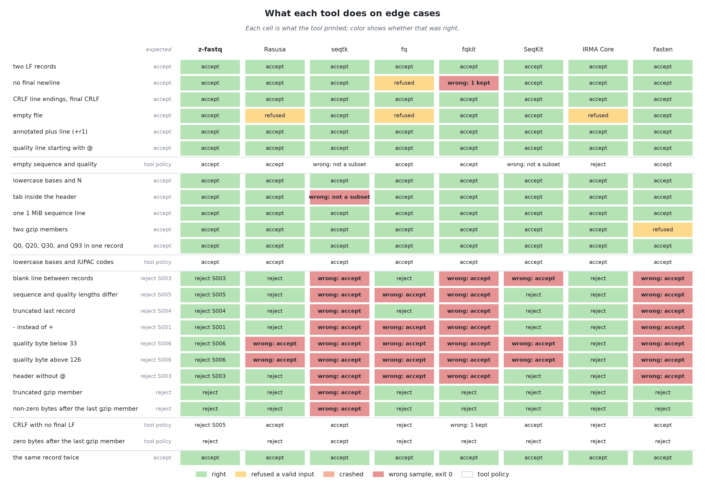
</picture>

> [!NOTE]
> A cell is the tool's verdict when asked for every record (K = 1,000, above every edge file's count, or p = 1): `accept` (exit 0, every record back unchanged and in order), `reject S003` (with the rule it named), `reject`, `wrong: accept` (exit 0 on a malformed input), `wrong: N kept` or `wrong: not a subset` (exit 0 on a valid input with another output: records lost, changed, or reordered), `refused` (rejected a valid input), or `crash`. "tool policy" rows have no single right answer.

Inputs where a tool gave a wrong sample

| Tool      | Input                                                            | Exit | Printed             |
| --------- | ---------------------------------------------------------------- | ---: | ------------------- |
| IRMA Core | bench/data/real/illumina-drr1001190/medium_R1.fastq.gz           |    0 | wrong: not a subset |
| IRMA Core | bench/data/real/illumina-drr1001190/medium_interleaved.fastq.gz  |    0 | wrong: not a subset |
| IRMA Core | bench/data/real/illumina-drr147610/medium.fastq.gz               |    0 | wrong: not a subset |
| IRMA Core | bench/data/real/illumina-err4686103/medium_R1.fastq.gz           |    0 | wrong: not a subset |
| IRMA Core | bench/data/real/illumina-err4686103/medium_interleaved.fastq.gz  |    0 | wrong: not a subset |
| IRMA Core | bench/data/real/illumina-srr19571648/medium_R1.fastq.gz          |    0 | wrong: not a subset |
| IRMA Core | bench/data/real/illumina-srr19571648/medium_interleaved.fastq.gz |    0 | wrong: not a subset |
| IRMA Core | bench/data/real/mgi-err10448913/medium_R1.fastq.gz               |    0 | wrong: not a subset |
| IRMA Core | bench/data/real/mgi-err10448913/medium_interleaved.fastq.gz      |    0 | wrong: not a subset |
| IRMA Core | bench/data/real/ont-err14758576/medium.fastq.gz                  |    0 | wrong: not a subset |
| IRMA Core | bench/data/real/pacbio-srr29396856/medium.fastq.gz               |    0 | wrong: not a subset |
| IRMA Core | bench/data/synthetic/dense/medium.fastq.gz                       |    0 | wrong: not a subset |
| IRMA Core | bench/data/synthetic/endings/medium.fastq.gz                     |    0 | wrong: not a subset |
| IRMA Core | bench/data/synthetic/long/medium.fastq.gz                        |    0 | wrong: not a subset |
| IRMA Core | bench/data/synthetic/longread/medium.fastq.gz                    |    0 | wrong: not a subset |
| IRMA Core | bench/data/synthetic/paired/medium_R1.fastq                      |    1 | reject              |
| IRMA Core | bench/data/synthetic/paired/medium_R1.fastq.gz                   |    1 | reject              |
| IRMA Core | bench/data/synthetic/variable/medium.fastq.gz                    |    0 | wrong: not a subset |
| seqtk     | bench/data/real/ont-err14758576/medium.fastq                     |    0 | wrong: not a subset |
| seqtk     | bench/data/real/ont-err14758576/medium.fastq.gz                  |    0 | wrong: not a subset |

## Is the sample fair?
> 200 seeds per tool and mode on files whose headers are the record index: 79,100 short reads (single-end modes) and 14,413 pairs (pair modes), p = 0.1 and K = 1,000; first and last record on a 200-record file with K = 20 or p = 0.1. Count bias: the mean kept count's distance from N p in standard errors (exact: every run kept K). Spread: the standard deviation over the binomial's (`fixed`: the same count every run). Worst tenth: the largest distance of a tenth of the file's kept share from its expected share, in standard errors.

| Mode                 | Tool      | Count bias (z) | Spread | Worst tenth (z) | First kept | Last kept | Same twice | Seeds differ | Mates | Fair |
| -------------------- | --------- | -------------: | -----: | --------------: | ---------: | --------: | ---------- | ------------ | ----- | ---- |
| Fraction             | z-fastq   |           -2.1 |   0.97 |             1.8 |         15 |        26 | yes        | yes          | -     | yes  |
| Fraction             | Rasusa    |           -0.4 |   1.02 |             1.5 |         24 |        16 | yes        | yes          | -     | yes  |
| Fraction             | seqtk     |           -2.1 |   0.97 |             1.8 |         15 |        26 | yes        | yes          | -     | yes  |
| Fraction             | fq        |           +0.7 |   0.99 |             3.2 |         20 |        18 | yes        | yes          | -     | yes  |
| Fraction             | SeqKit    |           +1.0 |   1.04 |             1.6 |         24 |        19 | yes        | yes          | -     | yes  |
| Fraction             | IRMA Core |           +0.0 |  fixed |            15.9 |         18 |        20 | yes        | yes          | -     | no   |
| Exact count          | z-fastq   |          exact |      - |             1.4 |         18 |        26 | yes        | yes          | -     | yes  |
| Exact count          | Rasusa    |          exact |      - |             1.4 |         19 |        16 | yes        | yes          | -     | yes  |
| Exact count          | seqtk     |          exact |      - |             1.4 |         18 |        26 | yes        | yes          | -     | yes  |
| Exact count          | fq        |          exact |      - |             2.5 |         26 |        23 | yes        | yes          | -     | yes  |
| Exact count          | fqkit     |          exact |      - |             1.3 |         14 |        17 | yes        | yes          | -     | yes  |
| Exact count          | SeqKit    |          exact |      - |             1.1 |         20 |        15 | yes        | yes          | -     | yes  |
| Exact count          | IRMA Core |          exact |      - |             1.9 |         18 |        20 | yes        | yes          | -     | yes  |
| Paired fraction      | z-fastq   |           -2.1 |   0.96 |             3.1 |          - |         - | yes        | yes          | yes   | yes  |
| Paired fraction      | Rasusa    |           -1.0 |   1.03 |             2.2 |          - |         - | yes        | yes          | yes   | yes  |
| Paired fraction      | fq        |           -1.1 |   1.06 |             2.1 |          - |         - | yes        | yes          | yes   | yes  |
| Paired fraction      | IRMA Core |           -0.1 |  fixed |             2.7 |          - |         - | yes        | yes          | yes   | yes  |
| Paired exact count   | z-fastq   |          exact |      - |             2.0 |          - |         - | yes        | yes          | yes   | yes  |
| Paired exact count   | Rasusa    |          exact |      - |             1.5 |          - |         - | yes        | yes          | yes   | yes  |
| Paired exact count   | fq        |          exact |      - |             2.6 |          - |         - | yes        | yes          | yes   | yes  |
| Paired exact count   | IRMA Core |          exact |      - |             1.5 |          - |         - | yes        | yes          | yes   | yes  |
| Interleaved fraction | z-fastq   |           -2.1 |   0.96 |             3.1 |          - |         - | yes        | yes          | yes   | yes  |
| Interleaved fraction | Fasten    |           -0.2 |   0.99 |             1.2 |          - |         - | no         | yes          | yes   | yes  |

A tool fails at a count bias beyond 4.9, a spread outside 0.5 to 1.5, a tenth beyond 5.3 (each two-sided 1e-6), the first or last record kept outside 3 to 43 times of 200, or the same kept set from seeds 11 and 12. At these sizes a tenth's share is tested to about 0.7% (fraction) and 2% (exact) of its value. Same twice is reproducibility, not fairness.

## Fraction sampling, p = 0.1
> The real runs and synthetic shapes at the medium tier, about 1 GiB of FASTQ each, pooled into kinds of input. Every tool runs on one CPU, with the file in the page cache.

<picture>
  <source media="(prefers-color-scheme: dark)" srcset="results/figures/fraction-overview-dark.png">
  <source media="(prefers-color-scheme: light)" srcset="results/figures/fraction-overview-light.png">
  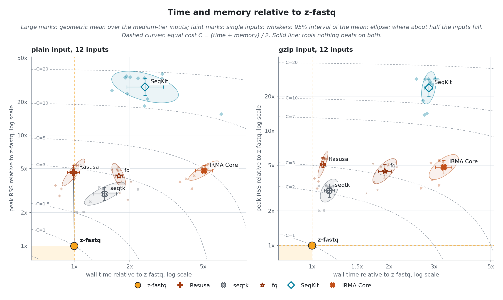
</picture>

z-fastq itself takes 237.2 ms and 0.98 MiB per plain input, 1465.2 ms and 0.95 MiB per gzip input (geometric means over 12 inputs each); the table gives every tool as a multiple of that.
Geometric-mean process CPU time is 235.3 ms for plain input and 1457.3 ms for gzip. Elapsed time also includes launcher overhead and time waiting to run or for I/O.

| Tool      | Plain time | Plain memory | Gzip time | Gzip memory | Passes malformed |
| --------- | ---------: | -----------: | --------: | ----------: | ---------------- |
| z-fastq   |      1.00x |        1.00x |     1.00x |       1.00x | none             |
| Rasusa    |      0.99x |        4.61x |     1.10x |       5.06x | 2 of 9           |
| seqtk     |      1.46x |        2.96x |     1.17x |       3.01x | 9 of 9           |
| fq        |      1.74x |        4.29x |     1.92x |       4.44x | 5 of 9           |
| SeqKit    |      2.42x |       27.30x |     2.86x |      23.72x | 3 of 9           |
| IRMA Core |      5.05x |        4.79x |     3.27x |       4.83x | none             |

<picture>
  <source media="(prefers-color-scheme: dark)" srcset="results/figures/fraction-speed-dark.png">
  <source media="(prefers-color-scheme: light)" srcset="results/figures/fraction-speed-light.png">
  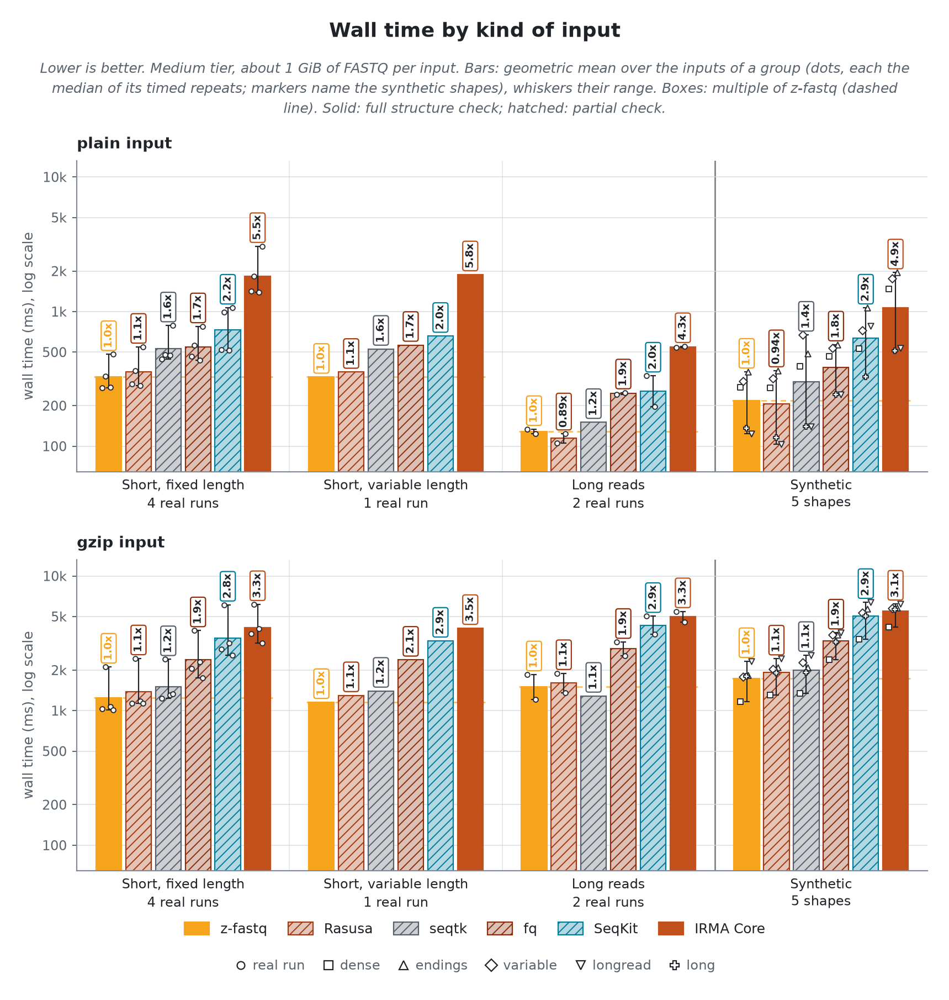
</picture>

<picture>
  <source media="(prefers-color-scheme: dark)" srcset="results/figures/fraction-memory-dark.png">
  <source media="(prefers-color-scheme: light)" srcset="results/figures/fraction-memory-light.png">
  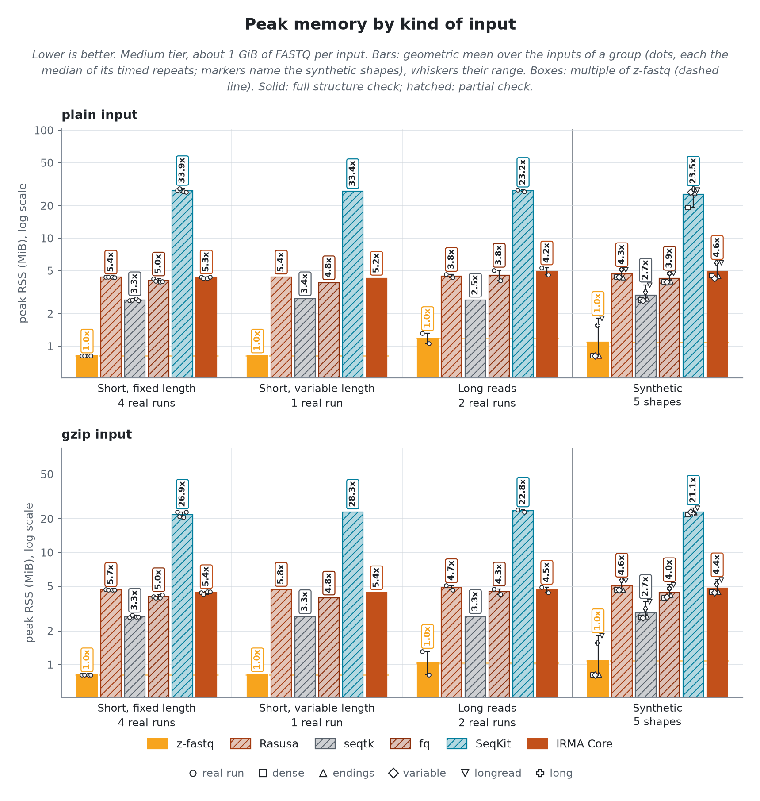
</picture>

Minor page faults by kind of input

<picture>
  <source media="(prefers-color-scheme: dark)" srcset="results/figures/fraction-faults-dark.png">
  <source media="(prefers-color-scheme: light)" srcset="results/figures/fraction-faults-light.png">
  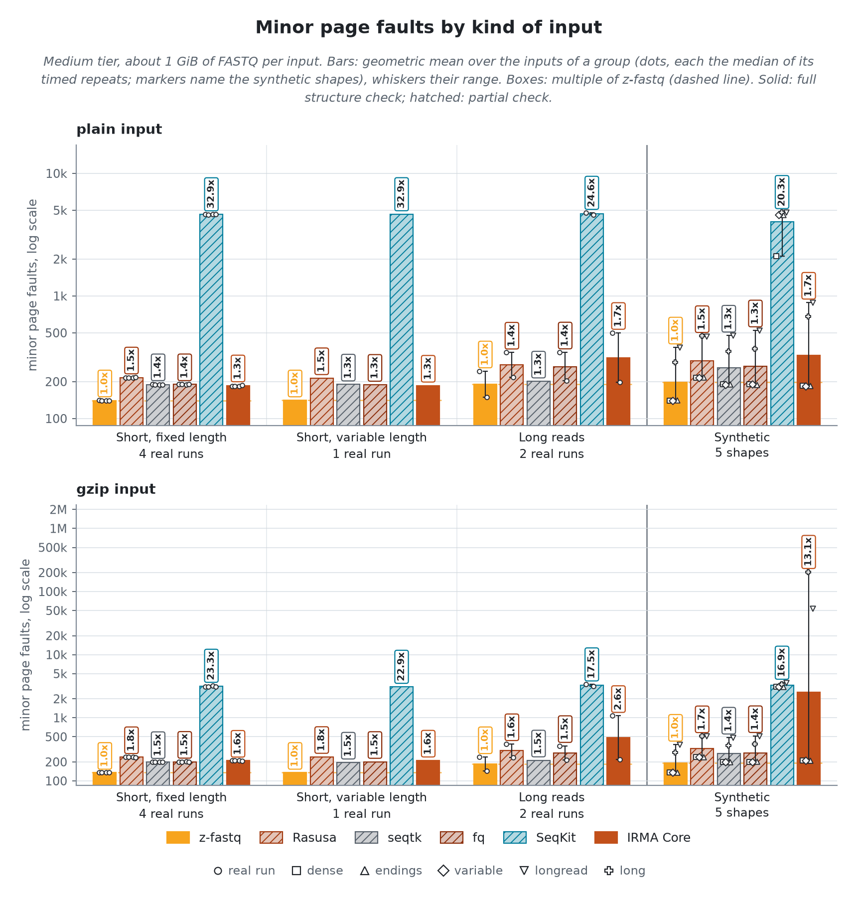
</picture>

### Scaling
> Each synthetic shape from 1 MiB to 1 GiB of FASTQ: throughput and peak memory against input size. A shape changes one thing a sampler pays for, so its line shows what that one thing costs each tool.

<picture>
  <source media="(prefers-color-scheme: dark)" srcset="results/figures/fraction-scaling-speed-dark.png">
  <source media="(prefers-color-scheme: light)" srcset="results/figures/fraction-scaling-speed-light.png">
  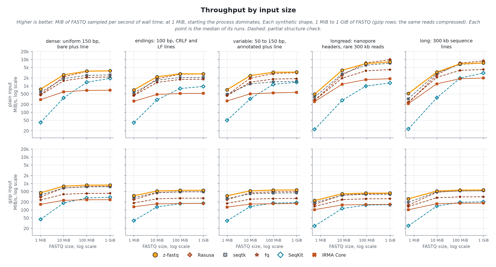
</picture>

<picture>
  <source media="(prefers-color-scheme: dark)" srcset="results/figures/fraction-scaling-memory-dark.png">
  <source media="(prefers-color-scheme: light)" srcset="results/figures/fraction-scaling-memory-light.png">
  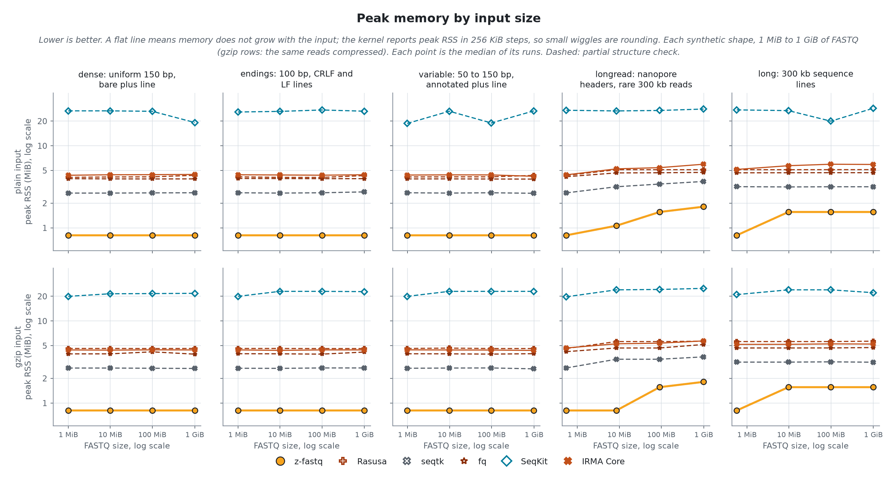
</picture>

At 1 GiB, z-fastq samples 2.8 to 8.0 GiB/s on plain input and 0.4 to 0.9 GiB/s on gzip input. Faster on a single shape there, as throughput over z-fastq's: Rasusa on plain long (1.18x); Rasusa on plain longread (1.20x).
z-fastq peaks at 0.81 to 1.81 MiB across sizes and shapes. Memory that grows with the input: seqtk by 1.4x on plain longread; SeqKit by 1.4x on plain variable; IRMA Core by 1.3x on plain longread.

## Exact count, K = 100,000 (1,000 for long reads)
> The real runs and synthetic shapes at the medium tier, about 1 GiB of FASTQ each, pooled into kinds of input. Every tool runs on one CPU, with the file in the page cache.

<picture>
  <source media="(prefers-color-scheme: dark)" srcset="results/figures/exact-overview-dark.png">
  <source media="(prefers-color-scheme: light)" srcset="results/figures/exact-overview-light.png">
  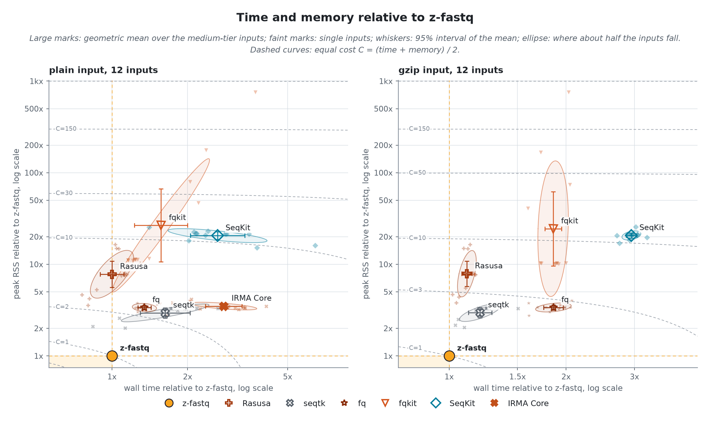
</picture>

z-fastq itself takes 421.5 ms and 1.34 MiB per plain input, 2938.9 ms and 1.34 MiB per gzip input (geometric means over 12 inputs each); the table gives every tool as a multiple of that.
Geometric-mean process CPU time is 418.5 ms for plain input and 2857.1 ms for gzip. Elapsed time also includes launcher overhead and time waiting to run or for I/O.

| Tool      | Plain time | Plain memory | Gzip time | Gzip memory | Passes malformed |
| --------- | ---------: | -----------: | --------: | ----------: | ---------------- |
| z-fastq   |      1.00x |        1.00x |     1.00x |       1.00x | none             |
| Rasusa    |      1.00x |        7.78x |     1.11x |       7.90x | 2 of 9           |
| seqtk     |      1.63x |        2.95x |     1.20x |       2.96x | 9 of 9           |
| fq        |      1.35x |        3.37x |     1.86x |       3.38x | 5 of 9           |
| fqkit     |      1.57x |       26.62x |     1.85x |      24.47x | 7 of 9           |
| SeqKit    |      2.63x |       20.56x |     2.95x |      20.66x | 3 of 9           |
| IRMA Core |      2.78x |        3.50x |         - |           - | none             |

<picture>
  <source media="(prefers-color-scheme: dark)" srcset="results/figures/exact-speed-dark.png">
  <source media="(prefers-color-scheme: light)" srcset="results/figures/exact-speed-light.png">
  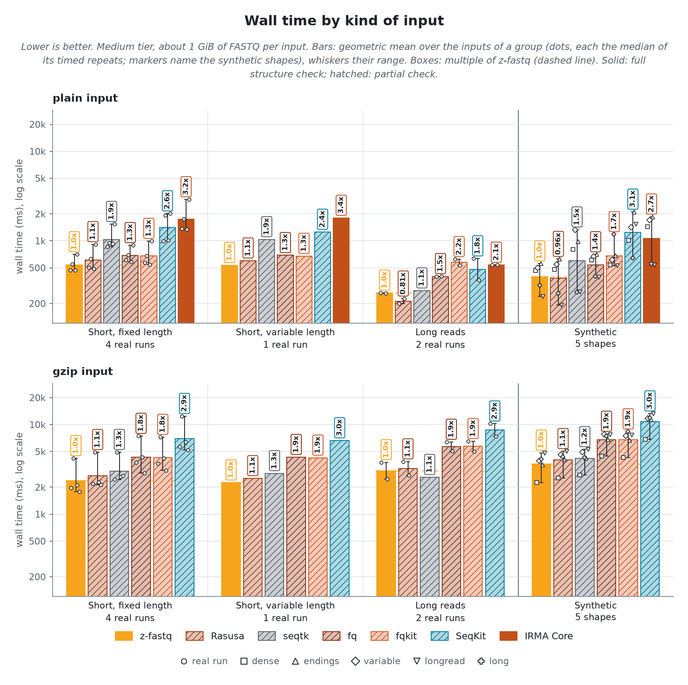
</picture>

<picture>
  <source media="(prefers-color-scheme: dark)" srcset="results/figures/exact-memory-dark.png">
  <source media="(prefers-color-scheme: light)" srcset="results/figures/exact-memory-light.png">
  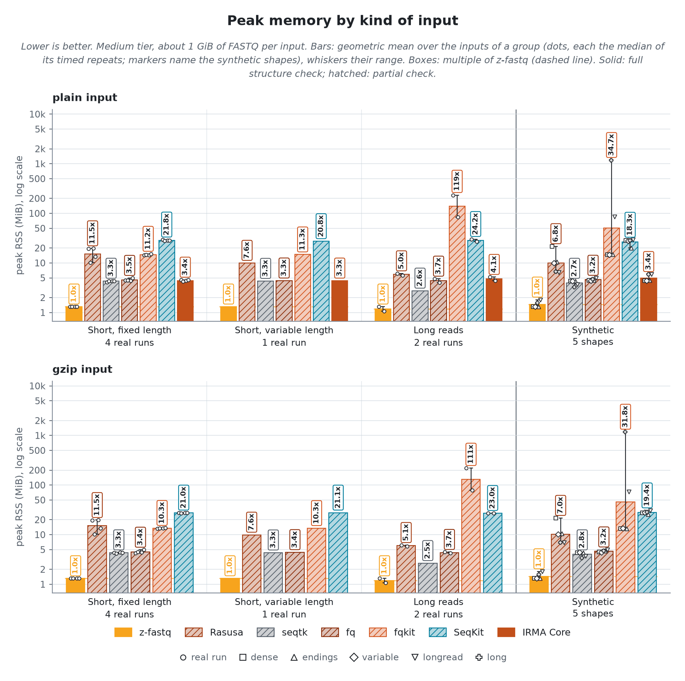
</picture>

Minor page faults by kind of input

<picture>
  <source media="(prefers-color-scheme: dark)" srcset="results/figures/exact-faults-dark.png">
  <source media="(prefers-color-scheme: light)" srcset="results/figures/exact-faults-light.png">
  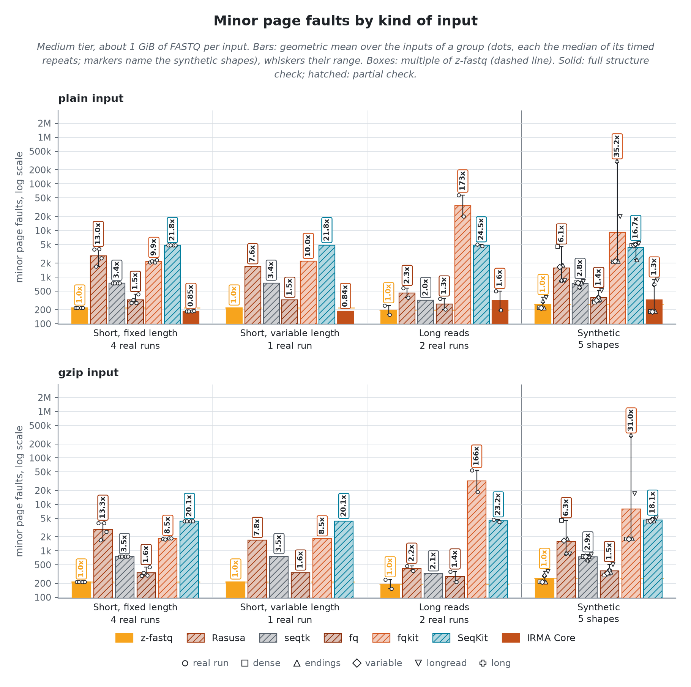
</picture>

K is 100,000 reads for short-read inputs and 1,000 for long-read inputs (the Long reads group, `longread`, and `long`); the `long` shape holds 1,789 records, so its 1,000 is close to a copy.

### Time and memory against K

<picture>
  <source media="(prefers-color-scheme: dark)" srcset="results/figures/exact-k-lines-dark.png">
  <source media="(prefers-color-scheme: light)" srcset="results/figures/exact-k-lines-light.png">
  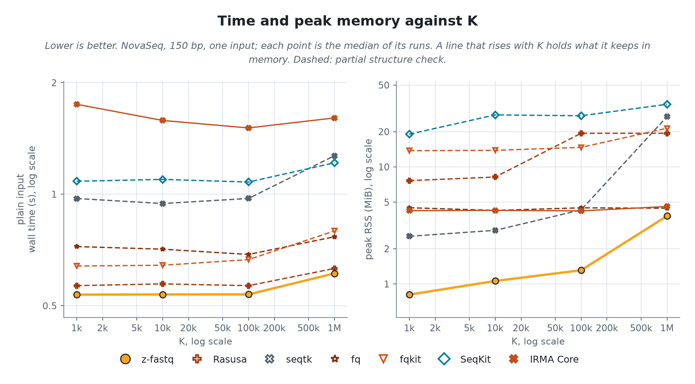
</picture>

|         K | z-fastq peak | Lowest other     | Highest other  |
| --------: | -----------: | ---------------- | -------------- |
|     1,000 |     0.81 MiB | 3.1x (seqtk)     | 23.4x (SeqKit) |
|    10,000 |     1.06 MiB | 2.7x (seqtk)     | 26.2x (SeqKit) |
|   100,000 |     1.31 MiB | 3.2x (IRMA Core) | 20.8x (SeqKit) |
| 1,000,000 |     3.81 MiB | 1.2x (fq)        | 9.0x (SeqKit)  |

## Pairs
> Each tool's time and peak memory as a multiple of z-fastq's, geometric mean over the 4 paired runs and the `paired` shape at 1 GiB. Paired fraction and paired exact count read two mate files; interleaved fraction reads one interleaved file on stdin, plain only, since Fasten cannot read gzip.

| Mode                 | Tool      | Plain time | Plain memory | Gzip time | Gzip memory | Passes malformed |
| -------------------- | --------- | ---------: | -----------: | --------: | ----------: | ---------------- |
| Paired fraction      | z-fastq   |      1.00x |        1.00x |     1.00x |       1.00x | none             |
| Paired fraction      | Rasusa    |      0.77x |        3.57x |     1.02x |       4.48x | 2 of 9           |
| Paired fraction      | fq        |      1.23x |        3.11x |     1.88x |       4.14x | 5 of 9           |
| Paired fraction      | IRMA Core |      3.71x |        3.35x |     2.73x |       4.47x | none             |
| Paired exact count   | z-fastq   |      1.00x |        1.00x |     1.00x |       1.00x | none             |
| Paired exact count   | Rasusa    |      0.92x |        9.43x |     1.04x |       8.04x | 2 of 9           |
| Paired exact count   | fq        |      0.93x |        2.69x |     1.39x |       2.48x | 5 of 9           |
| Paired exact count   | IRMA Core |      2.40x |        2.78x |         - |           - | none             |
| Interleaved fraction | z-fastq   |      1.00x |        1.00x |         - |           - | none             |
| Interleaved fraction | Fasten    |      3.92x |        2.43x |         - |           - | 7 of 9           |

## Reproducibility

How it was measured

Every tool runs through `zexec -r` inside one zebrac batch per case, held to one CPU core by a systemd scope with a CPU quota and a 4G memory cap, after the input was read once so every run reads from the page cache. zebrac gives wall time; zexec records each run's peak memory, CPU time, and minor faults for the tool alone. Peak RSS uses the kernel high-water counter, not an exact allocation count. Quick comparisons treat differences smaller than 256 KiB as inconclusive. Runs per tier, each after one warmup: tiny 31, xsmall 21, small 11, medium 3; sizes 1 MiB to 1 GiB. Generated by `bench/sample/run.sh release` on 2026-10-29.

Identity

- `z-fastq`: *0.1.0 at 246bbb1*
- `zebrac`: *0.6.2*
- `zexec`: *15000 bytes, static, no libc*
- `kernel`: *7.2.12-200.fc44.x86_64*
- `cpu`: *AMD Ryzen 9 3950X 16-Core Processor*
- `load at batch start`: *1.12 to 5.97*

Commands

- `z-fastq`, fraction: *zig-out/bin/z-fastq sample --fraction 0.1 --seed 11 IN*
- `Rasusa`, fraction: *tools/bin/rasusa reads -f 0.1 -1 -s 11 IN*
- `seqtk`, fraction: *tools/bin/seqtk sample -s 11 IN 0.1*
- `fq`, fraction: *tools/bin/fq subsample -p 0.1 -s 11 --r1-dst /dev/null IN*
- `SeqKit`, fraction: *tools/bin/seqkit sample -p 0.1 -s 11 -j 1 IN*
- `IRMA Core`, fraction: *tools/bin/irma-core sampler -p 10 -s 11 IN*
- `z-fastq`, exact: *zig-out/bin/z-fastq sample --count 100000 --seed 11 IN*
- `Rasusa`, exact: *tools/bin/rasusa reads -n 100000 -s 11 IN*
- `seqtk`, exact: *tools/bin/seqtk sample -2 -s 11 IN 100000*
- `fq`, exact: *tools/bin/fq subsample -n 100000 -s 11 --r1-dst /dev/null IN*
- `fqkit`, exact: *tools/bin/fqkit sample -n 100000 -s 11 -2 -@ 1 IN*
- `SeqKit`, exact: *tools/bin/seqkit sample2 -n 100000 -2 -w 0 -s 11 -j 1 IN*
- `IRMA Core`, exact: *tools/bin/irma-core sampler -t 100000 -s 11 IN*
- `z-fastq`, exact-k: *zig-out/bin/z-fastq sample --count 1000 --seed 11 IN*
- `Rasusa`, exact-k: *tools/bin/rasusa reads -n 1000 -s 11 IN*
- `seqtk`, exact-k: *tools/bin/seqtk sample -2 -s 11 IN 1000*
- `fq`, exact-k: *tools/bin/fq subsample -n 1000 -s 11 --r1-dst /dev/null IN*
- `fqkit`, exact-k: *tools/bin/fqkit sample -n 1000 -s 11 -2 -@ 1 IN*
- `SeqKit`, exact-k: *tools/bin/seqkit sample2 -n 1000 -2 -w 0 -s 11 -j 1 IN*
- `IRMA Core`, exact-k: *tools/bin/irma-core sampler -t 1000 -s 11 IN*
- `z-fastq`, paired-fraction: *zig-out/bin/z-fastq sample --paired --fraction 0.1 --seed 11 IN*
- `Rasusa`, paired-fraction: *tools/bin/rasusa reads -f 0.1 -1 -s 11 -o /dev/null -o /dev/null IN*
- `fq`, paired-fraction: *tools/bin/fq subsample -p 0.1 -s 11 --r1-dst /dev/null --r2-dst /dev/null IN*
- `IRMA Core`, paired-fraction: *tools/bin/irma-core sampler -p 10 -s 11 IN*
- `z-fastq`, paired-exact: *zig-out/bin/z-fastq sample --paired --count 100000 --seed 11 IN*
- `Rasusa`, paired-exact: *tools/bin/rasusa reads -n 100000 -s 11 -o /dev/null -o /dev/null IN*
- `fq`, paired-exact: *tools/bin/fq subsample -n 100000 -s 11 --r1-dst /dev/null --r2-dst /dev/null IN*
- `IRMA Core`, paired-exact: *tools/bin/irma-core sampler -t 100000 -s 11 IN*
- `z-fastq`, interleaved-fraction: *zig-out/bin/z-fastq sample --interleaved --fraction 0.1 --seed 11 IN*
- `Fasten`, interleaved-fraction: *tools/bin/fasten_sample -p -f 0.1*

Quick-check cases for peer and ab

Picked from these results: per family, group, and format, the case where z-fastq is closest to, or furthest behind, its fastest rival of any class. `run.sh peer` times z-fastq against a cached reference of the rival on each; `run.sh ab REV` times two z-fastq builds on each.

- `fraction: Long reads, plain`: *PromethION, 30 to 153 kb*; rival Rasusa at 0.79x z-fastq's time
- `fraction: Short, fixed length, plain`: *NovaSeq, Casava headers*; rival Rasusa at 1.03x z-fastq's time
- `fraction: Short, variable length, plain`: *10x mates, 28 and 150 bp*; rival Rasusa at 1.09x z-fastq's time
- `fraction: Synthetic, plain`: *longread: nanopore headers, rare 300 kb reads*; rival Rasusa at 0.83x z-fastq's time
- `fraction: Long reads, gzip`: *PromethION, 30 to 153 kb*; rival Rasusa at 1.02x z-fastq's time
- `fraction: Short, fixed length, gzip`: *NovaSeq, 150 bp*; rival Rasusa at 1.10x z-fastq's time
- `fraction: Short, variable length, gzip`: *10x mates, 28 and 150 bp*; rival Rasusa at 1.12x z-fastq's time
- `fraction: Synthetic, gzip`: *longread: nanopore headers, rare 300 kb reads*; rival Rasusa at 1.04x z-fastq's time
- `exact: Long reads, plain`: *PromethION, 30 to 153 kb*; rival Rasusa at 0.76x z-fastq's time
- `exact: Short, fixed length, plain`: *NovaSeq, Casava headers*; rival Rasusa at 1.04x z-fastq's time
- `exact: Short, variable length, plain`: *10x mates, 28 and 150 bp*; rival Rasusa at 1.12x z-fastq's time
- `exact: Synthetic, plain`: *longread: nanopore headers, rare 300 kb reads*; rival Rasusa at 0.80x z-fastq's time
- `exact: Long reads, gzip`: *PromethION, 30 to 153 kb*; rival Rasusa at 1.02x z-fastq's time
- `exact: Short, fixed length, gzip`: *NovaSeq, Casava headers*; rival Rasusa at 1.09x z-fastq's time
- `exact: Short, variable length, gzip`: *10x mates, 28 and 150 bp*; rival Rasusa at 1.12x z-fastq's time
- `exact: Synthetic, gzip`: *long: 300 kb sequence lines*; rival seqtk at 1.04x z-fastq's time

Hardware counters (user space, plain medium-tier inputs, geometric means)

| Tool      | Instructions per byte | Instructions per cycle | Cache misses per MiB | Branch misses per MiB |
| --------- | --------------------: | ---------------------: | -------------------: | --------------------: |
| z-fastq   |                  1.67 |                   3.51 |                 1805 |                   400 |
| Rasusa    |                  1.09 |                   2.64 |                  622 |                   765 |
| seqtk     |                  2.00 |                   2.59 |                 3933 |                  2004 |
| fq        |                  2.90 |                   3.46 |                  338 |                  1576 |
| SeqKit    |                  3.59 |                   2.38 |                 1502 |                  2890 |
| IRMA Core |                  9.31 |                   3.29 |                 1382 |                  5123 |

