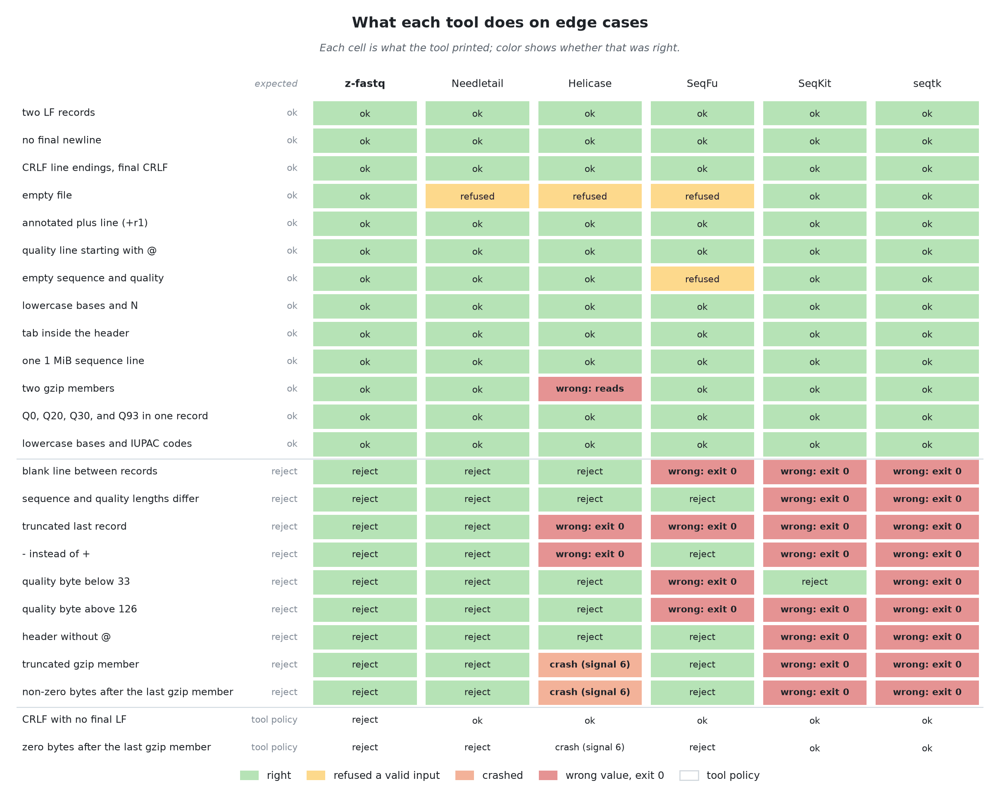
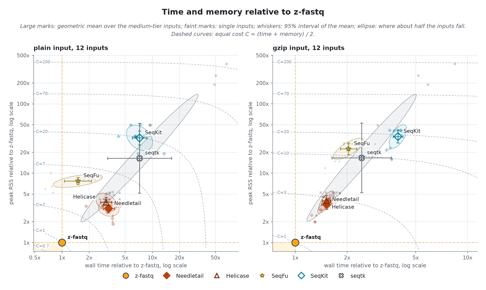
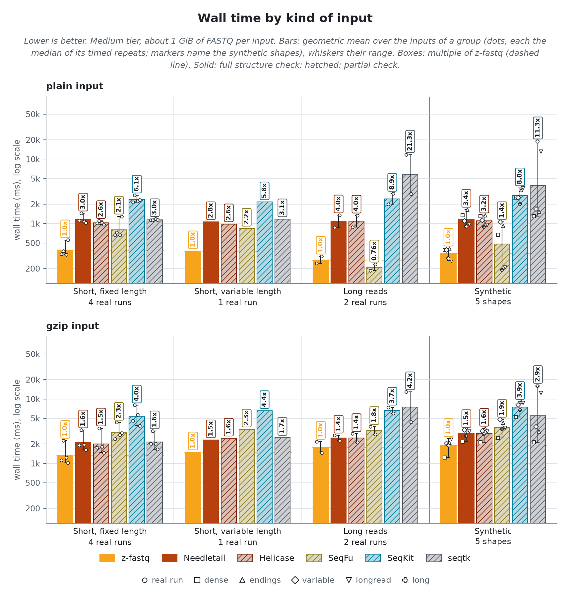
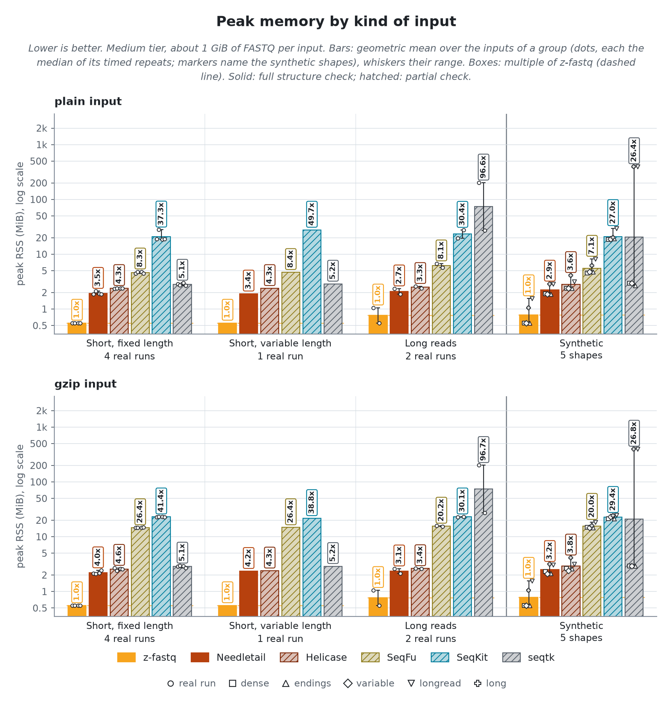
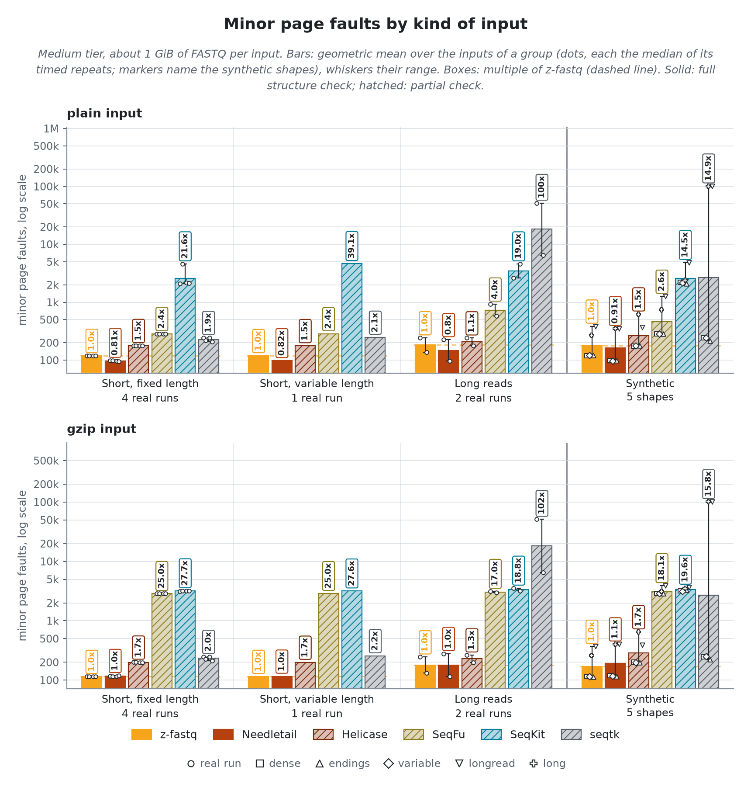
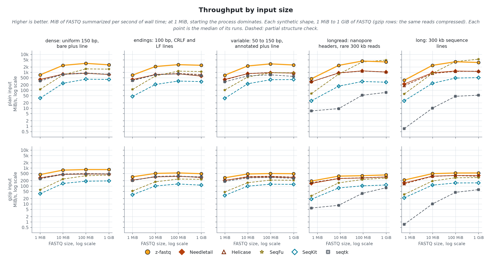
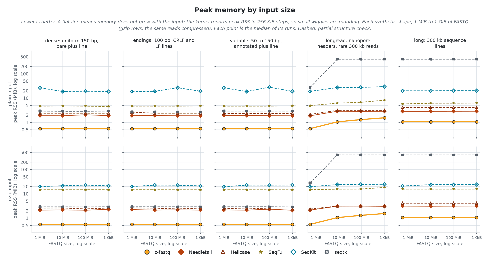

<!-- markdownlint-disable MD013 MD033 MD041 -->

# Aggregate statistics
> `z-fastq stats` against 5 other tools, on 7 real sequencing runs and 5 synthetic shapes, plain and gzip. A tool is timed only where its values were right; time and memory come from the same run, on one CPU.

- `z-fastq`: *0.1.0 at bc7f908, source modified*
- `machine`: *Ryzen 9 3950X, Linux 7.2.11; one CPU per run*
- `runner`: *zebrac 0.6.2 with zexec*
- `data`:
  - **Real**: *7 public sequencing runs, 1 GiB each, pooled in the bars by the kind of reads they hold*
    - `Short, fixed length`: *NovaSeq, 150 bp; NovaSeq, Casava headers; BGISEQ, 100 bp; miRNA, 36 bp*
    - `Short, variable length`: *10x mates, 28 and 150 bp*
    - `Long reads`: *PromethION, 30 to 153 kb; Revio HiFi, 4 to 21 kb*
  - **Synthetic**: *5 shapes generated from real reads, each changing one thing; one group in the bars at 1 GiB, and the scaling lines from 1 MiB to 1 GiB*
    - `dense`: *uniform 150 bp, bare plus line*
    - `endings`: *100 bp, CRLF and LF lines*
    - `variable`: *50 to 150 bp, annotated plus line*
    - `longread`: *nanopore headers, rare 300 kb reads*
    - `long`: *300 kb sequence lines*
- `date`: *2026-10-25*

## Findings

- **Right answers:** z-fastq returned the right values on all 218 checked inputs and rejected every malformed edge case. 4 of the 5 other tools print wrong values or crash on at least one.
- **Speed:** Needletail, the fastest other full-check tool, takes 3.29x z-fastq's time on plain input and 1.52x on gzip.
- **Memory:** every other tool peaks at 3.1x to 34x z-fastq's 0.68 MiB.
- **Where z-fastq is not fastest:** SeqFu on plain long reads (0.76x).
- **Wrong on valid input, exit 0:** two gzip members: Helicase (reads wrong).

## Compared tools
> *complete* tools check as much as z-fastq; *partial* tools check less, so they do less work. The bold count is how many of four malformed inputs the tool rejects: a sequence and quality length mismatch, a truncated last record, `-` instead of `+`, and a quality byte below 33.

- `z-fastq 0.1.0` **(subject)**; *checks every record's structure*; **4 of 4 rejected**
- `Needletail 0.7.3` **(complete)**; *checks every record's structure; built for this CPU*; **4 of 4 rejected**
- `Helicase 0.2.0` **(partial)**; *accepts a truncated last record and a bad plus line*; **2 of 4 rejected**
- `SeqFu 1.29.0` **(partial)**; *lengths only: no base or quality counts; accepts a truncated last record, a blank line, and out-of-range quality bytes*; **2 of 4 rejected**
- `SeqKit 2.14.0` **(partial)**; *no structure check; keeps every read length*; **1 of 4 rejected**
- `seqtk 1.5` **(partial)**; *no structure check; per-position table*; **0 of 4 rejected**

> [!IMPORTANT]
> Partial tools skip checks z-fastq makes, so they do less work per record; their times are not like-for-like with z-fastq or the complete tools.

## Right answers
> Reads are compared with the count recorded when the corpus was cut, and every other field with Needletail on the same input, an independent parser that must agree with z-fastq exactly. A printed decimal may differ by half its last digit. The edge cases are small inputs where tools differ: each cell shows what the tool printed, and its color whether that was right.

z-fastq returned the right values on all 218 inputs: every corpus file and synthetic shape on disk, 1 MiB to 1 GiB, plain and gzip. Every other tool was right on every input it was given.

> [!CAUTION]
> Helicase, SeqFu, SeqKit and seqtk print wrong values and exit 0 on some malformed inputs, so a script cannot tell the values are wrong. Helicase crashes on some malformed gzip input.

<picture>
  <source media="(prefers-color-scheme: dark)" srcset="results/figures/edges-dark.png">
  <source media="(prefers-color-scheme: light)" srcset="results/figures/edges-light.png">
  
</picture>

> [!NOTE]
> A cell is `ok` (every value printed is right), `reject` (exited with an error), `wrong: FIELD` (printed a wrong value, exit 0), `refused` (rejected a valid input), or `crash`. "tool policy" rows have no single right answer.

## Speed and memory
> The real runs and synthetic shapes at the medium tier, about 1 GiB of FASTQ each, pooled into kinds of input. Every tool runs on one CPU with the file in the page cache.

<picture>
  <source media="(prefers-color-scheme: dark)" srcset="results/figures/file-overview-dark.png">
  <source media="(prefers-color-scheme: light)" srcset="results/figures/file-overview-light.png">
  
</picture>

z-fastq itself takes 346.7 ms and 0.68 MiB per plain input, 1637.0 ms and 0.68 MiB per gzip input (geometric means over 12 inputs each); the table gives every tool as a multiple of that.

| Tool       | Plain time | Plain memory | Gzip time | Gzip memory |
| ---------- | ---------: | -----------: | --------: | ----------: |
| z-fastq    |      1.00x |        1.00x |     1.00x |       1.00x |
| Needletail |      3.29x |        3.08x |     1.52x |       3.52x |
| Helicase   |      3.08x |        3.82x |     1.52x |       4.00x |
| SeqFu      |      1.50x |        7.74x |     2.04x |      22.49x |
| SeqKit     |      7.21x |       32.26x |     3.95x |      33.85x |
| seqtk      |      7.22x |       16.49x |     2.43x |      16.67x |

<picture>
  <source media="(prefers-color-scheme: dark)" srcset="results/figures/file-speed-dark.png">
  <source media="(prefers-color-scheme: light)" srcset="results/figures/file-speed-light.png">
  
</picture>

<picture>
  <source media="(prefers-color-scheme: dark)" srcset="results/figures/file-memory-dark.png">
  <source media="(prefers-color-scheme: light)" srcset="results/figures/file-memory-light.png">
  
</picture>

Minor page faults by kind of input

<picture>
  <source media="(prefers-color-scheme: dark)" srcset="results/figures/file-faults-dark.png">
  <source media="(prefers-color-scheme: light)" srcset="results/figures/file-faults-light.png">
  
</picture>

## Scaling
> Each synthetic shape from 1 MiB to 1 GiB of FASTQ: throughput and peak memory against input size. A shape changes one thing a tool pays for, so its line shows what that one thing costs each tool.

<picture>
  <source media="(prefers-color-scheme: dark)" srcset="results/figures/file-scaling-speed-dark.png">
  <source media="(prefers-color-scheme: light)" srcset="results/figures/file-scaling-speed-light.png">
  
</picture>

<picture>
  <source media="(prefers-color-scheme: dark)" srcset="results/figures/file-scaling-memory-dark.png">
  <source media="(prefers-color-scheme: light)" srcset="results/figures/file-scaling-memory-light.png">
  
</picture>

At 1 GiB, z-fastq summarizes 2.4 to 3.7 GiB/s on plain input and 0.4 to 0.8 GiB/s on gzip input. Faster on a single shape there, as throughput over z-fastq's: SeqFu on plain long (1.53x); SeqFu on plain longread (1.26x).
z-fastq peaks at 0.56 to 1.56 MiB across sizes and shapes. Memory that grows with the input: Needletail by 1.5x on plain longread; Helicase by 1.5x on plain longread; SeqFu by 1.7x on plain longread; SeqKit by 1.6x on plain longread; seqtk by 14.6x on plain longread.

## Other input forms
> The same statistics, with the input on stdin or as many files in one call.

### Stdin

The same file on stdin.

Each tool's time and peak memory reading the file from a pipe, as a multiple of its own with the path (geometric mean over the shared shapes):

| Tool       | Plain time | Plain memory | Gzip time | Gzip memory |
| ---------- | ---------: | -----------: | --------: | ----------: |
| z-fastq    |      0.90x |        1.00x |     0.96x |       1.00x |
| Needletail |      0.90x |        1.03x |     0.97x |       0.99x |
| Helicase   |      0.93x |        0.90x |     0.93x |       0.84x |
| SeqFu      |      0.92x |        1.02x |     0.94x |       0.99x |
| SeqKit     |      0.92x |        1.31x |     0.93x |       1.04x |
| seqtk      |      0.87x |        1.01x |     0.96x |       1.01x |

### Many files

Every xsmall corpus file in one call.

Summarizing all 11 xsmall corpus files (110 MiB) in one call, z-fastq takes 34.4 ms on plain input and 181.4 ms on gzip, at 0.81 MiB peak. SeqFu takes 2.1x and 2.2x as long with 8x and 24x the memory. SeqKit takes 8.1x and 3.9x as long with 35x and 29x the memory.

## Reproducibility

How it was measured

Every tool runs through `zexec -r` inside one zebrac batch per case, held to one CPU core by a systemd scope with a CPU quota and a 4G memory cap, after the input was read once so every run reads from the page cache. zebrac gives wall time; zexec records each run's peak memory, CPU time, and minor faults for the tool alone. The kernel reports peak memory in 256 KiB steps, so values closer than that are equal. Runs per tier, each after one warmup: tiny 31, xsmall 21, small 11, medium 3; sizes 1 MiB to 1 GiB. Generated by `bench/stats/run.sh release` on 2026-10-25.

Identity

- `z-fastq`: *0.1.0 at bc7f908, source modified*
- `zebrac`: *0.6.2*
- `zexec`: *12616 bytes, static, no libc*
- `kernel`: *7.2.11-200.fc44.x86_64*
- `cpu`: *AMD Ryzen 9 3950X 16-Core Processor*
- `load at batch start`: *3.69 to 18.02*

Commands

- `z-fastq`: *zig-out/bin/z-fastq stats IN*
- `Needletail`: *bench/cache/adapters/native/needletail-adapter stats IN*
- `Helicase`: *bench/cache/adapters/native/helicase-adapter stats IN*
- `SeqFu`: *tools/bin/seqfu stats --threads 1 IN*
- `SeqKit`: *tools/bin/seqkit stats -a -T -j 1 IN*
- `seqtk`: *tools/bin/seqtk fqchk IN*

Quick-check cases for peer and ab

Picked from these results: per group and format, the case where z-fastq leads its fastest full-check rival by the least. `run.sh peer` times z-fastq against a cached reference of the rival on each; `run.sh ab REV` times two z-fastq builds on each.

- `Long reads, plain`: *PromethION, 30 to 153 kb*; rival Needletail at 3.62x z-fastq's time
- `Short, fixed length, plain`: *miRNA, 36 bp*; rival Needletail at 1.85x z-fastq's time
- `Short, variable length, plain`: *10x mates, 28 and 150 bp*; rival Needletail at 2.84x z-fastq's time
- `Synthetic, plain`: *variable: 50 to 150 bp, annotated plus line*; rival Needletail at 2.82x z-fastq's time
- `Long reads, gzip`: *PromethION, 30 to 153 kb*; rival Needletail at 1.25x z-fastq's time
- `Short, fixed length, gzip`: *BGISEQ, 100 bp*; rival Needletail at 1.45x z-fastq's time
- `Short, variable length, gzip`: *10x mates, 28 and 150 bp*; rival Needletail at 1.54x z-fastq's time
- `Synthetic, gzip`: *longread: nanopore headers, rare 300 kb reads*; rival Needletail at 1.30x z-fastq's time

Hardware counters (user space, plain medium-tier inputs, geometric means)

| Tool       | Instructions per byte | Instructions per cycle | Cache misses per MiB | Branch misses per MiB |
| ---------- | --------------------: | ---------------------: | -------------------: | --------------------: |
| z-fastq    |                  2.97 |                   3.91 |                 1415 |                   160 |
| Needletail |                 11.39 |                   3.51 |                  893 |                  2133 |
| Helicase   |                 11.23 |                   3.57 |                 1777 |                  2176 |
| SeqFu      |                  2.51 |                   2.13 |                 1239 |                  1748 |
| SeqKit     |                 24.53 |                   3.17 |                 2751 |                 22614 |
| seqtk      |                 11.17 |                   1.54 |                40438 |                  5530 |

