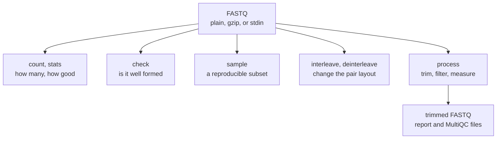

# z-fastq

z-fastq is a FASTQ toolkit in a single Linux executable. It counts and summarizes reads, checks that files are well formed, takes reproducible samples, moves paired reads between two files and one, and processes pairs: trimming, filtering, and quality control in one streaming pass. The reader, writer, and statistics behind it are also available as a small Zig library.

I am building it because everyday FASTQ work should run well on an ordinary machine. A tool can be fast and still be a poor neighbour in a workflow if every step holds more memory than the job needs, or if a malformed record slips through without a word. z-fastq streams its input, keeps its memory bounded, and says exactly what went wrong when something does.

<b>Figure 1.</b> The seven commands. Every command reads plain FASTQ, gzip, or standard input through the same path.

## Where to start

New here? [Install z-fastq](Installation), then follow [Getting started](Getting-Started), which runs the main commands on a small file in a few minutes.

**Work with reads**

- [Counting and statistics](Counting-and-Statistics): how many reads, how long, how good.
- [Validation](Validation): what makes a record valid, and what `check` reports when one is not.
- [Paired reads](Paired-Reads): how R1 and R2 are matched, record by record.
- [Sampling](Sampling): reproducible subsets that keep mates together.
- [Interleaving](Interleaving): between two files and one interleaved file.

**Prepare paired reads for analysis**

- [Processing paired reads](Processing): adapter, poly-G, and quality trimming, then filtering.
- [Quality control](Quality-Control): what `process` measures, and the files MultiQC reads.

**Look things up**

- [Command cheat sheet](Command-Cheat-Sheet): every command and option.
- [Report reference](Report-Reference): every field of the JSON outputs.
- [Input and output](Input-and-Output), [Automation](Automation), and [Limits and supported formats](Limits-and-Supported-Formats).

**Decide and solve**

- [Choosing a FASTQ tool](Choosing-a-FASTQ-Tool): where z-fastq fits, and where another tool fits better.
- [Recipes](Recipes), [Troubleshooting](Troubleshooting), and the [FAQ](FAQ).
- [References](References): the tools z-fastq builds on and is compared with, the data it is checked on, and citations.

**Build on it**

- [Zig library](Zig-Library) and [For contributors](For-Contributors).

## At a glance

- One static executable for Linux x86-64, written in Zig 0.16.0, with a single package dependency, [zipir](https://github.com/eneskemalergin/zipir), for gzip.
- Single-threaded and streaming: memory stays flat however many reads a file holds.
- Trimming and filtering follow fastp 1.1.0's rules, and quality control follows FastQC 0.13.0's definitions. z-fastq covers part of what those tools do and replaces neither ([References](References)).
- Version 0.1.0 is released; 0.2.0, which adds `process`, is in development.

> [!NOTE]
> z-fastq never repairs a malformed record silently. A file it cannot read correctly fails with an error code, the position of the problem, and a nonzero exit status.
