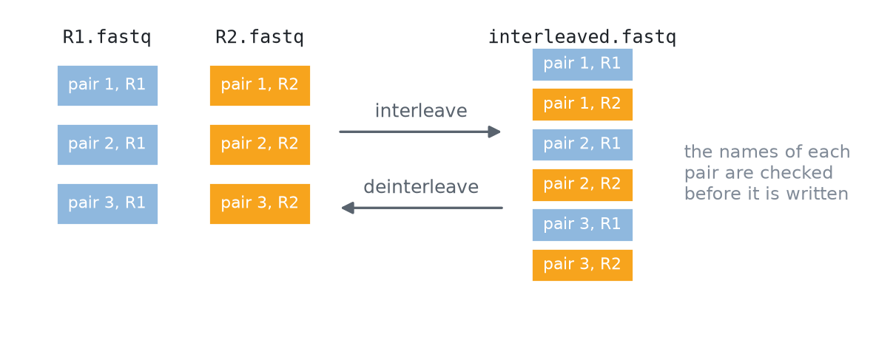

# Interleaving

Paired reads come in two layouts. Most sequencers write two files, R1 and R2; some tools prefer one interleaved file, in which each mate 1 record is followed by its mate 2. `interleave` and `deinterleave` move between the two, checking every pair on the way.

<p align="center">
  <picture>
    <source media="(prefers-color-scheme: dark)" srcset="assets/pair-layouts-dark.png">
    <source media="(prefers-color-scheme: light)" srcset="assets/pair-layouts-light.png">
    
  </picture>
</p>
<p align="center"><sub><b>Figure 1.</b> Two files and one interleaved file hold the same pairs in a different order.</sub></p>

Both commands validate every record and match the mates' names ([Paired reads](Paired-Reads)) before writing a pair. They never trim, reorder, or repair anything.

## interleave

```bash
z-fastq interleave R1.fastq.gz R2.fastq.gz > interleaved.fastq
z-fastq interleave R1.fastq.gz R2.fastq.gz | gzip > interleaved.fastq.gz
```

The result goes to standard output as plain FASTQ; pipe it to `gzip` to compress it. Add `--pair-names exact` when the whole first word of each name must match.

## deinterleave

```bash
z-fastq deinterleave --out1 R1.fastq --out2 R2.fastq interleaved.fastq.gz
```

The first record of each pair goes to `--out1`, the second to `--out2`. Both must be new files; z-fastq never overwrites one. A failure partway, such as a broken pair, leaves the two files partly written.

## Inputs and failures

Each input may be plain, gzip, or `-` for standard input, with at most one `-`. The first broken record, mismatched name, or unequal record count stops the run with a nonzero exit status ([Automation](Automation#exit-status)).

<p align="center">
  <picture>
    <source media="(prefers-color-scheme: dark)" srcset="https://raw.githubusercontent.com/eneskemalergin/z-fastq/main/bench/layout/results/figures/interleave-overview-dark.png">
    <source media="(prefers-color-scheme: light)" srcset="https://raw.githubusercontent.com/eneskemalergin/z-fastq/main/bench/layout/results/figures/interleave-overview-light.png">
    
  </picture>
</p>
<p align="center"><sub><b>Figure 2.</b> Interleaving: time and peak memory relative to z-fastq. A few tools are faster on plain input, and several of them also write broken pairs with exit status 0. The <a href="https://github.com/eneskemalergin/z-fastq/blob/main/bench/layout/README.md">layout benchmark</a> has the details and the same figure for deinterleaving.</sub></p>

## Related pages

- [Paired reads](Paired-Reads): how mate names are matched.
- [Sampling](Sampling#pairs): paired samples come out interleaved.
- [Recipes](Recipes#make-an-interleaved-gzip-file): an interleaved gzip file in one line.
