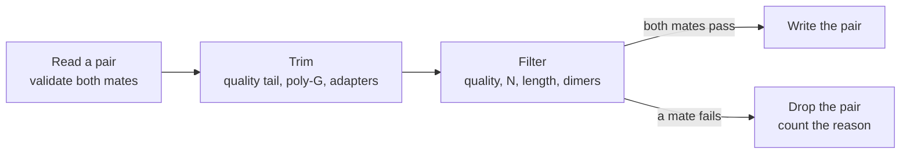
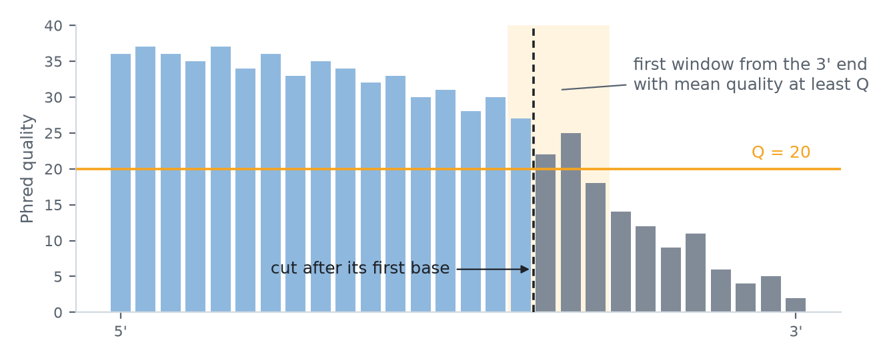
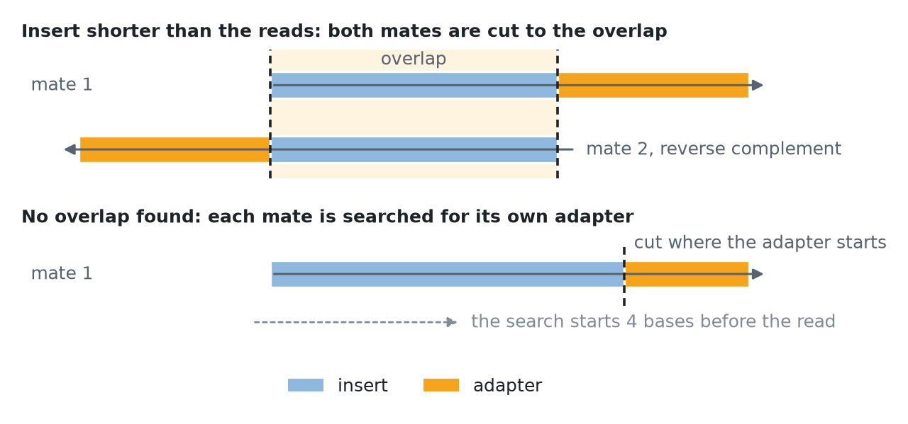

# Processing paired reads

`process` reads two mate files side by side, checks every pair as `check --paired` does, and writes the pairs it keeps to two new files. On the way it can trim adapters, overlaps, poly-G runs, and low-quality ends, and drop pairs that fail quality, `N`, or length filters. Each trim and each filter is off until you ask for it, so a plain `process` run validates and copies, and nothing else.



<p align="center"><sub><b>Figure 1.</b> What happens to each pair. Every step is off until its options are given.</sub></p>

The trimming and filtering rules are fastp 1.1.0's, followed step by step, so `process` keeps exactly the records fastp keeps with the same settings. I chose to match fastp rather than invent new rules: its behavior is well known, and a workflow that already trusts it can compare the two outputs record by record. z-fastq is not a fastp replacement, though; it covers only these trims and filters ([References](References)).

## A first run

```bash
z-fastq process --gzip \
  --adapter1 AGATCGGAAGAGCACACGTCTGAACTCCAGTCA --adapter2 AGATCGGAAGAGCGTCGTGTAGGGAAAGAGTGT \
  --min-length 15 --report sample.json \
  --out1 trimmed_R1.fastq.gz --out2 trimmed_R2.fastq.gz R1.fastq.gz R2.fastq.gz
```

This trims the Illumina TruSeq adapters, drops pairs with a mate shorter than 15 bases, writes gzip outputs, and records what happened in `sample.json`. [Quality control](Quality-Control) explains the measurements in that report, and [Report reference](Report-Reference) lists its fields.

## Outputs

- `--out1` and `--out2` must be new files; an existing path, an input included, fails before anything is written.
- Mate 1 goes to `--out1` and mate 2 to `--out2`, in input order. Headers and plus lines are copied as they are; trims shorten the sequence and quality together.
- `--gzip` compresses both outputs with Zipir's `fast` preset. `--gzip-preset even` or `dense` gives smaller files for more CPU time: on a 1.5 million pair NovaSeq sample the whole run took 5.8 s with `fast` and 14.0 s with `even`, for 216 MB and 180 MB. The output carries no time stamp, so the same inputs give the same bytes.
- One input may be standard input; outputs are always files.
- `--max-pairs N` stops after the first N pairs, and the report records that the inputs were not read to the end. Use `check --paired` to validate whole files. It cannot be combined with the MultiQC-compatible outputs, which cannot say that only part of a file was read.

## Trimming

The trims run in this order on every pair, each only when its options are given.

### Quality tail

`--trim-tail-window W --trim-tail-quality Q` looks at windows of W bases, starting at the 3' end and moving toward the 5' end, and stops at the first window whose mean quality is at least Q (Figure 2). The read keeps everything up to that window's first base; trailing `N` bases are then removed.

<p align="center">
  <picture>
    <source media="(prefers-color-scheme: dark)" srcset="assets/quality-tail-dark.png">
    <source media="(prefers-color-scheme: light)" srcset="assets/quality-tail-light.png">
    
  </picture>
</p>
<p align="center"><sub><b>Figure 2.</b> Quality-tail trimming with a 4-base window and Q = 20. Windows are tried from the 3' end; the first whose mean reaches Q is marked, and the read keeps everything up to that window's first base.</sub></p>

A read no longer than W is emptied, and a read with no passing window keeps one base. When either mate ends up empty, the pair is not trimmed further and is dropped.

### Poly-G

`--trim-poly-g N` removes the run of `G` that two-colour instruments write when the signal ends. Bases are scanned from the 3' end; the scan stops after more than 5 other bases, or, from the Nth base on, when other bases exceed one in eight. If at least N bases were scanned, the read is cut before the leftmost `G` seen. A shorter run can still go when the scan carries past it: with N = 10, a read ending in nine `G` loses them.

### Adapters

`--adapter1 A1 --adapter2 A2` removes adapters in two ways (Figure 3).

<p align="center">
  <picture>
    <source media="(prefers-color-scheme: dark)" srcset="assets/adapter-trimming-dark.png">
    <source media="(prefers-color-scheme: light)" srcset="assets/adapter-trimming-light.png">
    
  </picture>
</p>
<p align="center"><sub><b>Figure 3.</b> The two ways adapters are found. Top: the insert is shorter than the reads, so each read runs into the adapter, and the overlap between the mates shows where the insert ends. Bottom: without an overlap, each mate is searched for its own adapter.</sub></p>

1. **By overlap.** Mate 1 is compared with the reverse complement of mate 2 at each offset in turn. The first offset where the overlap has at most 5 mismatches in its first 50 positions, and no more than one per 5 bases, wins; more than 30 bases must overlap. When mate 2 then starts before mate 1, the insert is shorter than the reads, and both mates are cut to the overlap.
2. **By sequence.** Otherwise each mate is searched for its own adapter: a full copy, or at least 5 bases of its start at the read's 3' end, with one mismatch per 8 bases. The search begins 4 bases before the read, so a read that starts with the tail of an adapter is emptied. If nothing is found, a copy with one inserted or deleted base is tried. Like fastp, this last test compares the adapter with the start of the read, so it can also cut near the 3' end where no adapter is present.

Adapters are 4 to 128 uppercase bases of `A`, `C`, `G`, and `T`. Comparisons are exact bytes: a lowercase base never matches.

## Filtering

Each read is checked after trimming, and a pair is written only when both mates pass. A read fails on the first check below that applies.

| Check | A read fails when | Range |
| --- | --- | --- |
| always, with any trim or filter | no bases are left | |
| `--low-quality Q --max-low-quality-percent P` | more than P% of bases are below Q | Q 0 to 93, P 0 to 100 |
| `--max-n N` | more than N uppercase `N` | 0 to 50 |
| `--min-length N` | fewer than N bases | 0 to 4,294,967,295 |

- With adapters, a pair whose adapter or overlap step cut a mate and left both mates at 2 bases or fewer is an adapter dimer, and is dropped.
- A pair is dropped whole. Its reason is the worse of its mates' reasons, in the order adapter dimer, low quality, too short, too many `N`.
- Dropping pairs never changes the exit status. A malformed record still fails the run, because every pair is validated before it is trimmed.

fastp turns its filters on by default; z-fastq applies only the filters you give. `--low-quality 15 --max-low-quality-percent 40 --max-n 5 --min-length 15` are fastp's default values.

<details>
<summary>Matching fastp settings</summary>

Each pair of lines keeps the same records with fastp 1.1.0:

```text
z-fastq  --adapter1 A1 --adapter2 A2
fastp    --adapter_sequence A1 --adapter_sequence_r2 A2 --disable_trim_poly_g -Q -L

z-fastq  --adapter1 A --adapter2 A --trim-poly-g 10 --trim-tail-window 4 --trim-tail-quality 20
fastp    --adapter_sequence A --adapter_sequence_r2 A --trim_poly_g --poly_g_min_len 10
         --cut_tail --cut_tail_window_size 4 --cut_tail_mean_quality 20 -Q -L

z-fastq  --adapter1 A1 --adapter2 A2 --low-quality 15 --max-low-quality-percent 40 --max-n 5 --min-length 15
fastp    --adapter_sequence A1 --adapter_sequence_r2 A2 --disable_trim_poly_g
```

fastp 1.4.0 keeps the same records, except on mate 2 reads with the IUPAC letters `S`, `W`, or `D`, where its result depends on the CPU. fastp's automatic adapter detection, automatic poly-G mode, and its other filters are not part of z-fastq.

</details>

## When a run fails

A failure stops the run and exits with a nonzero status: `1` for invalid input, `2` for a usage error, `3` for I/O or memory, `4` for a limit. Pairs written before the failure stay in the outputs. The report is still written, with `"status": "error"` and the reason; the [MultiQC-compatible files](Quality-Control#multiqc-compatible-outputs) are written only when the run succeeds.

Treat a run as complete only when it exits with `0`.

## Related pages

- [Quality control](Quality-Control): what the run measures, and the files MultiQC reads.
- [Report reference](Report-Reference#report): the `trimming` and `filtering` counts in the report.
- [Paired reads](Paired-Reads): the name checks every pair passes first.
- [Recipes](Recipes#trim-filter-and-report-for-multiqc): a complete run with fastp's default filters.
