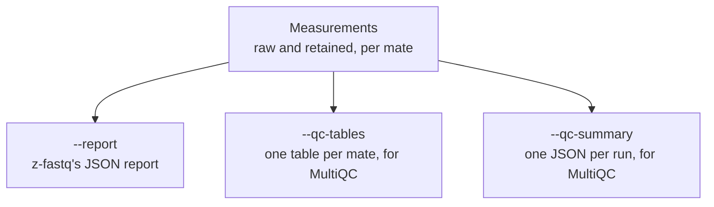

# Quality control

While `process` reads, it measures each mate twice: once as the reads arrive (**raw**) and once as they are written (**retained**). Comparing the two shows what trimming and filtering did. The measurements follow FastQC 0.13.0's module definitions, and the insert and duplication counts follow fastp 1.1.0, so the numbers line up with reports you may already know.

Measuring adds about a second of CPU time per million pairs, so it runs only when you ask for one of its outputs:



<p align="center"><sub><b>Figure 1.</b> One set of measurements, three ways to write it.</sub></p>

- **The report** (`--report`) holds everything, with the run's status, for scripts ([Report reference](Report-Reference#report)).
- **QC tables** (`--qc-tables`) hold the QC modules per mate, for MultiQC's FastQC module ([below](#qc-tables)).
- **The QC summary** (`--qc-summary`) holds the run's totals and curves, for MultiQC's fastp module ([below](#qc-summary)).

## What is measured

| Module                    | What it shows                                  |
| ------------------------- | ---------------------------------------------- |
| Per-base quality          | quality percentiles at each cycle              |
| Per-base content          | the share of A, C, G, and T at each cycle      |
| Per-base N                | the share of `N` at each cycle                 |
| Length distribution       | how many reads have each length                |
| Per-sequence quality      | how many reads have each mean quality          |
| Per-sequence GC           | how many reads have each GC percentage         |
| Terminal runs             | reads ending in at least 10 `G` or 10 `A`      |
| Adapter content           | where common adapters start in the reads       |
| Duplication levels        | how often each read sequence repeats           |
| Overrepresented sequences | sequences above 0.1% of reads                  |
| Per-tile quality          | each flow-cell tile's quality against the mean |

Long reads are grouped into ranges of cycles, as FastQC groups them, so a 150-base read gives about 40 rows rather than 150. Per-cycle modules cover reads up to 1024 bases; a mate with a longer read reports them as unavailable, with the reason, while the other modules keep working.

### Adapter content

The reads are searched for FastQC's six 12-base adapters: Illumina Universal, Illumina Small RNA 3' and 5', Nextera Transposase, PolyA, and PolyG. For each position, the module gives the share of reads whose first exact match starts at or before it, so the curve only rises. This is a measurement; trimming uses the adapters you give with `--adapter1` and `--adapter2`.

### Duplication and overrepresented sequences

Each read is keyed by its first 50 bases, in uppercase. The first 100,000 distinct keys are counted exactly; later reads with a new key count only toward the total, and the duplication levels are corrected for them as FastQC corrects them. A sequence above 0.1% of all reads is overrepresented.

`--contaminants PATH` names the likely source of each overrepresented sequence from a contaminant list in FastQC's format: a name, one or more tabs, and a sequence per line, with `#` lines and blank lines skipped. Give it the list your QC setup already uses; z-fastq ships none, so without it no source is named. A list over 1 MiB fails with status `4`, a sequence with a base other than A, C, G, or T with status `2`, and an unreadable file with status `3`, before any output is created.

### Per-tile quality

The tile is read from the header split at `:`: the fifth field when the first counted read has 7 or more fields, as Illumina's `instrument:run:flowcell:lane:tile:x:y` does, or the third when it has 5 or 6. Each tile's mean quality per group of cycles is compared with the average over all tiles, so a dark or bubbled tile stands out. The first 10,000 reads with a quality string count, then every tenth. The module is unavailable, and says why, when a header has no valid tile number, with more than 2,500 tiles, or when a counted read is longer than 1024 bases.

### Insert sizes

With adapters given, the mate overlap that trimming finds also gives the insert size, the length of the DNA fragment between the adapters. When mate 2 starts after mate 1, the insert spans both reads minus their overlap $`o`$; otherwise it is the overlap itself:

```math
\text{insert} =
\begin{cases}
\ell_1 + \ell_2 - o & \text{if mate 2 starts after mate 1}\\
o & \text{otherwise}
\end{cases}
```

where $`\ell_1`$ and $`\ell_2`$ are the mate lengths. Pairs with no overlap, or an insert of 512 or more, count as unknown.

### Pair duplication

`--pair-duplication` adds fastp's duplication rate for whole pairs: the share of pairs whose sequence, mate 1 followed by mate 2, was seen before. Like fastp, it hashes each pair to one bit in each of two large bit arrays, and a pair whose bits were both set already is a duplicate, so a rare hash collision counts too. fastp keeps a fixed 1 GiB for this; z-fastq keeps only the bits that are set, about 10 bytes per pair, and never more than 1 GiB. It needs `--report` or `--qc-summary`.

## MultiQC-compatible outputs

Two options write the same measurements in formats [MultiQC](https://multiqc.info) already reads, so a workflow can show z-fastq's QC beside its other steps. Both are written after the FASTQ outputs and before the native report. If writing any requested QC output or the native report fails, this run's QC tables and summary are removed. This is cleanup after failure, not an atomic multi-file transaction; earlier FASTQ output remains available. Neither can be combined with `--max-pairs`, since their formats cannot say that only part of a file was read.

### QC tables

```bash
z-fastq process --qc-tables qc --contaminants contaminant_list.txt --min-length 30 \
  --out1 trimmed_R1.fastq --out2 trimmed_R2.fastq R1.fastq.gz R2.fastq.gz
```

`--qc-tables DIR` writes one table per mate in FastQC's `fastqc_data.txt` layout, which MultiQC's FastQC module reads. The raw tables are named after the inputs; when trimming or filtering changes the reads, retained tables follow, named after the outputs. The run above writes:

```text
qc/R1_fastqc/fastqc_data.txt
qc/R2_fastqc/fastqc_data.txt
qc/trimmed_R1_fastqc/fastqc_data.txt
qc/trimmed_R2_fastqc/fastqc_data.txt
```

The folder name is the file name with `.gz`, `.bz2`, `.txt`, `.fastq`, `.fq`, `.csfastq`, `.sam`, `.bam`, and `.ubam` removed in that order, plus `_fastqc`; standard input is named `stdin`. Folders are created as needed.

- Two files that would share a folder, such as an input and an output with the same name, are refused before anything starts (status `2`), and so is a file name with a tab or line break.
- An existing `fastqc_data.txt` fails with `output path already exists` (status `3`) before any read is processed, and the outputs created by the run are removed.
- A mate with a read longer than 1024 bases has no per-cycle tables, so its table is not written: a warning names it, the run still succeeds, and the report lists the reason.

> [!TIP]
> MultiQC names a sample after the file name, with endings such as `.gz`, `.fastq`, `.trimmed`, and `.clean` removed, and keeps only one of two samples with the same name. Name the outputs so they stay distinct: `trimmed_R1.fastq.gz` works beside `R1.fastq.gz`, while `R1.trimmed.fastq.gz` would hide one of them.

Each module in a table carries the status FastQC would give it at its default limits: pass, warn, or fail. Treat these as hints about a module, not as a verdict on the sample. The tables match FastQC-Rust 1.1.0's output byte for byte, apart from the first line, which names z-fastq, and the order of overrepresented sequences with equal counts. Kmer Content, off in FastQC's defaults, is not included.

### QC summary

```bash
z-fastq process --adapter1 AGATCGGAAGAGCACACGTCTGAACTCCAGTCA --adapter2 AGATCGGAAGAGCGTCGTGTAGGGAAAGAGTGT \
  --min-length 15 --pair-duplication --qc-summary sample.json \
  --out1 trimmed_R1.fastq.gz --out2 trimmed_R2.fastq.gz --gzip R1.fastq.gz R2.fastq.gz
```

`--qc-summary PATH` writes one JSON file per run in the layout of fastp's JSON report, which MultiQC's fastp module reads: read and base totals before and after filtering, Q20 and Q30 rates, GC, the filter counts, the duplication rate, insert sizes, adapter-trimmed reads and bases, and per-cycle quality and base content. Add `--pair-duplication` to include the duplication rate. Without it, the summary omits the `duplication` section and avoids memory growth from pair-duplication tracking; all other summary measurements remain available. MultiQC names the sample after the file, so `sample.json` shows as `sample`.

The values describe what z-fastq did with the options you gave; they match fastp's report when the run uses fastp's settings ([Processing](Processing#filtering)). The fields, and what fastp writes that this file leaves out, are in [Report reference](Report-Reference#qc-summary).

## Limits and differences

- Quality is read as Phred+33 only. Java FastQC 0.13.0 can warn about possible Phred+64 without changing its reported Sanger / Illumina 1.9 encoding; a high minimum quality alone does not imply that FastQC switched decoding.
- Module statuses use FastQC's default limits and cannot be changed.
- In Adapter Content, a 12-base read that matches counts even before any longer read, as FastQC-Rust counts it; Java FastQC skips it.
- IUPAC codes other than `N` count as none of A, C, G, T, or N. fastp groups them with other bases, so GC and base content differ from fastp's only for reads that carry them.

## Speed

<p align="center">
  <picture>
    <source media="(prefers-color-scheme: dark)" srcset="https://raw.githubusercontent.com/eneskemalergin/z-fastq/main/bench/process/results/figures/qc-overview-dark.png">
    <source media="(prefers-color-scheme: light)" srcset="https://raw.githubusercontent.com/eneskemalergin/z-fastq/main/bench/process/results/figures/qc-overview-light.png">
    
  </picture>
</p>
<p align="center"><sub><b>Figure 2.</b> FastQC tables for both mates against FastQC-Rust and FastQC, on 1 GiB inputs and one CPU each; lower left is better. z-fastq also writes both mates in this job, which the FastQC tools do not. The <a href="https://github.com/eneskemalergin/z-fastq/blob/main/bench/process/README.md">process benchmark</a> has threads and every number.</sub></p>

[Performance](Performance) shows what threads buy FastQC-Rust and FastQC, and what they cost in memory.

## Related pages

- [Processing paired reads](Processing): the trims and filters that make the retained reads.
- [Report reference](Report-Reference): every field of the report and the QC summary.
- [References](References): the tools whose definitions these measurements follow, with citations.
