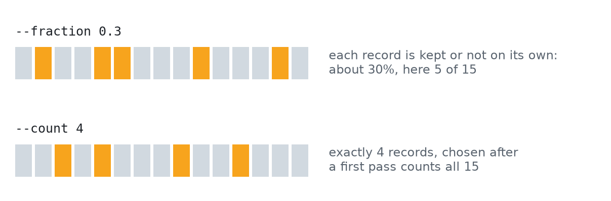

# Sampling

`sample` writes a subset of the records to standard output, and gives the same subset every time it sees the same input and seed. That makes a sample something you can rerun, share, and compare, rather than a one-off.

<p align="center">
  <picture>
    <source media="(prefers-color-scheme: dark)" srcset="assets/sampling-dark.png">
    <source media="(prefers-color-scheme: light)" srcset="assets/sampling-light.png">
    
  </picture>
</p>
<p align="center"><sub><b>Figure 1.</b> The two ways to sample. A fraction decides each record on its own, so the total varies a little; a count keeps exactly K records.</sub></p>

## By fraction or by count

```bash
z-fastq sample --fraction 0.1 --seed 42 reads.fastq.gz > sample.fastq
z-fastq sample --count 1000 --seed 42 reads.fastq > sample.fastq
```

**`--fraction P`** decides for each record on its own, in a single pass, so it works on pipes. You get about a share P of the records. A fraction is written `0`, `1`, `0.` and digits, or `1.` and zeros; percentages and scientific notation are refused.

**`--count K`** keeps exactly K records, or every record when there are fewer. It reads the file twice, once to count and once to write, so it needs a regular file rather than a pipe.

`--fraction 0` and `--count 0` write nothing; they only validate the input.

## Seeds

The seed is 11 unless you set it. The same seed, input, and options always select the same records:

```bash
z-fastq sample --fraction 0.01 --seed 2025 reads.fastq > a.fastq
z-fastq sample --fraction 0.01 --seed 2025 reads.fastq > b.fastq
cmp a.fastq b.fastq
```

This holds within a version of z-fastq; pin the version when exact records must stay the same across upgrades.

## Pairs

```bash
z-fastq sample --paired --fraction 0.1 --seed 42 R1.fastq R2.fastq > sample.fastq
z-fastq sample --interleaved --count 1000 --seed 42 interleaved.fastq > sample.fastq
```

The pair is the unit: both mates are kept or neither. The output is one interleaved stream, mate 1 then mate 2, which [`deinterleave`](Interleaving#deinterleave) splits back into two files.

## Memory and safety for exact counts

An exact count remembers a small entry for each chosen record, never the reads themselves, so its memory follows K rather than the size of the file:

```math
\text{memory} \approx 4\ \text{bytes} \times K
```

Past $`2^{32}`$ records an entry takes 8 bytes. In practice `--count 10000000` holds about 40 MB.

Because the file is read twice, it must not change in between. z-fastq compares its inode, size, and modification time across the two passes and stops with `input changed during exact sampling` if any differs; a rewrite that keeps all three is not detected.

<p align="center">
  <picture>
    <source media="(prefers-color-scheme: dark)" srcset="https://raw.githubusercontent.com/eneskemalergin/z-fastq/main/bench/sample/results/figures/fraction-overview-dark.png">
    <source media="(prefers-color-scheme: light)" srcset="https://raw.githubusercontent.com/eneskemalergin/z-fastq/main/bench/sample/results/figures/fraction-overview-light.png">
    
  </picture>
</p>
<p align="center"><sub><b>Figure 2.</b> Fraction sampling: time and peak memory relative to z-fastq. The tools faster than z-fastq here check less of each record; the <a href="https://github.com/eneskemalergin/z-fastq/blob/main/bench/sample/README.md">sample benchmark</a> shows where, and how exact counts compare.</sub></p>

## Output

The output is plain FASTQ; pipe it to `gzip` for compression. Records are written as they are chosen, so a malformed record late in the input fails the run after earlier records were written. Write to a temporary file and keep it only on success ([Automation](Automation#partial-output)).

## Related pages

- [Paired reads](Paired-Reads): how mates are matched before a pair is kept.
- [Interleaving](Interleaving): splitting a paired sample back into R1 and R2.
- [Recipes](Recipes#take-a-paired-subset-as-two-files): a paired subset as two files in one line.
