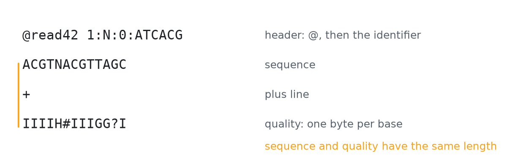

# Validation

`check` answers one question: can this file be trusted as FASTQ? It reads every record, stops at the first problem, and says exactly where the problem is.

```bash
z-fastq check reads.fastq.gz
```

A valid file prints nothing and exits with status `0`, so `check` works as a plain pass or fail step in a script.

## What a record must look like

<p align="center">
  <picture>
    <source media="(prefers-color-scheme: dark)" srcset="assets/fastq-record-dark.png">
    <source media="(prefers-color-scheme: light)" srcset="assets/fastq-record-light.png">
    
  </picture>
</p>
<p align="center"><sub><b>Figure 1.</b> The four lines of a FASTQ record. The quality line holds one byte per base, so it is exactly as long as the sequence.</sub></p>

- **Header.** Starts with `@`, and the identifier follows at once, with no space or tab in between.
- **Sequence.** One line of letters; wrapped sequences are not joined into one.
- **Plus line.** Starts with `+`; anything may follow it.
- **Quality.** One byte per base, Phred+33, from ASCII 33 (`!`) to 126 (`~`).

An empty sequence with an empty quality line is a valid record. Lines may end in LF or CRLF, even mixed in one file, and the last line may lack its final line break. A carriage return counts as part of a line ending only when a line feed follows it, so a last quality line ending in a lone CR keeps the CR and is one byte too long.

## Which letters pass

The default, `--alphabet iupac`, accepts the IUPAC nucleotide letters in either case. `--alphabet acgtn` accepts only A, C, G, T, and N. The choice only decides what passes: z-fastq never changes letters or their case.

## When a record fails

`check` reports the first failure with a code, the record number and the byte offset in the decompressed stream (both counted from 0), and the line within the record (counted from 1).

| Code | Problem |
| --- | --- |
| `S001` | the plus line does not start with `+` |
| `S002` | a sequence letter is outside the alphabet |
| `S003` | the header does not start with `@` and an identifier |
| `S004` | the file ends inside a record |
| `S005` | the sequence and quality lengths differ |
| `S006` | a quality byte is outside Phred+33 |

Pair checks add two more codes, `P001` and `P002`, described in [Paired reads](Paired-Reads#check-pairs).

<p align="center">
  <picture>
    <source media="(prefers-color-scheme: dark)" srcset="https://raw.githubusercontent.com/eneskemalergin/z-fastq/main/bench/check/results/figures/single-overview-dark.png">
    <source media="(prefers-color-scheme: light)" srcset="https://raw.githubusercontent.com/eneskemalergin/z-fastq/main/bench/check/results/figures/single-overview-light.png">
    
  </picture>
</p>
<p align="center"><sub><b>Figure 2.</b> Time and peak memory of other validators relative to z-fastq, on 1 GiB inputs and one CPU. The <a href="https://github.com/eneskemalergin/z-fastq/blob/main/bench/check/README.md">check benchmark</a> also shows which malformed files each tool lets through.</sub></p>

## Checking is not repairing

`check` does not skip bad records, fix qualities, or write a cleaned file. A broken record usually means a broken transfer or a broken tool upstream, and I would rather you find out than have it smoothed over.

## Related pages

- [Paired reads](Paired-Reads): checking that two files, or one interleaved file, hold matching pairs.
- [Automation](Automation): exit statuses, and `check --json` for scripts.
- [Limits and supported formats](Limits-and-Supported-Formats): line length and the formats z-fastq reads.
